# Ionosphere Corrections and the Rubbersheet Carrier Error: Four NISAR Pairs

*Greenland (track 73, frame 37) and Antarctica (track 94, frame 129), 12-day L-band pairs from
August–September 2026. DRAFT for review.*

**GrIMP** in this document means the Greenland Ice Mapping Project processing workflow: the software
that turns NISAR RUNW/ROFF products into ice-velocity maps, including its own ionosphere correction
and phase-ambiguity fixes.

---

## The problem in brief (non-specialist summary)

NISAR interferograms must be corrected for the ionosphere, the charged upper atmosphere that delays
radar signals. Between the two acquisitions of a pair, the ionosphere does two things:
- It adds a phase error.
- It makes features appear to shift slightly along the satellite track (the *azimuth* direction),
  here by 1–5 m.

The NISAR processor (ISCE3) aligns the two images with a "rubbersheet": a smooth correction field,
built from image matching, which follows both the ice motion and these ionospheric shifts. NISAR's
antenna points slightly forward (about 1.6°, the *squint*). Because of that, every along-track shift
applied while aligning the images also changes the interferometric phase.

For the part of the shift caused by ice motion, this is harmless. For the part caused by the
ionosphere, it is not: the ionosphere correction in the NISAR product (split-spectrum) does not see
it, and neither does GrIMP's. The corrected phase is left with a streaky error of about **0.9
radians per metre of ionospheric shift**, which looks like real ice motion.

The error can be removed after processing, from information already in the RUNW product:
- **Little or no surface motion** (e.g. permafrost or rock): the correction needs nothing else.
- **Ice sheets and glaciers:** the ice motion must be taken out first, using a velocity model.

**Result in one line:** in the Greenland pairs this error is the largest remaining error, and
removing it halves the residual phase (robust σ 2.1–2.4 → 1.2 rad). The RUNW and GrIMP ionosphere
corrections perform the same there. In the Antarctic pairs the ionospheric shifts are small, so the
carrier error is minor. The RUNW correction there has an unwrapping error that GrIMP's avoids.

---

## 1. Definitions

### 1.1 Quantities

| Symbol | Meaning | Value here |
|---|---|---|
| $`f_{dc}`$ | Doppler centroid, set by the antenna's forward squint | 951–967 Hz |
| $`V_g`$ | speed of the radar footprint along the ground | ≈ 6800 m/s |
| $`k=2\pi f_{dc}/V_g`$ | phase change per metre of along-track misalignment | 0.89–0.91 rad/m |
| $`\Delta a_c`$ | along-track shift applied by the rubbersheet: RUNW `pixelOffsets/alongTrackOffset`, ground metres, secondary minus reference | |
| $`\Delta a_{\text{motion}}`$ | true along-track surface motion over the 12 days | |
| $`\Delta a_{\text{model}}`$ | **synthetic** along-track motion predicted from the GrIMP velocity map (simulated offsets) | |
| $`s=\Delta a_c-\Delta a_{\text{model}}`$ | the part of the rubbersheet shift that is not modelled motion, mainly ionospheric | sd 2.5–2.7 m (Greenland), 0.5 m (Antarctica) |
| $`\phi_{\text{syn}}`$ | **synthetic interferogram**: the phase the velocity map predicts for this pair (`simPhase/velSim`) | |

### 1.2 The carrier error

A zero-Doppler-focused SAR image carries the squint as a phase ramp (the Doppler carrier) around each
target. When the secondary image is resampled to follow an along-track shift, the carrier converts
the shift into phase:
- **Shift from ice motion:** cancels correctly against the motion's own effect on the phase.
- **Shift from the ionosphere:** remains. The split-spectrum method attributes it to the
  non-dispersive part, so it is not removed with the ionosphere.

The error left in the ionosphere-corrected phase is

$$
\delta\phi_{\text{carrier}} \simeq -k\,\big(\Delta a_c-\Delta a_{\text{motion}}\big). \tag{1}
$$

We call $`-k\,s`$, with the velocity map standing in for the true motion, the **predicted carrier
error**. The derivation and tests on 17 further frames are in
[squintCoregistrationIonosphere.md](squintCoregistrationIonosphere.md).

### 1.3 The correction, applied after the fact

Equation (1) can be removed after processing, either from the phase or from the RUNW ionosphere screen:

$$
\phi_{\text{corrected}} = \phi_{\text{iono-corrected}} + k\,(\Delta a_c-\Delta a_{\text{motion}})
\quad\Longleftrightarrow\quad
\text{screen}' = \text{screen} - k\,(\Delta a_c-\Delta a_{\text{motion}}). \tag{2}
$$

Everything in Eq. (2) except the motion term is in the RUNW product:
- $`\Delta a_c`$ is `pixelOffsets/alongTrackOffset`;
- $`f_{dc}`$ is in `processingInformation/parameters`;
- $`V_g`$ is `geolocationGrid/groundTrackVelocity`.

How the motion term is handled depends on the surface:
- **Little or no surface motion** (permafrost, rock, most land deformation): $`\Delta a_{\text{motion}}\approx0`$
  and the correction is simply $`k\,\Delta a_c`$, with no model needed.
- **Ice:** $`\Delta a_{\text{motion}}`$ must come from a velocity model, as here.

ISCE3 is not expected to model surface motion, so applying Eq. (2) is naturally left to the user, who
has the appropriate motion model. Two caveats:
- the offset layer can contain gross outliers (seen in some ISCE3 0.25.8 RUNWs), so it should be
  culled first;
- according to the ISCE3 source, the stored layer is the applied shift field, but this has not been
  verified byte-for-byte against a product.

### 1.4 Two ways to obtain the ionospheric shift

The correction needs the ionospheric part of the along-track shift, $`\Delta a_c-\Delta a_{\text{motion}}`$.
This document uses the **offsets-minus-model** route: the rubbersheet shift stored in the RUNW, minus
the synthetic motion from a velocity map. That is one way to get the answer.

An alternative is to **differentiate the ionosphere screen**. An along-track gradient in the
ionospheric phase acts as a Doppler offset, and azimuth compression turns a Doppler offset into an
azimuth shift. So, if the screen is clean (for example, free of unwrapping errors), its along-track
derivative, suitably scaled, predicts the ionospheric shift directly.

| | Offsets minus motion model (used here) | Differentiated ionosphere screen |
|---|---|---|
| **Inputs** | RUNW `pixelOffsets/alongTrackOffset`, plus a surface-motion model | the ionosphere screen alone |
| **Motion model** | needed over moving ice; zero for stable ground | not needed |
| **Fidelity to the error** | uses the shift the processor actually applied, which is exactly what creates the error, including any part the rubbersheet only partly followed | estimates the true ionospheric shift; this matches the applied shift only where the rubbersheet followed it fully |
| **Scale factor** | none: the shift is measured in metres | needs the slow-time scaling of the screen gradient, which depends on the ionospheric height. GrIMP's existing implementation (`azIonoCorrection`) uses an empirical gain of 0.4 |
| **Noise and resolution** | limited by the dense-offset grid (≈0.3 km) and its boxcar filter | differentiation amplifies noise, so heavy smoothing is needed; narrow streaks are underestimated |
| **Failure modes** | velocity-model error leaks in at κ ≈ 1.7% of the error; gross outliers in the stored offsets (seen in some ISCE3 0.25.8 RUNWs) must be culled | any unwrapping error or step in the screen becomes a spike in its derivative; gaps must be handled before differentiating |
| **Independence** | independent of the screen, so it still works where the screen is flawed | inherits every screen error |

The two routes are complementary. Offsets minus model is the more direct where a good motion model
exists. The screen derivative avoids the model, but only where the screen is clean.

### 1.5 The phase products compared

| Name used in figures | Definition |
|---|---|
| **RUNW split-spectrum corrected** | `unwrappedPhase − ionospherePhaseScreen`, as delivered in the NISAR RUNW. The screen comes from frequency sub-bands (Greenland), or from the main and 5 MHz side bands (Antarctica). |
| **GrIMP corrected** | GrIMP's `correctedUnwrappedPhase`: RUNW unwrapped phase minus GrIMP's own ionosphere screen, with integer-cycle (connected-component) fixes. GrIMP's screen comes from the unwrapped phase plus the range offsets, using the opposite signs of phase advance and group delay. |
| **+ carrier correction** | the RUNW or GrIMP corrected phase + $`k(\Delta a_c-\Delta a_{\text{model}})`$: Eq. (2), with the velocity map for the motion. Applied to the RUNW phase, this is the after-the-fact correction a user would apply to the delivered product. |

Neither GrIMP's screen nor the RUNW screen absorbs the carrier error, so both corrected phases carry
the full $`-k\,s`$ (measured slope ≈ −0.9 rad/m).

### 1.6 How the results are measured

- **Residual:** phase minus synthetic interferogram, $`\phi-\phi_{\text{syn}}`$, with each connected
  component's median and a plane removed. What remains is ionosphere, carrier error, velocity-map
  error and noise.
  - **σ** is its standard deviation.
  - **Robust σ** is 1.48 × the median absolute deviation, which is less sensitive to isolated bad
    areas.
- **Streak slope:** regression of the residual on $`s`$, after high-pass (wavelengths < 22 km) or
  band-pass (22–67 km) filtering both. An uncorrected phase gives −0.9 rad/m; a corrected one gives 0.
- **Baseline misfit:** RMS misfit of GrIMP's phase-baseline fit (`tiepoints`) to its tie points.
- **Pixels used:** inside a valid RUNW subswath, in a connected component, coherence > 0.3, on rock
  or slow ice. Grey in the maps is excluded: 6–7% of the Greenland frames (almost all subswath edge), and
  15–16% of the Antarctic frames (subswath edges 5–7%, coherence ≤ 0.3 9–11%).

Residual σ and baseline misfit both use the velocity map, as does the synthetic-motion correction,
so for that correction they are partly circular. The streak slope is the most direct test of Eq. (1).

---

## 2. Pairs and products

| Pair (RSLC dates) | RUNW granule | GrIMP frame directory |
|---|---|---|
| Greenland 18 → 30 Aug | `NISAR_L1_PR_RUNW_028_073_A_037_029_7700_SH_…_P05023` | `newGreenlandProject/track-73/5535_37` |
| Greenland 30 Aug → 11 Sep | `NISAR_L1_PR_RUNW_029_073_A_037_030_7700_SH_…_P05023` | `newGreenlandProject/track-73/5708_37` |
| Antarctica 19 → 31 Aug | `NISAR_L1_PR_RUNW_028_094_D_129_029_4000_SH_…_P05023` | `Antarctica40/track-94/5556_129` |
| Antarctica 31 Aug → 12 Sep | `NISAR_L1_PR_RUNW_029_094_D_129_030_4000_SH_…_P05023` | `Antarctica40/track-94/5729_129` |

All four were processed by ISCE3 0.25.16. Its alignment code is unchanged from 0.25.8 in the
respects that matter: sub-bands, and the Antarctic side band, reuse the main-band rubbersheet, and
nothing compensates the ionospheric shift. S-band was not used. Production directories were only
read; all work is in `newGreenlandProject/carrierSandbox/frames/`.

---

## 3. Results

| Pair | Phase product | σ / robust σ (rad) | Baseline misfit (rad) | Streak slope < 22 km / 22–67 km (rad/m) |
|---|---|---|---|---|
| **Greenland 18→30 Aug** | RUNW split-spectrum | 2.38 / 2.32 | 2.19 | −1.05 / −0.89 |
| | GrIMP | 2.44 / 2.44 | 2.26 | −1.06 / −0.92 |
| | RUNW + carrier correction | **1.26 / 1.15** | – | – |
| | GrIMP + carrier correction | **1.32 / 1.19** | **1.45** | **−0.17 / −0.03** |
| **Greenland 30 Aug→11 Sep** | RUNW split-spectrum | 2.28 / 2.17 | 2.98 | −1.06 / −0.93 |
| | GrIMP | 2.27 / 2.14 | 3.02 | −1.03 / −0.92 |
| | RUNW + carrier correction | **1.27 / 1.17** | – | – |
| | GrIMP + carrier correction | **1.32 / 1.20** | **0.98** | **−0.14 / −0.02** |
| **Antarctica 19→31 Aug** | RUNW split-spectrum | 21.5 / 26.8 | 40.6 | −2.36 / −1.31 |
| | GrIMP | 2.61 / 2.20 | 4.49 | −0.86 / −1.19 |
| | RUNW + carrier correction | 21.6 / 26.9 | – | – |
| | GrIMP + carrier correction | 2.54 / 2.15 | 4.44 | **+0.04 / −0.30** |
| **Antarctica 31 Aug→12 Sep** | RUNW split-spectrum | 21.9 / 26.6 | 39.4 | −2.57 / −2.28 |
| | GrIMP | 2.59 / 2.00 | 4.16 | −0.62 / −0.97 |
| | RUNW + carrier correction | 21.8 / 26.5 | – | – |
| | GrIMP + carrier correction | 2.61 / 2.00 | 4.20 | **+0.29 / −0.06** |

Baseline fits were run for the uncorrected RUNW and GrIMP phases and for GrIMP + carrier correction
only. In Antarctica the slopes are taken over all land, because the mask there has no ice/rock
distinction.

**Implication:** in Greenland, the RUNW and GrIMP ionosphere corrections are equivalent, and the
carrier error is the largest remaining error in both. Removing it, from either, halves the residual,
and it cuts GrIMP's baseline misfit by 36–68%. So, in the absence of unwrapping errors in the screen,
the correction can be applied after the fact to the RUNW ionosphere as delivered. In Antarctica the correction removes the carrier signature (slope → 0),
but the ionospheric shifts are small, so the total residual barely changes.

### 3.1 Greenland, 18 → 30 Aug

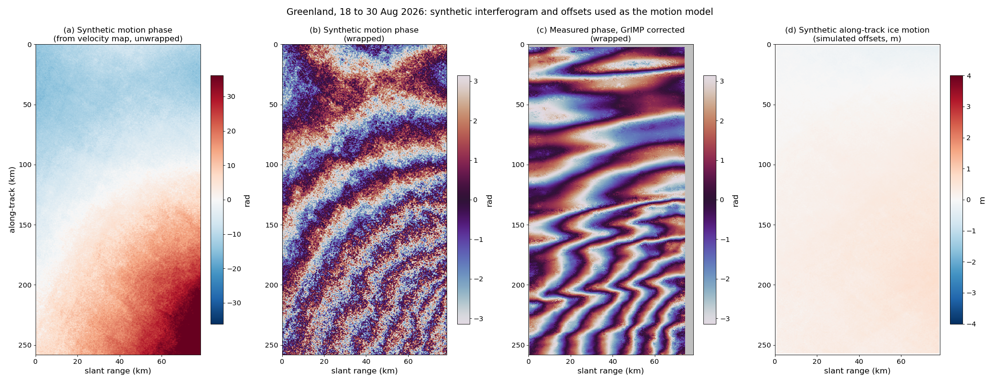

**Figure 1.** The motion model for Greenland 18 → 30 Aug.
- (a) The synthetic interferogram, i.e. the phase predicted by the GrIMP velocity map, unwrapped.
- (b) The same, wrapped to ±π.
- (c) The measured GrIMP-corrected phase, wrapped to ±π, for comparison with (b).
- (d) The synthetic along-track ice motion $`\Delta a_{\text{model}}`$, in metres, from the simulated
  offsets.

(a) is subtracted to form the residuals; (d) is subtracted from the rubbersheet shift to isolate the
ionospheric shift.

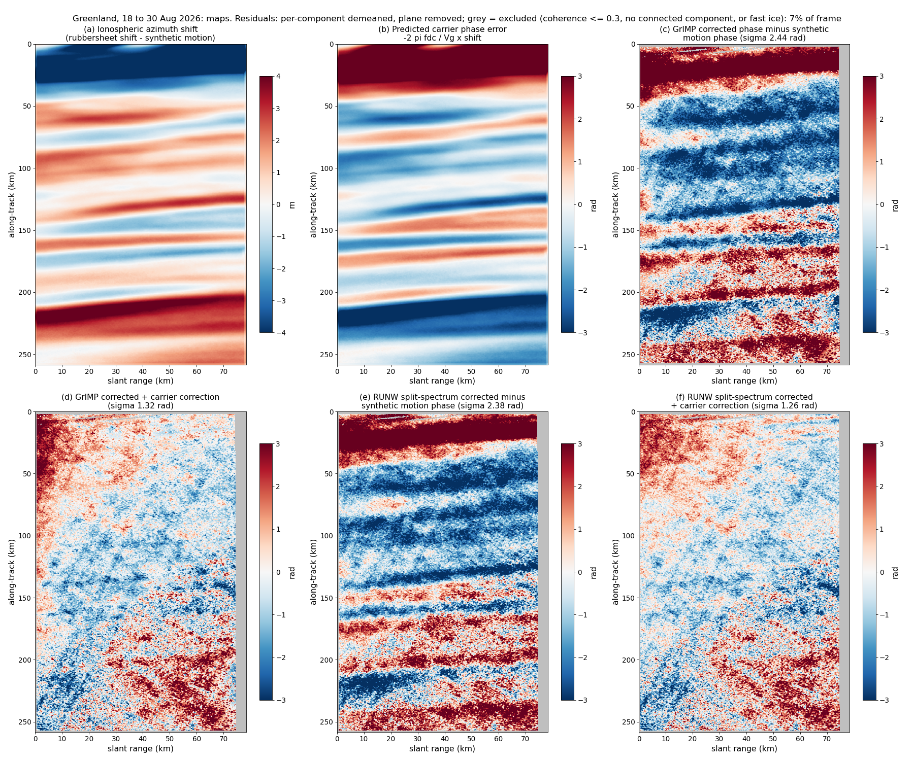

**Figure 2.** Maps for Greenland 18 → 30 Aug. Grey marks excluded pixels: invalid subswath, outside a
connected component, coherence ≤ 0.3, or fast ice.
- (a) The ionospheric along-track shift $`s=\Delta a_c-\Delta a_{\text{model}}`$, in metres: streaks
  running across the swath.
- (b) The predicted carrier error $`-k\,s`$, in radians.
- (c) The GrIMP-corrected phase minus the synthetic interferogram. It contains the pattern in (b).
- (d) GrIMP corrected plus the carrier correction, with the ionospheric shift taken as the
  rubbersheet shift minus synthetic motion. The streaks are largely gone.
- (e) The RUNW split-spectrum-corrected phase minus the synthetic interferogram, nearly identical to (c).
- (f) The RUNW split-spectrum-corrected phase plus the same carrier correction, applied after the
  fact to the delivered product. It matches (d).

Each residual has its connected-component median and a plane removed.

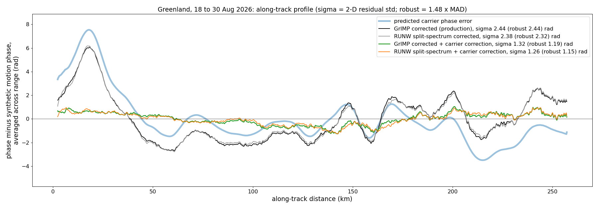

**Figure 3.** Along-track profile for Greenland 18 → 30 Aug: each residual (phase minus synthetic
interferogram) averaged across range, against distance along the track. The legend gives each
residual's 2-D σ and robust σ.
- **Thick blue:** the predicted carrier error.
- **Black and grey:** the GrIMP and RUNW-corrected phases. They follow the prediction closely, with
  swings of up to 6 rad.
- **Green:** GrIMP corrected plus the carrier correction, within about ±1 rad.
- **Orange:** RUNW split-spectrum corrected plus the same carrier correction, which follows the green curve.

Each curve has its own plane and mean removed, so the curves are not exactly additive. Near 200–250
km the prediction dips to −3.5 rad but the production curve does not follow, which suggests a local
velocity-map or rubbersheet mismatch there.

### 3.2 Greenland, 30 Aug → 11 Sep

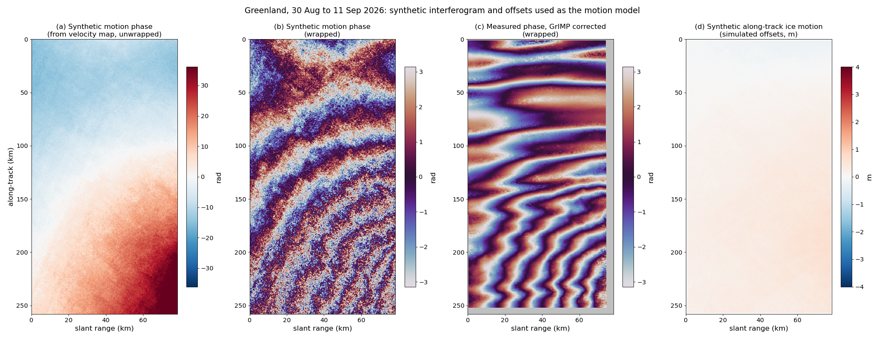

**Figure 4.** The motion model for Greenland 30 Aug → 11 Sep.
- (a) The synthetic interferogram from the GrIMP velocity map, unwrapped.
- (b) The same, wrapped to ±π.
- (c) The measured GrIMP-corrected phase, wrapped to ±π.
- (d) The synthetic along-track ice motion $`\Delta a_{\text{model}}`$, in metres.

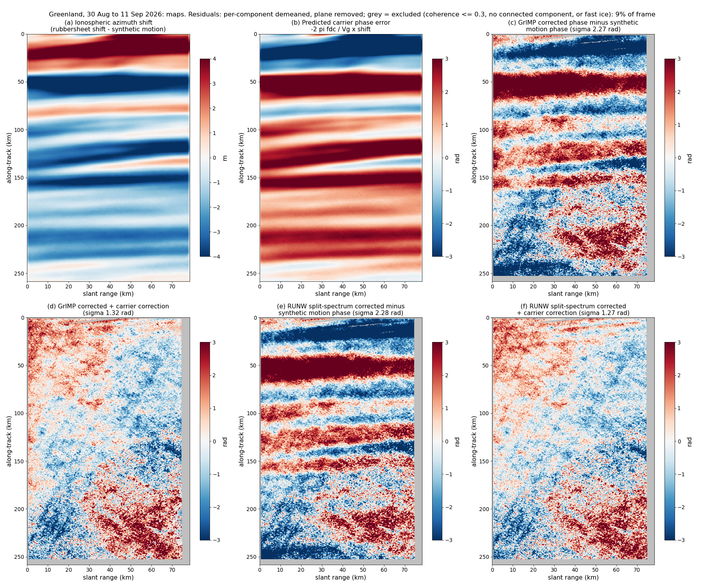

**Figure 5.** Maps for Greenland 30 Aug → 11 Sep. Grey marks excluded pixels: invalid subswath,
outside a connected component, coherence ≤ 0.3, or fast ice.
- (a) The ionospheric along-track shift $`s`$, in metres.
- (b) The predicted carrier error $`-k\,s`$, in radians.
- (c) The GrIMP-corrected phase minus the synthetic interferogram.
- (d) GrIMP corrected plus the carrier correction, with the ionospheric shift taken as the
  rubbersheet shift minus synthetic motion.
- (e) The RUNW split-spectrum-corrected phase minus the synthetic interferogram.
- (f) The RUNW split-spectrum-corrected phase plus the same carrier correction.

Each residual has its connected-component median and a plane removed.

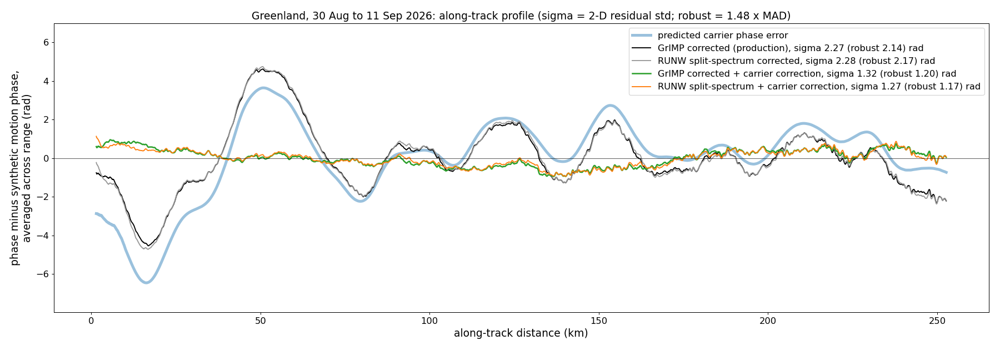

**Figure 6.** Along-track profile for Greenland 30 Aug → 11 Sep: residuals averaged across range,
against distance along the track, with each residual's 2-D σ and robust σ in the legend.
- **Thick blue:** the predicted carrier error.
- **Black and grey:** the GrIMP and RUNW-corrected phases.
- **Green:** GrIMP corrected plus the carrier correction.
- **Orange:** RUNW split-spectrum corrected plus the same carrier correction.

The baseline misfit for this pair falls from 3.02 to 0.98 rad.

### 3.3 Antarctica, 19 → 31 Aug

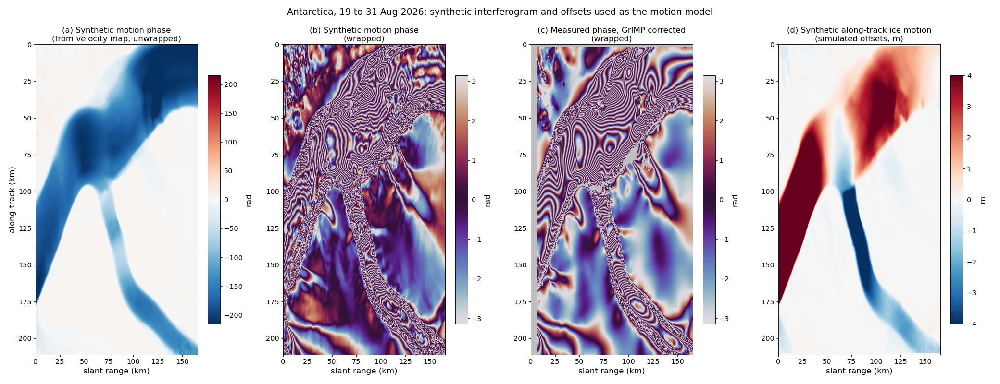

**Figure 7.** The motion model for Antarctica 19 → 31 Aug.
- (a) The synthetic interferogram from the GrIMP velocity map, unwrapped.
- (b) The same, wrapped to ±π.
- (c) The measured GrIMP-corrected phase, wrapped to ±π.
- (d) The synthetic along-track ice motion, in metres.

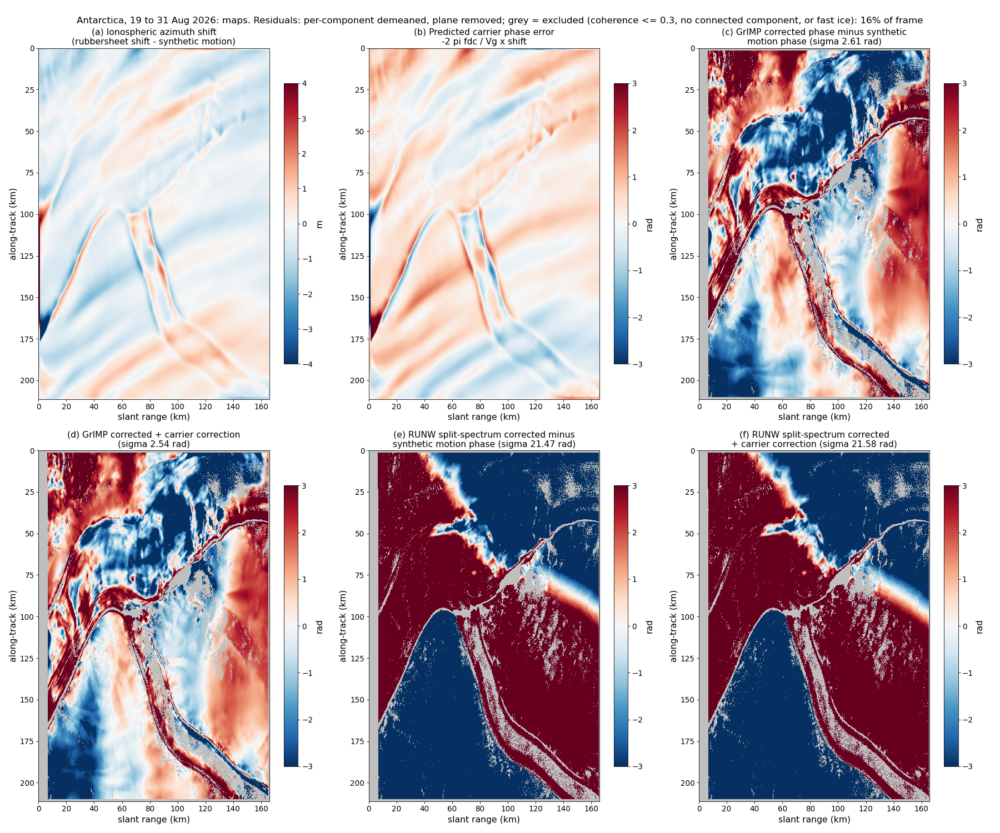

**Figure 8.** Maps for Antarctica 19 → 31 Aug. Grey marks excluded pixels: invalid subswath, outside
a connected component, or coherence ≤ 0.3.
- (a) The ionospheric along-track shift $`s`$: small (about ±1 m) and oblique.
- (b) The predicted carrier error.
- (c) The GrIMP-corrected phase minus the synthetic interferogram.
- (d) GrIMP corrected plus the carrier correction, with the ionospheric shift taken as the
  rubbersheet shift minus synthetic motion.
- (e) The RUNW split-spectrum-corrected phase minus the synthetic interferogram.
- (f) The RUNW split-spectrum-corrected phase plus the same carrier correction. The correction
  cannot remove the unwrapping error in the RUNW screen (Figure 12).

The GrIMP residual is dominated by structure aligned with the glacier and grounding zone, more likely
velocity-map or tidal-flexure error than ionosphere. The RUNW residual is dominated by the
screen-unwrapping error shown in Figure 12.

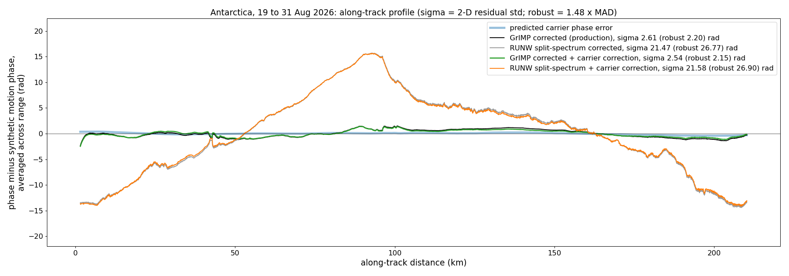

**Figure 9.** Along-track profile for Antarctica 19 → 31 Aug: residuals averaged across range, with
each residual's σ and robust σ in the legend.
- **Thick blue:** the predicted carrier error. It is small after averaging, because the oblique
  ionospheric bands cancel across range.
- **Black:** GrIMP corrected.
- **Grey:** RUNW split-spectrum corrected, which drifts by about ±15 rad.
- **Green:** GrIMP corrected plus the carrier correction.
- **Orange:** RUNW split-spectrum corrected plus the carrier correction.

### 3.4 Antarctica, 31 Aug → 12 Sep

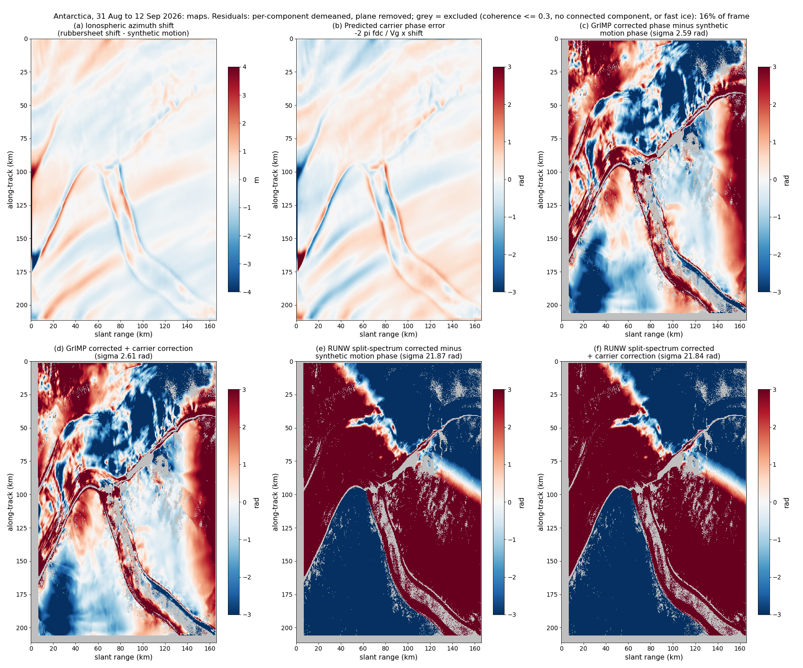

**Figure 10.** Maps for Antarctica 31 Aug → 12 Sep. Grey marks excluded pixels: invalid subswath,
outside a connected component, or coherence ≤ 0.3.
- (a) The ionospheric along-track shift $`s`$, in metres.
- (b) The predicted carrier error, in radians.
- (c) The GrIMP-corrected phase minus the synthetic interferogram.
- (d) GrIMP corrected plus the carrier correction, with the ionospheric shift taken as the
  rubbersheet shift minus synthetic motion.
- (e) The RUNW split-spectrum-corrected phase minus the synthetic interferogram.
- (f) The RUNW split-spectrum-corrected phase plus the same carrier correction.

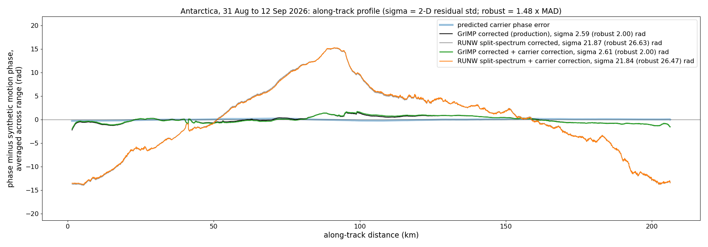

**Figure 11.** Along-track profile for Antarctica 31 Aug → 12 Sep: residuals averaged across range,
with each residual's σ and robust σ in the legend.
- **Thick blue:** the predicted carrier error.
- **Black:** GrIMP corrected.
- **Grey:** RUNW split-spectrum corrected.
- **Green:** GrIMP corrected plus the carrier correction.
- **Orange:** RUNW split-spectrum corrected plus the carrier correction.

---

## 4. Connected components and the ionosphere screens

Unwrapping assigns each connected region of an interferogram (a *connected component*) its own
reference, so components can be offset from one another by whole cycles (2π). GrIMP compares each
component with the synthetic interferogram and adds the integer number of cycles that best reconciles
them.

The cycles GrIMP added are
$`\mathrm{round}[(\text{GrIMP corrected}-(\text{unwrapped}-\text{GrIMP screen}))/2\pi]`$.

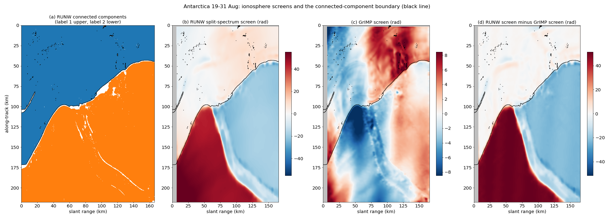

**Figure 12.** Antarctica 19 → 31 Aug: the two ionosphere screens and the connected components. The
black line is the boundary between components.
- (a) The RUNW connected components: label 1 is the upper region (4.7 million pixels), label 2 the
  lower (6.9 million pixels).
- (b) The RUNW split-spectrum screen. Part of component 2, between the boundary and a line along the
  glacier's shear margin, is offset by about +40 rad. This looks like an unwrapping error in the
  ionosphere estimate.
- (c) The GrIMP screen, which has no such step.
- (d) Their difference, isolating the RUNW offset.

At the boundary the RUNW screen steps by 9.2 rad (1.46 cycles) and the GrIMP screen by 2.5 rad.

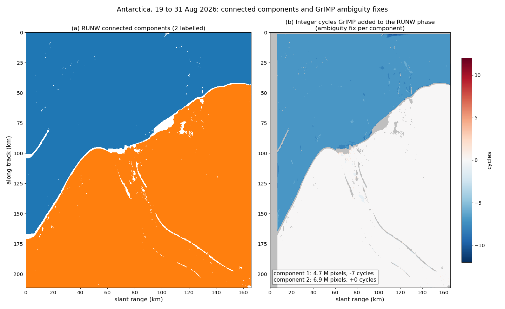

**Figure 13.** Antarctica 19 → 31 Aug: connected-component fixes.
- (a) The RUNW connected components, as in Figure 12: label 1 upper, label 2 lower.
- (b) The integer cycles GrIMP added to the RUNW phase. Component 2 is unchanged; component 1, the
  upper region, is shifted by **−7 cycles**, with 98% of its pixels agreeing on that shift.

The unwrapped RUNW phase steps by +7.5 cycles across the boundary relative to the synthetic
interferogram, and GrIMP's −7 removes most of that.

**Figure 14.** Antarctica 31 Aug → 12 Sep: connected-component fixes.
- (a) The RUNW connected components. Label 1 is the upper region (4.6 million pixels) and label 2 the
  lower (6.7 million pixels), the same split as in the previous pair.
- (b) The integer cycles GrIMP added: component 1 is again shifted by **−7 cycles** (98% agreement),
  and component 2 is unchanged.

The same correction in consecutive pairs points to a persistent unwrapping split along the same
boundary.

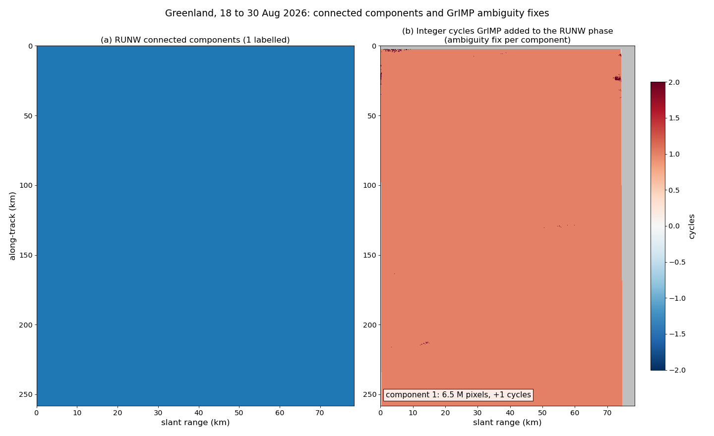

**Figure 15.** Greenland 18 → 30 Aug: connected-component fixes.
- (a) The RUNW has a single connected component.
- (b) GrIMP adds a uniform +1 cycle, which only sets the reference, and +2 on a few isolated islands.

The 30 Aug → 11 Sep pair is likewise a single component, shifted uniformly by −2 cycles.

**Implication:** the Antarctic RUNW phase cannot be used across its two components without GrIMP's
fix, and the RUNW screen there carries an apparent unwrapping error. Both matter far more in
Antarctica than the carrier correction does, and both are independent of it.

---

## 5. Open items

- The 200–250 km mismatch in Greenland 18 → 30 Aug: a velocity-map error or a local rubbersheet
  artefact.
- Confirming the suspected unwrapping error in the Antarctic RUNW screen, for example from the
  sub-band interferograms.
- A velocity-level check of the correction, e.g. a crossing-orbit comparison or GNSS.

**Reproduction:** in `carrierSandbox/`:
- `frameCarrierAnalysis.py` (results and baseline fits);
- `frameFigures.py` (Figures 1–11 and 13–15);
- `diagScreens.py` (Figure 12).

The analysis applies the RUNW subswath mask and culls rubbersheet offsets more than 15 m from the
synthetic motion.
