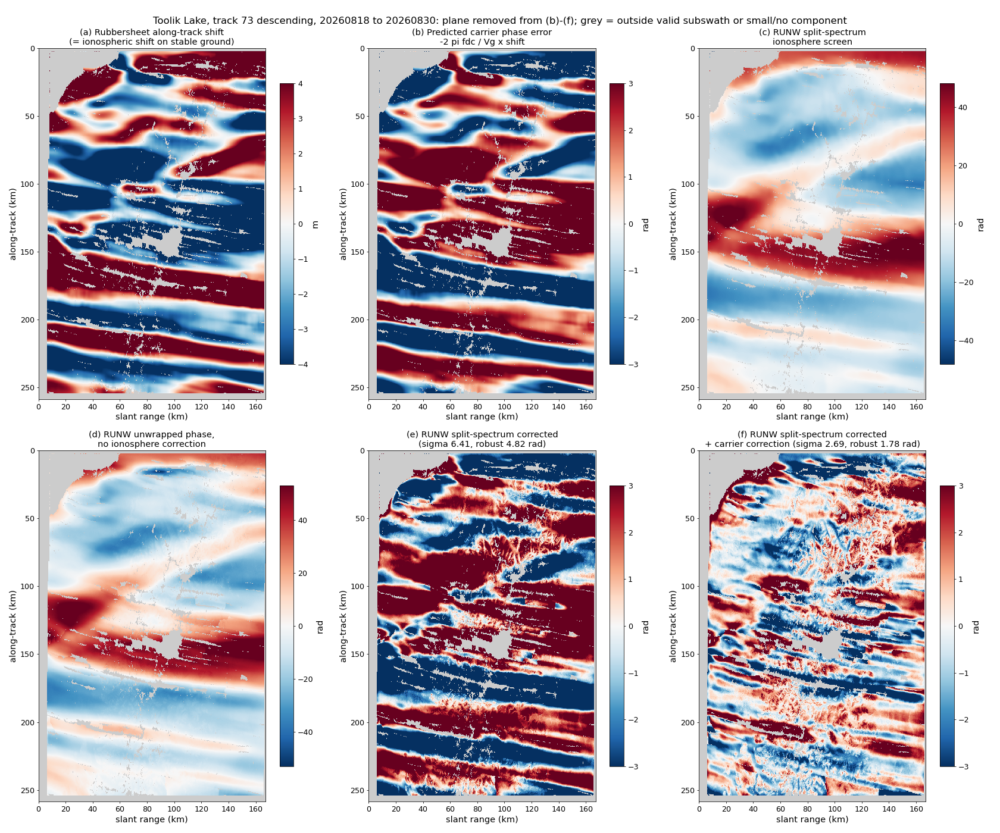
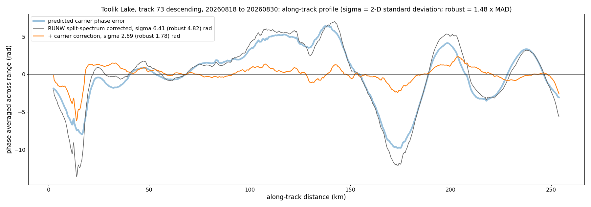
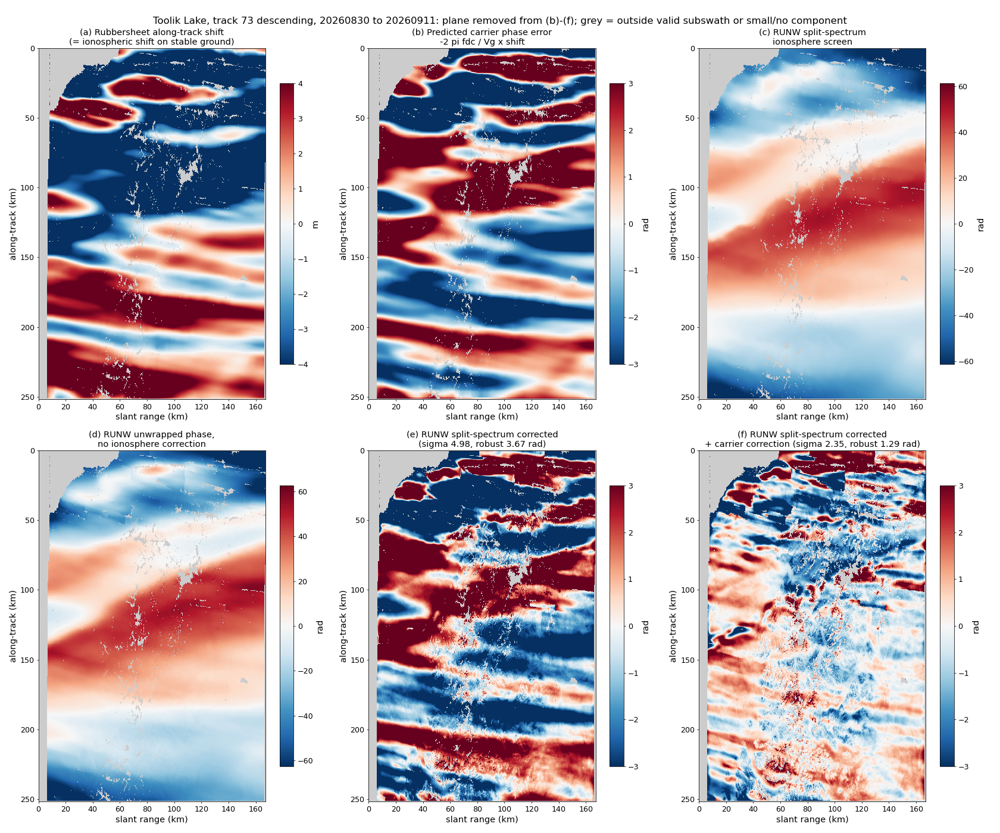
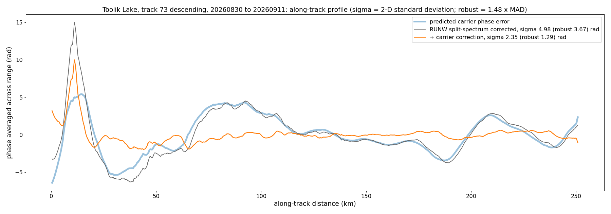
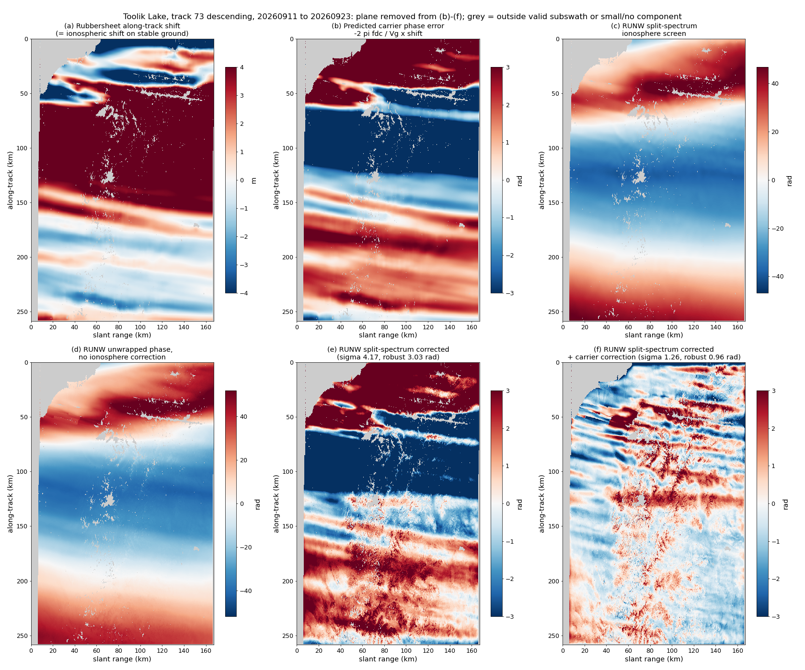
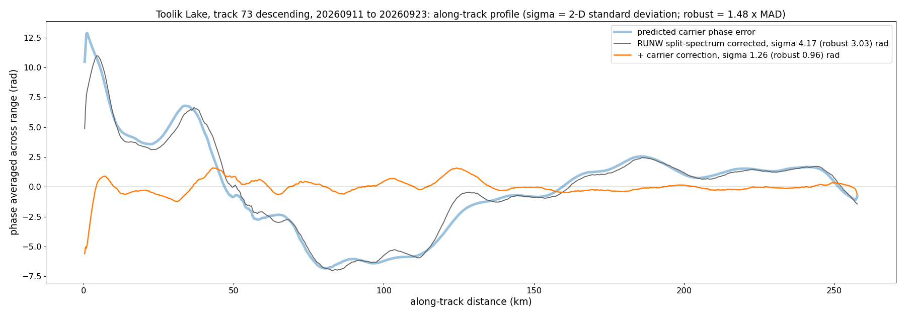
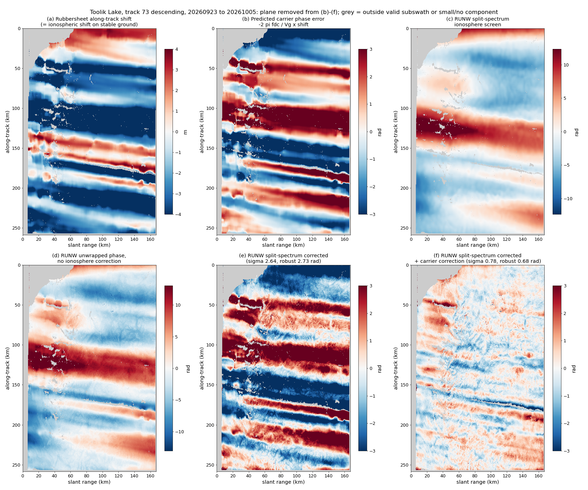
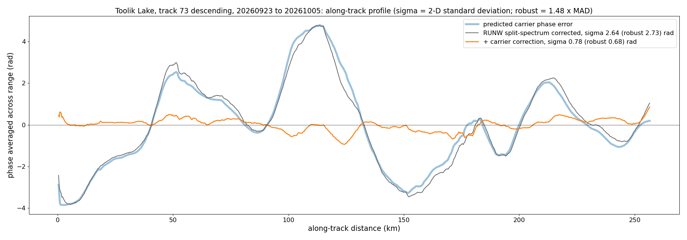
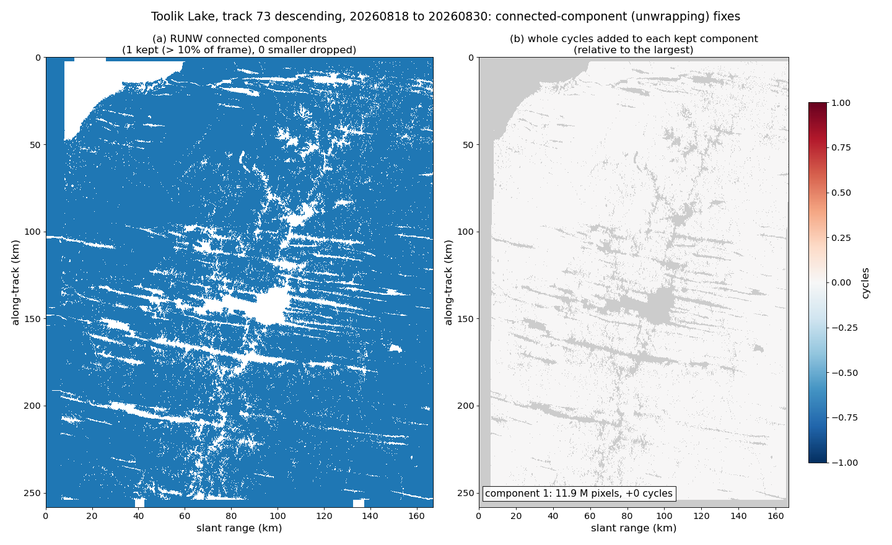

# Rubbersheet Carrier Correction over Permafrost: Toolik Lake, Alaska

*Four consecutive 12-day NISAR L-band pairs, track 73 descending, frame 53, 18 August – 5 October 2026.
The correction is applied to the delivered RUNW product with a zero motion model. DRAFT for review.*

---

## The problem in brief (non-specialist summary)

NISAR interferograms are corrected for the ionosphere, the charged upper atmosphere that delays radar
signals. Besides adding a phase error, the ionosphere makes the ground appear to shift slightly along
the satellite track, here by several metres.

When the NISAR processor (ISCE3) aligns the two images it follows that shift with a smooth correction
field (a "rubbersheet"). NISAR's antenna points slightly forward (about 1.6°, the *squint*), so every
along-track shift applied during alignment also changes the interferometric phase. The ionosphere
correction delivered with the product does not account for this, so the corrected phase keeps a streaky
error of about **0.9 radians per metre of ionospheric shift**.

On ground that does not move horizontally, such as the permafrost around Toolik Lake, the whole
rubbersheet shift is ionospheric. The error can then be removed using only information in the RUNW
product, with no motion model at all.

**Result in one line:** in these four pairs the error accounts for **78–91% of the residual phase
variance**. Removing it lowers the robust residual from 2.7–4.8 rad to 0.7–1.8 rad.

---

## 1. Definitions

| Symbol | Meaning | Value here |
|---|---|---|
| $`f_{dc}`$ | Doppler centroid, set by the antenna's forward squint | 954–956 Hz |
| $`V_g`$ | speed of the radar footprint along the ground | ≈ 6800 m/s |
| $`k=2\pi f_{dc}/V_g`$ | phase change per metre of along-track misalignment | 0.88 rad/m |
| $`\Delta a_c`$ | along-track shift applied by the rubbersheet: RUNW `pixelOffsets/alongTrackOffset`, ground metres | spread 2.9–6.0 m |
| $`\Delta a_{\text{motion}}`$ | true along-track ground motion over 12 days | taken as 0 |

The ionosphere-corrected phase (`unwrappedPhase − ionospherePhaseScreen`) carries an error

$$
\delta\phi_{\text{carrier}} \simeq -k\,(\Delta a_c-\Delta a_{\text{motion}}) , \tag{1}
$$

which the delivered screen does not contain. It is removed after the fact by

$$
\phi_{\text{corrected}} = \big(\phi_{\text{unw}}-\text{screen}\big) + k\,(\Delta a_c-\Delta a_{\text{motion}}),
\qquad \Delta a_{\text{motion}}=0 \text{ here}. \tag{2}
$$

Equivalently, the screen itself can be replaced by $`\text{screen}-k\,\Delta a_c`$. The rubbersheet
shift is used because it is the shift actually applied when the images were resampled, so it is a direct
measure of what introduced the error. The derivation and tests over Greenland and Antarctica are in
[squintCoregistrationIonosphere.md](squintCoregistrationIonosphere.md) and
[carrierCorrectionFrames.md](carrierCorrectionFrames.md).

## 2. Data and processing

- **Choice of track.** Toolik Lake (68.63°N, 149.60°W) is covered by ascending tracks 63 and 106 and by
  descending tracks 73 and 102. For the pair 30 Aug → 11 Sep on each track:

  | Track | Pass | Spread of short-wavelength along-track shift | Total spread | Screen spread |
  |---|---|---|---|---|
  | 63 | ascending | 0.67 m | 1.10 m | 7 rad |
  | 106 | ascending | 0.50 m | 2.16 m | 17 rad |
  | 102 | descending | 0.83 m | 2.89 m | 9 rad |
  | 73 | descending | 1.50 m | 5.93 m | 41 rad |

  The descending (evening) passes show the stronger ionosphere. Track 73 is the worst and is used
  throughout.
- **Products.** Four RUNWs, `NISAR_L1_PR_RUNW_0{28,29,30,31}_073_D_053_…_4000_SH_…_P05023`, from ISCE3
  0.25.16, with the main- and 5 MHz side-band ionosphere estimate. They were downloaded to
  `carrierSandbox/toolik/RUNW/`.
- **Masking.** Pixels outside a valid subswath in either image (the RUNW `mask` layer) are excluded.
- **Unwrapping (connected components).** Components covering more than 10% of the valid frame are kept
  and shifted by whole cycles to match the largest; smaller components are dropped. In all four pairs
  the RUNW contained a single large component, so no cycle shifts were needed (Figure 9). 80–87% of
  each frame is kept; the rest is invalid subswath or unlabelled pixels.
- **Rubbersheet shift.** Gross outliers are removed (more than 5 m from the local median, or more than
  15 m in size), and gaps are filled from the nearest valid value before interpolating to the
  interferogram grid.
- **Statistics.** All statistics use 4×4 block averages, with a plane removed.
  - **σ** is the standard deviation; **robust σ** is 1.48 × the median absolute deviation.
  - **Variance explained** is $`1-(\sigma_{\text{after}}/\sigma_{\text{before}})^2`$.
  - The **streak slope** regresses the phase on $`\Delta a_c`$ at 22–67 km wavelengths. The prediction
    is −k ≈ −0.88 rad/m before correction and 0 after.

Over Toolik the ground is treated as stable horizontally. Seasonal thaw subsidence or heave over 12
days (a few millimetres to centimetres, vertical) remains in the phase, but it does not affect the
along-track shift and so does not enter Eq. (2).

## 3. Results

| Pair | σ before → after (rad) | Robust σ before → after (rad) | Variance explained (robust) | Streak slope before → after (rad/m) | Spread of $`\Delta a_c`$ |
|---|---|---|---|---|---|
| 18 → 30 Aug | 6.41 → 2.69 | 4.82 → 1.78 | 82% (86%) | −1.02 → −0.14 | 6.0 m |
| 30 Aug → 11 Sep | 4.98 → 2.35 | 3.67 → 1.29 | 78% (88%) | −1.03 → −0.15 | 5.5 m |
| 11 → 23 Sep | 4.17 → 1.26 | 3.03 → 0.96 | 91% (90%) | −0.89 → −0.00 | 5.0 m |
| 23 Sep → 5 Oct | 2.64 → 0.78 | 2.73 → 0.68 | 91% (94%) | −0.89 → −0.01 | 2.9 m |

**Implication:** over stable ground, the carrier error is by far the largest error remaining in the
delivered RUNW phase after the ionosphere correction. Removing it with nothing but the product's own
rubbersheet offsets reduces the residual variance by 78–94%, and the measured slope matches the
predicted −k.

### 3.1 18 → 30 August 2026

**Figure 1.** Maps for 18 → 30 August 2026. A plane has been removed from (b)–(f). Grey is outside a
valid subswath or not in a kept connected component.
- (a) Rubbersheet along-track shift $`\Delta a_c`$ (m). On stable ground this is the ionospheric shift.
- (b) Predicted carrier error $`-k\,\Delta a_c`$ (rad).
- (c) The RUNW split-spectrum ionosphere screen (rad).
- (d) The RUNW unwrapped phase with no ionosphere correction (rad).
- (e) The split-spectrum-corrected phase, unwrapped minus screen. It contains the streak pattern of (b).
- (f) The corrected phase after adding the carrier correction $`k\,\Delta a_c`$. The streaks are largely
  removed.

**Figure 2.** Along-track profile for 18 → 30 August 2026: phase averaged across range, against
distance along the track. Each panel's σ and robust σ are in the legend.
- **Thick blue:** the predicted carrier error.
- **Grey:** the RUNW split-spectrum-corrected phase. It follows the prediction closely over swings of
  ±10 rad.
- **Orange:** after the carrier correction, mostly within ±1–2 rad.

### 3.2 30 August → 11 September 2026

**Figure 3.** Maps for 30 August → 11 September 2026. A plane has been removed from (b)–(f). Grey is
outside a valid subswath or not in a kept connected component.
- (a) Rubbersheet along-track shift $`\Delta a_c`$ (m).
- (b) Predicted carrier error $`-k\,\Delta a_c`$ (rad).
- (c) The RUNW split-spectrum ionosphere screen (rad).
- (d) The RUNW unwrapped phase with no ionosphere correction (rad).
- (e) The split-spectrum-corrected phase.
- (f) The corrected phase after adding the carrier correction.

**Figure 4.** Along-track profile for 30 August → 11 September 2026: phase averaged across range,
against distance along the track, with σ and robust σ in the legend.
- **Thick blue:** the predicted carrier error.
- **Grey:** the RUNW split-spectrum-corrected phase.
- **Orange:** after the carrier correction.

### 3.3 11 → 23 September 2026

**Figure 5.** Maps for 11 → 23 September 2026. A plane has been removed from (b)–(f). Grey is outside
a valid subswath or not in a kept connected component.
- (a) Rubbersheet along-track shift $`\Delta a_c`$ (m).
- (b) Predicted carrier error $`-k\,\Delta a_c`$ (rad).
- (c) The RUNW split-spectrum ionosphere screen (rad).
- (d) The RUNW unwrapped phase with no ionosphere correction (rad).
- (e) The split-spectrum-corrected phase.
- (f) The corrected phase after adding the carrier correction.

**Figure 6.** Along-track profile for 11 → 23 September 2026: phase averaged across range, against
distance along the track, with σ and robust σ in the legend.
- **Thick blue:** the predicted carrier error.
- **Grey:** the RUNW split-spectrum-corrected phase.
- **Orange:** after the carrier correction.

### 3.4 23 September → 5 October 2026

**Figure 7.** Maps for 23 September → 5 October 2026. A plane has been removed from (b)–(f). Grey is
outside a valid subswath or not in a kept connected component.
- (a) Rubbersheet along-track shift $`\Delta a_c`$ (m).
- (b) Predicted carrier error $`-k\,\Delta a_c`$ (rad).
- (c) The RUNW split-spectrum ionosphere screen (rad).
- (d) The RUNW unwrapped phase with no ionosphere correction (rad).
- (e) The split-spectrum-corrected phase.
- (f) The corrected phase after adding the carrier correction.

**Figure 8.** Along-track profile for 23 September → 5 October 2026: phase averaged across range,
against distance along the track, with σ and robust σ in the legend.
- **Thick blue:** the predicted carrier error.
- **Grey:** the RUNW split-spectrum-corrected phase.
- **Orange:** after the carrier correction.

### 3.5 Connected components

**Figure 9.** Connected components for 18 → 30 August 2026.
- (a) RUNW connected components. Those covering more than 10% of the valid frame are kept.
- (b) Whole cycles added to each kept component, relative to the largest.

Here, as in the other three pairs, the RUNW has a single large component, so no unwrapping fix was
needed. The same check for the other pairs is in `carrierSandbox/toolik/figures/*_components.png`.

---

## 4. Caveats

- **Zero-motion assumption.** This holds for horizontal motion over Toolik's tundra. Areas with real
  along-track motion (solifluction lobes, landslides, rock glaciers) would need their motion removed
  from $`\Delta a_c`$ first.
- **Remaining residual.** The 0.7–1.8 rad left after correction includes troposphere, split-spectrum
  noise, real vertical permafrost motion, and any part of the rubbersheet field that differs from what
  was applied.
- **Offset layer.** The correction relies on `pixelOffsets/alongTrackOffset` being the shift actually
  applied when the images were resampled. The ISCE3 source says it is; it has not been verified
  byte-for-byte against a product.
- **Plane removal.** Statistics are computed after removing a plane, so long-wavelength errors common
  to both phases are not assessed.

## Reproduction

`newGreenlandProject/carrierSandbox/toolik/toolikAnalysis.py` (about 1 minute for all four pairs). Its
outputs are `results.json` and `figures/`. The URL lists from the ASF search are `search.RUNW`,
`test.urls` and `t73.urls`.
