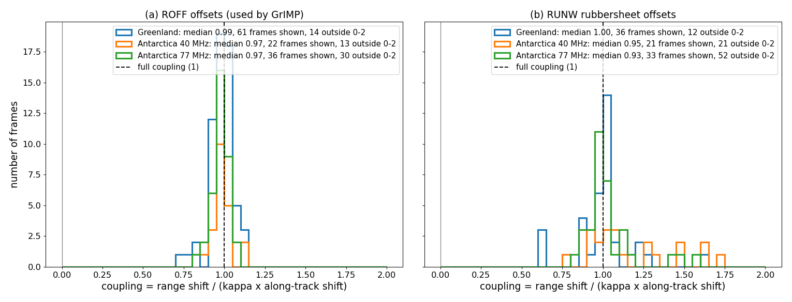
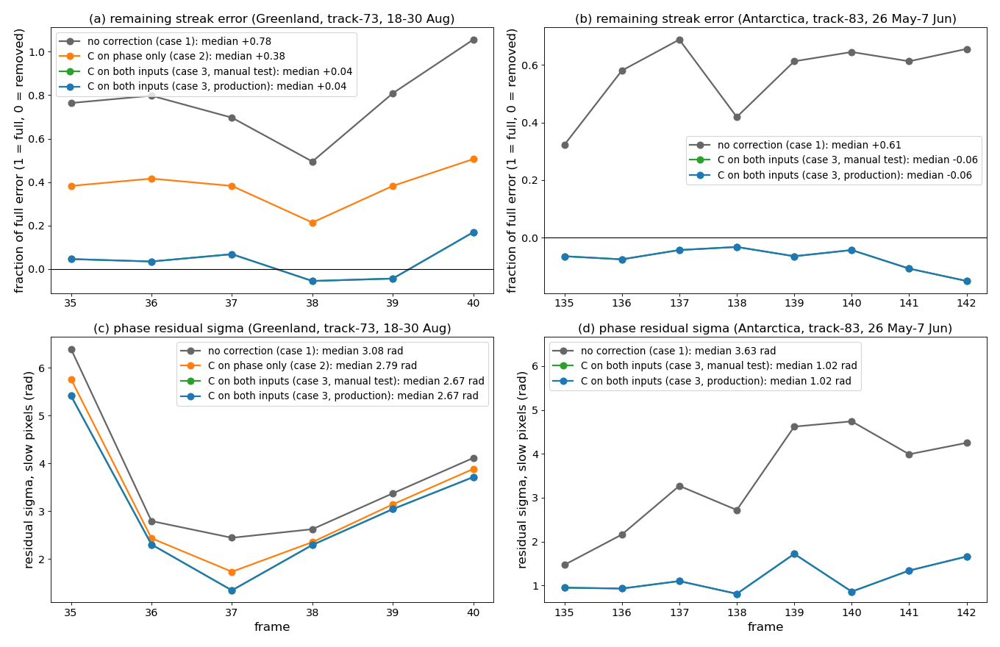

# The Carrier Correction in GrIMP: Range Offsets Carry the Error Too

*How the rubbersheet carrier correction has to be applied inside GrIMP's ionosphere estimate, and why. Survey of 600
NISAR frames plus full-pipeline tests on a Greenland and an Antarctic pair. October 2026.*

**GrIMP** is the Greenland Ice Mapping Project processing workflow: the software that turns NISAR RUNW/ROFF products
into ice-velocity maps. Its ionosphere estimate ("screen") combines the unwrapped phase with the range offsets.

Companion documents: the error and its after-the-fact correction,
[carrierCorrectionFrames.md](carrierCorrectionFrames.md) and [carrierCorrectionToolik.md](carrierCorrectionToolik.md);
the theory, [squintCoregistrationIonosphere.md](squintCoregistrationIonosphere.md).

---

## In brief (non-specialist summary)

NISAR's phase carries a streaky error wherever the ionosphere shifts the image along-track: the processor's
"rubbersheet" follows that shift, and the antenna's slight forward squint turns the shift into phase. The fix, called
the carrier correction here, is known and cheap.

Putting it into GrIMP turned out to need care. GrIMP estimates the ionosphere from the phase **and** the range offsets.
The range offsets carry a matching error of the opposite sign: the same ionospheric shift also moves the image slightly
in range, again because of the squint. Inside GrIMP's estimate the two errors cancel, so the estimate is clean but the
corrected phase keeps the whole error, and the range offsets keep theirs.

The correction must therefore be applied to both inputs. Done that way, it removes the streak error from the phase
completely, leaves GrIMP's ionosphere estimate (and the azimuth correction derived from it) unchanged, and also corrects
the range offsets. On a strong-ionosphere Antarctic pair the phase-baseline residual fell by more than half and the
range-baseline residual by a quarter.

---

## 1. Definitions

| Symbol | Meaning |
|---|---|
| $`s`$ | ionosphere-induced along-track image shift (m), measured as the RUNW rubbersheet shift minus the window-averaged velocity-model motion, $`\Delta a_c-S[\Delta a_{\text{model}}]`$ |
| $`k_{dc}=2\pi f_{dc}/V_{\text{groundtrack}}`$ | carrier wavenumber, ≈ 0.88–0.93 rad/m |
| $`C=k_{dc}\,s`$ | the carrier correction (rad); the RUNW phase carries $`-C`$ |
| $`\kappa=\lambda f_{dc}/(2V_{\text{groundtrack}})`$ | squint coupling factor, ≈ 0.017 |
| screen | GrIMP's ionosphere estimate, $`(\phi+\phi_{\text{off}})/2`$ before filtering, where $`\phi_{\text{off}}=-\tfrac{4\pi}{\lambda}\,\Delta r_{\text{off}}`$ is the range offset in phase units |

## 2. Why the range offsets carry the error

The ionospheric along-track shift is not ground motion. It comes from a Doppler offset during focusing, which slides
the focused target along its own range-migration curve. With squint that curve has slope $`dR/dt=\lambda f_{dc}/2`$, so
the target also moves in range by

$$
\Delta r = \kappa\, s .
$$

Any measurement of where the target sits sees this, so the range offsets carry it whether or not they were
rubbersheeted. In phase units

$$
\tfrac{4\pi}{\lambda}\,\kappa\, s = \tfrac{2\pi f_{dc}}{V_{\text{groundtrack}}}\, s = k_{dc}\, s = C ,
$$

exactly the carrier correction. The phase carries $`-C`$ (from the rubbersheet) and the offsets carry $`+C`$ (from the
squinted range migration). Real ice motion moves the ground and has neither term.

**Implication:** in GrIMP's screen $`(\phi+\phi_{\text{off}})/2`$ the two cancel. The screen is clean of the carrier
error, the corrected phase $`\phi-\text{screen}`$ keeps all of it, and the range offsets carry a $`\kappa s`$ error of
their own (4–10 cm for 2–6 m shifts).

| Where the correction goes | Phase after correction | Screen; range and azimuth ionosphere corrections |
|---|---|---|
| nowhere (production until 2026-10) | full error | clean |
| phase only, before the screen | **half** the error | pick up $`+C/2`$ |
| phase $`+C`$ **and** offset phase $`-C`$, before the screen | error removed | unchanged (clean) |

Adding $`C`$ to the phase and $`-C`$ to the offset phase cancels in the screen, so for the phase this is identical to
adding $`C`$ after the screen, which is what the after-the-fact correction in
[carrierCorrectionFrames.md](carrierCorrectionFrames.md) did. The coupling only matters for correcting the range
offsets themselves.

### Physical picture: why a Doppler shift couples into range and real motion does not

1. **The ionospheric shift is a Doppler error, not a displacement.** An along-track gradient in the ionospheric
   delay adds a phase that is linear in slow time, i.e. a Doppler offset $`\Delta f`$. Azimuth compression turns it
   into a time shift $`\Delta t = \Delta f / k_a`$ ($`k_a`$ the azimuth FM rate), so the focused target appears
   displaced along track by $`s = V_{\text{groundtrack}}\,\Delta t`$
   ([squintCoregistrationIonosphere.md](squintCoregistrationIonosphere.md) §5.1).
2. **The shifted response slides along the target's own range-migration curve.** The focused position is read off
   the range history $`R(t)`$, so a response shifted by $`\Delta t`$ sits at a range changed by the slope of that
   curve at the beam centre, $`dR/dt = \lambda f_{dc}/2`$:
   $$
   \Delta r = \tfrac{\lambda f_{dc}}{2}\,\Delta t = \kappa\, s .
   $$
   The range-Doppler view gives the same result: range-migration correction uses the Doppler-dependent range
   $`R(f) \approx R_0\,(1 + \lambda^2 f^2 / 8V_{\text{eff}}^2)`$, and its slope at $`f_{dc}`$ times $`\Delta f`$ is again
   $`\lambda f_{dc}\Delta t/2`$. At zero squint the beam centre is the vertex of the curve and the coupling vanishes to
   first order; NISAR's ~1.5° residual squint ($`f_{dc} \approx 980`$ Hz) puts it on the sloped flank.
3. **Real ice motion moves the target and its whole migration curve.** Its zero-Doppler range is still the true
   closest approach, so the offsets carry no $`\kappa`$ term. In the phase, the squinted line of sight sees part of
   the along-track motion $`\Delta a_m`$, adding $`k_{dc}\,\Delta a_m`$; the rubbersheet registers the secondary by the
   same shift, and resampling the carrier adds $`-k_{dc}\,\Delta a_m`$. The two cancel and the phase is zero-Doppler
   (in the theory document's notation $`\Delta\phi = \Delta\phi_{\text{zero-Doppler}} - 2\pi f_{dc}(c-d)`$ with
   coregistration $`c`$ equal to the displacement $`d`$, §3). For an ionospheric shift nothing moved, so there is no
   line-of-sight term, and the resampling leaves $`-k_{dc}\,s = -C`$.
4. **Hence $`C = k_{dc}\,(\Delta a_c - S[\Delta a_{\text{model}}])`$, not $`k_{dc}\,\Delta a_c`$.** The rubbersheet shift
   $`\Delta a_c`$ contains both parts. The motion part has already cancelled correctly, so only the remainder is added
   back; adding $`k_{dc}\,\Delta a_c`$ whole would undo the zero-Doppler restoration and put the squinted geometry
   back into the phase. $`S[\cdot]`$ is the dense-offset window average, because that is the motion field the
   rubbersheet actually applied.

**Implication:** the carrier error and the range coupling are both signatures of a Doppler shift without a
matching displacement, which is why they isolate the ionosphere from ice motion. The motion cancellation holds only
at the rubbersheet's resolution (see §6).

## 3. The coupling, measured on 600 frames

**Figure 1.** Coupling = (slant-range shift) / (κ × along-track shift), measured as the slope of the slant-range
offset on the along-track offset at streak scales (high-pass), on slow-moving pixels only. 1 means the offsets carry
the full $`\kappa s`$. 200 random frames per project; shown are frames with a measurable shift (high-pass sd ≥ 0.3 m)
and a clear relation (|r| ≥ 0.3), all processor versions together; the legend gives how many fall outside 0–2 (not
plotted). Those are mostly frames where ice motion leaks past the slow-pixel mask.
- (a) The ROFF offsets GrIMP uses (layer 3).
- (b) The RUNW rubbersheet offsets.

| Project | ISCE3 | ROFF coupling: median (95% CI) | frames |
|---|---|---|---|
| Greenland | 0.25.8 | 1.01 (0.97–1.03) | 36 |
| Greenland | 0.25.16 | 0.99 (0.97–1.02) | 28 |
| Antarctica 40 MHz | 0.25.16 | 0.99 (0.95–1.02) | 21 |
| Antarctica 77 MHz | 0.25.8 | 0.97 (0.95–0.99) | 65 |

**Implication:** the offsets GrIMP uses carry the full coupling, in both regions and both processor versions. A
minority of frames give large negative values, most likely ice motion leaking past the slow-pixel mask.

## 4. Full-pipeline tests

Two sandbox copies of production pairs were run through the whole GrIMP chain (ionosphere estimate, merge, baseline
fits): Greenland track-73, merged frame 5535_0000 (18–30 Aug 2026, ice-only screen with global fill), and Antarctica
track-83, 4334_0000 (26 May–7 Jun 2026, ISCE3 0.25.8, strong ionosphere, shifts sd 2–6 m).

**Figure 2.** Per frame, on slow pixels: the phase residual (corrected phase minus the velocity-model phase, with each
connected component's median and a plane removed).
- (a, b) Remaining streak error: slope of the residual on $`s`$, as a fraction of the full error (1 = full, 0 =
  removed).
- (c, d) Residual standard deviation.

The manual test and the production code give identical per-frame results (the lines overlap). The phase-only variant
was not saved per frame for the Antarctic pair.

Merged-frame baseline fits (σ of the fit residuals):

| Greenland 5535_0000 | Phase baseline | Range, with ionosphere correction | Azimuth, with azimuth ionosphere correction |
|---|---|---|---|
| no correction | 8.49 rad | 0.1157 m | 2.621 m |
| phase only, before the screen | 8.11 | 0.1116 | 2.686 |
| both inputs (manual test) | 7.83 | 0.1169 | 2.620 |
| **both inputs, production code** | **7.83** | **0.1142** | **2.620** |

| Antarctica 4334_0000 | Phase baseline | Range, with ionosphere correction | Azimuth, with azimuth ionosphere correction |
|---|---|---|---|
| no correction | 4.55 rad | 0.1621 m | 2.369 m |
| phase only, before the screen | 2.77 | 0.1247 | 2.574 |
| both inputs (manual test) | 1.98 | 0.1621 | 2.368 |
| **both inputs, production code** | **1.98 (−57%)** | **0.1132 (−30%)** | **2.360** |

Per frame (Figure 2): the remaining streak error falls from 0.78 to 0.04 (Greenland) and from 0.61 to −0.06
(Antarctica); the median residual σ from 3.08 to 2.67 rad and from 3.63 to 1.02 rad. "Phase only, before the screen"
is the first production version, switched on and then paused on 2026-10-17: it removes about half the error and puts
the other half into the screen. The manual test adds the range-coupling term only on the merged grid, which is why the
production code's range result is better.

**Implication:** correcting both inputs removes the streak error completely in both regions, and the production code
reproduces the manual test. The merged-frame phase-baseline residual falls by more than half (4.55 to 1.98 rad) in Antarctica, where the
ionosphere is strong; in the Greenland frame other errors dominate the merged residual, so the gain there shows mainly
per frame. Removing $`\kappa s`$ from the range offsets lowers the range-baseline residual. The azimuth fit is
unchanged, because the screen it is derived from is unchanged.

## 5. Implementation (nisargrimpworkflow)

- `carrierCorrection.py`: computes $`C`$ on the interferogram grid from RUNW layers and the simulated offsets (the
  model motion is averaged over the dense-offset window, as the rubbersheet saw it). Rubbersheet outliers are culled;
  for processors before CRID 5032 a frame-wide test also removes the −70 m / −200 m patches of some 0.25.8 products.
  About 1–6 s per frame.
- `estimateIonosphere --carrierCorrection --carrierOffsets`: phase $`+C`$ and offset phase $`-C`$ before the screen is
  estimated; writes `<stem>.carrierCorrection.tif` (phase grid) and `<stem>.carrierRangeCoupling.offset.tif` (the
  $`\kappa s`$ term in SLC pixels, offset grid), and folds the latter into the range-offset ionosphere correction that
  every consumer already adds.
- `SetupNISAR`: passes both flags (or `carrierCorrection: true` and `carrierOffsets: true` in project.yaml); mosaics
  the coupling layer into the merged frame; in the global-fill path (Greenland) adds each frame's coupling layer to its
  filled range correction, since the fill is built from the pure screens.
- `azIonoCorrection`: subtracts the coupling layer when it differentiates a filled range correction, so the azimuth
  correction stays a pure ionosphere derivative.
- `carrierFix/reprocessCarrier.py` (Antarctica2026): archive reprocess, one orbit queue across tracks, nightly lock,
  daily deadline, per-track re-tie with `--overWrite`; a frame is done when it has both layers.

## 6. Caveats

- First-order correction: nonlinear defocus from strong ionospheric gradients is not captured (as in the companion
  documents).
- The velocity model enters the correction only through $`S[\Delta a_{\text{model}}]`$, at κ-level sensitivity.
- Motion cancels only at the rubbersheet's resolution. The squinted line of sight sees the pointwise along-track
  motion $`\Delta a_m`$ while the rubbersheet applies its window average $`S[\Delta a_m]`$, so
  $`k_{dc}\,(\Delta a_m - S[\Delta a_m])`$ remains uncorrected wherever along-track motion varies within the
  dense-offset window (shear margins, termini). Not modelled; small except in strong shear.
- The RUNW rubbersheet offsets of some 0.25.8 Antarctic frames show weak coupling; the ROFF offsets GrIMP uses do not.
  The correction does not depend on RUNW's coupling.
- The azimuth ionosphere correction's empirical gain (0.4) appears to under-correct by about half on the Antarctic
  sandbox (slope −0.46 against the measured shift); that is separate from this document and still open.

## Reproduction

`/Volumes/insar4/ian/Antarctica2026/carrierFix/`: `couplingSurvey.py` (survey, `couplingSurvey.csv`),
`variantTest.py` and `finalTest.py` (sandbox runs), `diagVariants.py` (Figure 2 numbers), `plotCarrierCoupling.py`
(figures). Sandboxes: `/Volumes/insar1/ian/NISAR/realNISAR/GreenlandCarrierSandbox`,
`/Volumes/insar4/ian/AntarcticaSandbox/Antarctica40`.
