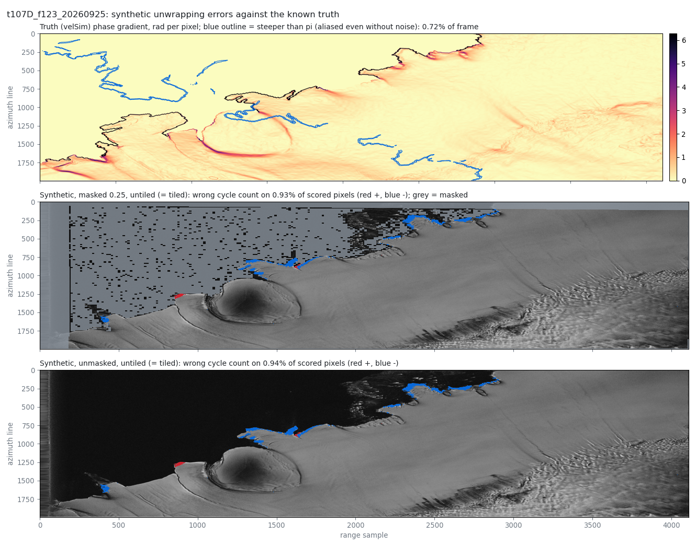

# snaphu tiling and noise masking for Antarctica40 RUNWs

**Status: draft, 2026-11-14.** Real-data diagnostics on 5 frames and a synthetic test on the first 10 of 100
frames. The synthetic test is running on all 100 frames; this note will be extended when it finishes (see
[Plan](#plan)).

## Question

On 80 MHz Greenland RIFGs, snaphu with 4 x 4 tiles plus single-tile re-optimization (`-S`) was about 2.5x faster
than stock untiled snaphu, with identical results. On 40 MHz Antarctica40 RUNWs the same tiled run was *slower*
than untiled on the first coastal frame. This note works out why, what preprocessing fixes it, and whether the fix
costs accuracy.

## Setup

| | |
|---|---|
| Frames | 100 Antarctica40 40 MHz RUNWs (`_4000_`), 60 coastal / 40 interior, from `frames.csv` |
| Input | each RUNW's own unwrapped phase, rewrapped (`exp(i phase)`), and its coherence; RUNW grid, 13 x 16 looks |
| snaphu | v2.0.7; `STATCOSTMODE SMOOTH`, `INITMETHOD MCF`, `NCORRLOOKS 139`, `LAMBDA 0.238404` |
| Untiled | stock binary (`snaphu-2.0.7-stock`) |
| Tiled | `snaphu-2.0.7-grimpopt` (no per-tile sleep, jump-pointer `FindApex`; byte-identical output to stock), `-S`, 4 x 4 tiles, 200 px overlap, `NPROC 16` |
| Host | ryder: 48 physical cores (96 hyperthreads); load from other jobs 4-45 during the runs |
| Comparison | whole-cycle differences counted per *joint* connected component (pairs of overlapping components), so the arbitrary offset between components is not counted |

Timings are wall-clock from runs sharing the machine with other work, so ratios are indicative to perhaps +-20%.

## Findings on real data

### 1. Unmasked coastal frames make `-S` slower than untiled

`t107D_f123_20260925` (coastal, 8.2 Mpx): untiled **775 s**, tiled + `-S` **1,133 s**. Both give the same answer
(0.000% of pixels differ). The tiled run averaged only 1.4 cores: the 16-way tile pass is short, and almost all
the time is the single-threaded full-scene re-optimization.

The frame has 714k residues (8.7% of 2 x 2 loops). 77% are in open ocean, and they are very unevenly spread over
the tiles (five tiles hold 107-139k each, most hold 0-5k). The tile seams cut through the dense ocean, each tile
pairs residues differently near its edges, and `-S` then has to reconcile all of it in one thread.

The interior frame `t085D_f129_20260924` (31k residues, no ocean) already gave 3.5x for tiling unmasked, and the
Greenland frames, mostly coherent land, gave 2.5x. The penalty is specific to residue-dense noise.

JPL did not mask the ocean before unwrapping these products: the RUNW lists a water mask as an input, but the
unwrapping preprocessing names only `subswath_mask`, and the ocean phase in the RUNW is noise (median gradient
2.1 rad/px against 0.34 over ice), with coherent ocean pixels inside connected components. So unmasked untiled is
the production-like baseline.

### 2. What the preprocessing has to do

| Attempt on `t107D` | Untiled | Tiled + `-S` | Note |
|---|---|---|---|
| none | 775 s | 1,133 s | |
| far ocean (> 10 km) in `BYTEMASKFILE` only | 827 s | 164 s | the masked pixels keep their noisy phase, so their residues stay in the problem |
| residue mask, nearest-neighbour fill | 682 s | 83 s | fill removes the residues, but nearest fill makes new ones at the ends of thin masked bands |
| residue mask, smooth fill (adopted) | 746-855 s | 116-127 s | see below |

- **Masking alone is not enough.** snaphu's byte mask only makes masked pixels free to cut through; their phase
  still defines residues. The masked pixels must also be **filled** with a smooth phase so they hold no residues.
- **Fill smoothly.** A nearest-neighbour fill leaves a phase step where the fills from two sides meet, which acts
  as a residue at the end of the band; on `t085D` that produced a straight one-cycle cut through coherent ice.
  The adopted fill is a distance-weighted complex average of the kept phase (normalized Gaussian convolution of
  the unit phasors, widening until it has support), close to JPL's `distance_interpolator`.
- **Sub-swath-invalid pixels hold 0, not data.** The RUNW stores exactly 0 there (4.9-10.4% of a frame). Treating
  that as phase makes a step all along the swath edge. They are now filled smoothly and kept in the unwrapping, as
  JPL does, but left out of all comparisons.

### 3. The residue mask

15 x 15 pixel blocks whose residue density exceeds a threshold, keeping only regions at least 3 blocks thick (so
thin streaks across the ice stay with snaphu's coherence weighting), filled smoothly and left out of the byte
mask. Block densities are nearly two-valued: blocks are either almost clean or near the ~0.33 per loop of random
phase.

| Frame | Mask, 0.10 / 0.25 | Untiled, 0.10 / 0.25 | Tiled + `-S`, 0.10 / 0.25 | % bad vs RUNW, 0.10 / 0.25 |
|---|---|---|---|---|
| `t048A_f137` interior | 5.4% / 4.4% | 601 / 693 s | 82 / 104 s | 0.031 / 0.031 |
| `t085D_f129` interior | 0.2% / 0.1% | 709 / 694 s | 238 / 217 s | 1.283 / 1.282 |
| `t107D_f123` coastal | 27.5% / 23.7% | 746 / 855 s | 116 / 127 s | 0.329 / 0.079 |
| `t055D_f125` coastal | 54.8% / 46.5% | 1,187 / 1,583 s | 99 / 199 s | 0.166 / 0.143 |
| `t138A_f141` coastal | 57.5% / 39.3% | 1,571 / 2,933 s | 374 / 1,427 s | 24.1 / 29.9 |

Tiled + `-S` and untiled give the same answer with the mask (0.000% different) on every frame except `t138A` at
0.25 (0.007%, about 1,000 pixels: snaphu's statistical-cost problem is not convex, and with 415k residues left the
two starting points reach slightly different local minima).

`t138A_f141` is mostly noise. The mask at 0.10 cuts along the glacier-tongue edges and turns pieces JPL had
connected into islands joined only through masked ground, so their relative cycle offsets differ from JPL's
(24% of compared pixels). Raising the threshold to 0.25 masks only near-random blocks (0.07% of JPL-component
pixels instead of 2.4%), but leaves 415k residues and makes both runs much slower without reducing the
disagreement.

Agreement with the RUNW measures disagreement between two MCF solutions, not error. Where the two disagree
inside one component, the velocity-model synthetic phase settled some patches each way and left others
undecided, because the synthetic is itself several cycles off near fronts and glacier tongues.

The GrIMP carrier correction (`+C`, and the full `+C - I` correction) changed neither the residue count (+1.6%)
nor the tiled time on `t085D`; it only flipped a near-tie one-cycle block in and out of agreement with JPL.

## Synthetic test

To score against a known answer:

- **Truth**: the frame's velocity-model phase (`simPhase/velSim.tif`) on the RUNW grid.
- **Noise**: the phase of an L-look interferogram at each pixel's coherence, drawn exactly from the 2 x 2 complex
  Wishart (Bartlett: two draws per pixel), one fixed realization per frame so both runs see the same interferogram.
- **Coherence**: the RUNW's own, varying pixel by pixel; debiased for 139 looks, and corrected for the fringe-slope
  loss sinc(g_r/2) sinc(g_a/2) that makes the estimate read low where the phase gradient is steep (slopes from the
  truth; cells steeper than about 2.4 rad/px left decorrelated).
- **L**: calibrated per frame (16-208) so the synthetic's residue density by coherence matches the real data.
- **Runs**: the production baseline, **unmasked untiled** (stock), against the proposal, **masked tiled + `-S`**
  (grimpopt, residue mask at 0.25). Up to 5 untiled and 3 tiled runs at a time.
- **Score**: per snaphu component, the share of pixels whose cycle count differs from the component's median
  offset against the truth, over the pixels the mask keeps (the same set for both runs).

### Results, first 10 frames

| Frame | Class | Mpx | L | Residues | Masked | Baseline | Proposal | Speedup | Wrong cycles, baseline | Wrong cycles, proposal |
|---|---|---|---|---|---|---|---|---|---|---|
| `t003D_f121` | coastal | 7.0 | 16 | 1,915k | 77.8% | 770 s | 53 s | 14.6x | (no components) | (no components) |
| `t014A_f143` | coastal | 6.6 | 128 | 767k | 31.6% | 677 s | 81 s | 8.4x | 0.530% | 0.554% |
| `t048A_f137` | interior | 12.4 | 208 | 287k | 2.7% | 514 s | 72 s | 7.1x | 0.000% | 0.000% |
| `t055D_f125` | coastal | 9.3 | 64 | 1,638k | 47.4% | 1,543 s | 100 s | 15.4x | 0.061% | 0.068% |
| `t064A_f140` | coastal | 14.6 | 16 | 3,408k | 55.8% | 3,233 s | 168 s | 19.3x | 0.203% | 0.203% |
| `t078D_f122` | coastal | 3.9 | 16 | 989k | 73.9% | 270 s | 23 s | 11.6x | 0.228% | 0.227% |
| `t085D_f129` | interior | 12.5 | 208 | 54k | 0.1% | 769 s | 104 s | 7.4x | 0.000% | 0.000% |
| `t107D_f123` | coastal | 8.2 | 64 | 686k | 23.3% | 870 s | 102 s | 8.6x | 0.960% | 0.921% |
| `t144A_f143` | coastal | 10.5 | 64 | 1,420k | 26.1% | 2,332 s | 191 s | 12.2x | 0.970% | 0.929% |
| `t170A_f145` | coastal | 3.5 | 32 | 820k | 59.7% | 222 s | 30 s | 7.3x | 1.152% | 2.488% |

- **Speed**: the proposal is **7-19x faster** (median 10.1x; 11,200 s against 923 s in total), with the largest
  gains on large, noisy coastal frames.
- **Accuracy**: within 0.03 percentage points of the baseline on 8 of the 9 scorable frames (median 0.216%
  against 0.215% wrong).
  `t003D` has no connected components in either run (almost all noise), so only its timing counts.
- **`t170A` is worse with the proposal** (2.49% against 1.15%). Earlier diagnostic runs on that frame separate the
  two changes: **unmasked tiled** gives 1.152% (the same as the baseline) and **masked untiled** gives 2.488%. The
  extra errors come from the **mask**, not from tiling, which matches the island effect seen on `t138A`.
- **Tiling never changed the answer**: on every frame where both were run, tiled + `-S` and untiled gave the same
  error. Without the mask, though, tiling is slow on noisy frames (`t144A` unmasked tiled took 2,297 s).
- **Where the errors are**: on `t107D` nearly all of the ~0.9% is a rim along the ice front, where the velocity
  model itself jumps by up to 38 rad per pixel between ice and ocean, which no unwrapper can recover; masked and
  unmasked make the same mistakes. (Figure from the uncorrected first synthetic run; the corrected run's numbers
  are within 0.04%.)

## Conclusions so far

1. Tiling with `-S` gives the same answer as untiled snaphu, but its speed depends on the residues left after
   the tiled pass: it is fast on clean data and slow on noisy coastal frames.
2. A residue mask (15 x 15 blocks, threshold 0.25, at least 3 blocks thick), with the masked and sub-swath-invalid
   pixels filled smoothly, makes masked tiled + `-S` 7-19x faster than unmasked untiled on the synthetic frames.
3. On most frames the mask costs no accuracy. On fragmented coastal frames it can disconnect pieces of good data
   and change their relative cycle offsets (`t170A`, `t138A`); there the cost belongs to the mask, not to tiling.

## Plan

When all 100 synthetic frames are done:

1. Repeat the results table and summarize speedup and accuracy by class (coastal / interior), size and noise
   level; list frames where the proposal is less accurate, and check each one the way `t170A` was checked
   (masked untiled and unmasked tiled) to see whether the mask or the tiling is responsible.
2. Look at mask variants for the fragmented coastal cases: a mask limited to ocean-like residue regions (for
   example those overlapping an ocean mask), or a lower thickness rule, and score them on the frames that lost
   accuracy.
3. Decide the threshold and mask rule, then add the preprocessing (residue mask, smooth fill of masked and
   sub-swath-invalid pixels) in front of tiled + `-S` in the production unwrapping.
4. Rerun the real-data comparison on a sample with the final preprocessing.

## Files

Work directory `/Volumes/insar4/ian/Data/NISAR/Antarctica/unwrapTest40/`:

| Path | Contents |
|---|---|
| `frames.csv` | the 100 frames, with their class |
| `bin/runUnwrapTest.py` | the original unmasked runner (stopped after 2 frames) |
| `diagOceanMask/diagResidueMask2.py` | real-data residue mask (version 2) and its runs (`residueMask2/`, `residueMask2_t0.25/`, `residueMask2carrier*/`) |
| `diagOceanMask/patchVsSynthetic.py` | local test of disagreement patches against the synthetic phase |
| `diagOceanMask/synthTest.py` | the synthetic test; results in `synth2/{none,mask0.25}/<frame>/result.json` |
| `diagOceanMask/synth2/queueAll.sh` | the runner working through all 100 frames |
