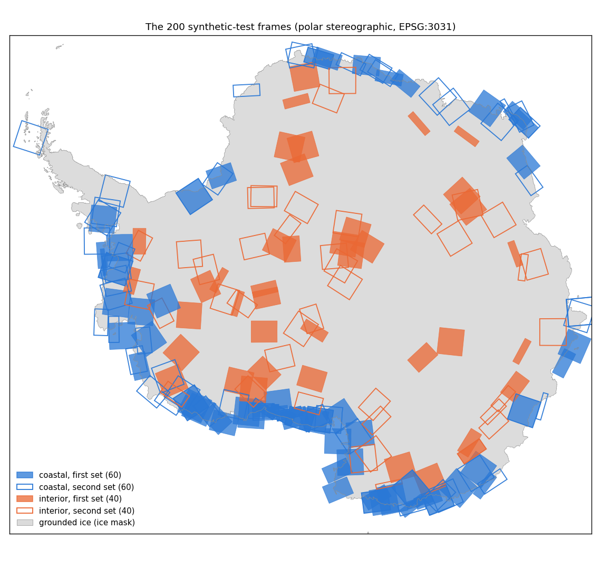
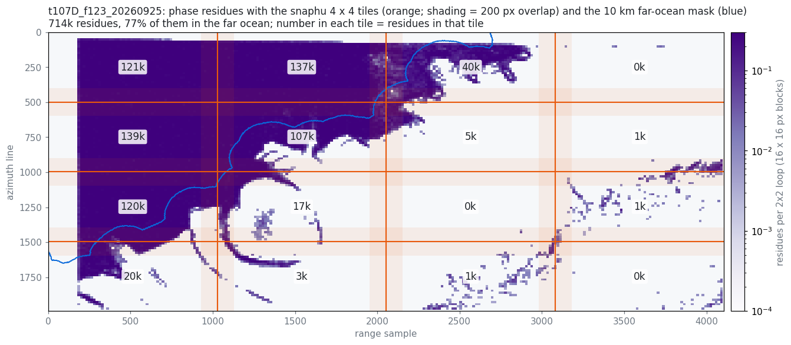
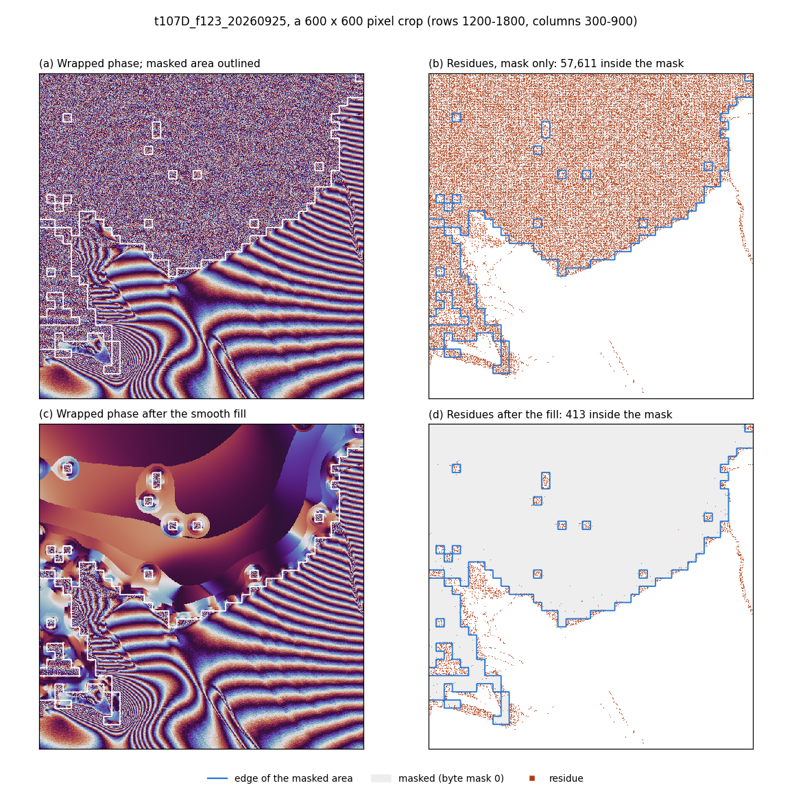
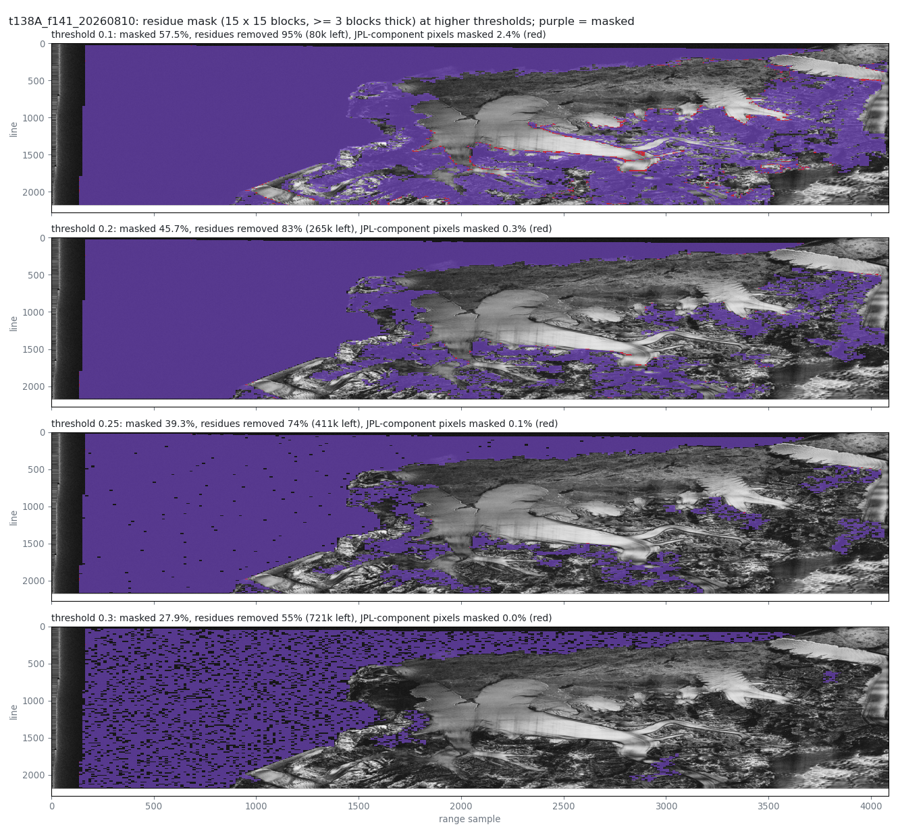
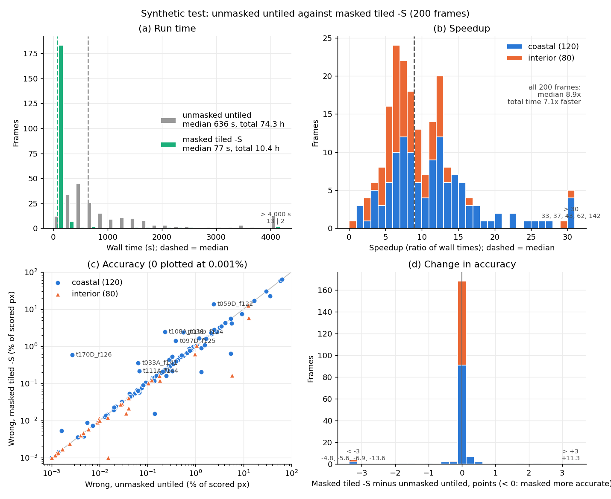

# Tiled phase unwrapping of noisy NISAR interferograms: the cost of residues and a masking remedy

**Status: draft, 2026-11-15.** Based on real-data diagnostics for 5 Antarctica40 frames and a synthetic test on
200 frames. An earlier version of the synthetic test used a truth that is zero, not missing, where the velocity map
has no coverage; all synthetic results here are from the corrected test (Section 2.5).

## Summary

These experiments are designed to see if the wall-clock time for snaphu can be reduced by using tiled rather than
untiled unwrapping. Specifically, we investigate tiling with the `-S` option, using a slightly modified version of
snaphu 2.0.7 (Section 2.2). Tiling splits the interferogram into tiles (here 4 x 4) that are unwrapped in parallel
and then assembled; with `-S`, snaphu then re-optimizes the assembled solution as a single tile so that the result
has no errors along the tile seams. Production unwrapping of NISAR RUNW products uses
untiled snaphu, which runs on a single core because its network solver is sequential.

On 80 MHz Greenland interferograms, tiled unwrapping with `-S` was about 2.5 times faster than untiled unwrapping,
with identical results. On 40 MHz Antarctic interferograms it was often slower. The slowdown comes from
residue-dense noise, mostly open ocean and sea ice. The tiles solve the noise independently, they disagree along
their seams, and the single-threaded re-optimization then has to reconcile hundreds of thousands of residues.

Removing the noise before unwrapping restores the benefit of tiling, but only if the noisy pixels are both masked
and filled with a smooth phase. Snaphu's mask does not remove residues: it only makes the masked pixels free to
cross, while the residues in them, which come from their noisy wrapped phase, still have to be connected.
Replacing that phase with a smooth fill removes them; a crude fill, such as copying the nearest good pixel,
creates new ones (Section 3.2). We use a mask built from the residues themselves: 15 x 15 pixel blocks whose residue density exceeds 0.25
per loop, restricted to regions at least three blocks thick.

In a synthetic test with a known answer on 200 frames, masked tiled unwrapping is a median 8.9 times faster
than the unmasked untiled unwrapping used in production, and 7.1 times faster in total (10.4 h against
74.3 h). Scaled to the 1,803 frame locations of the Antarctica40 project (30% coastal), one pass of unwrapping
would take about 107 h instead of about 658 h, about 6 times less. Accuracy is effectively unchanged: on
165 of the 193 frames that could be scored the two error rates differ by less than 0.07 percentage points, and the
mean share of pixels with the wrong cycle count is 1.55% masked tiled against 1.64% unmasked untiled. The
mask makes 10 frames substantially more accurate and 7 less accurate; the losses come from disconnecting pieces
of good data whose relative cycle offsets then go wrong.

On 16 of the 200 frames, snaphu's assembly of the tiles fails to converge. The `-S` re-optimization repairs the
result, so the answer is unaffected, but these frames gain a median of only 3.6 times and take about half of the
masked tiled time. Wider tile overlaps reduce this on the worst frames but cost about as much on the others.

## 1. Introduction

Snaphu solves phase unwrapping as a minimum-cost network flow problem. Its cost grows with the number of
**residues**: 2 x 2 pixel loops whose wrapped phase differences do not sum to zero, each of which must be
connected to a residue of the opposite sign or to the edge of the data. With coherent data, residues are rare. In
decorrelated data, such as open water, about one loop in three is a residue.

To unwrap large interferograms faster, snaphu can divide the image into overlapping tiles, unwrap them in
parallel, and assemble the result. With `-S` it then re-optimizes the assembled solution as a single tile, which
removes the errors tiling would otherwise introduce at the seams. That last step is single-threaded and works on
the whole scene, but it is normally quick. It starts from the assembled tile solution, which on clean data is
already almost right, so the solver has little left to change.

We are evaluating this tiled mode (with a modified build of snaphu 2.0.7 that removes a fixed per-tile delay and speeds up
part of the network solver) for unwrapping NISAR RUNW products. The goal is to make unwrapping cheap enough to
redo routinely, for example after correcting the interferogram, without changing the answer. On 68 Greenland
frames the tiled mode was 2.5 times faster and gave identical results (it would likely be faster still with the
masking described below). On the first Antarctic coastal frame it
was 1.5 times *slower*. This note explains why, describes a preprocessing step that removes the penalty, and
tests whether that step costs accuracy.

## 2. Data and methods

We performed experiments both with actual phase data and with a larger set of synthetic interferograms based on a
reference velocity map. The two answer different questions. The actual data show how snaphu behaves on real
noise, including open ocean, sea ice and decorrelated shear margins, and how long it takes. But they have no
known answer, so two solutions can only be compared with each other or with the RUNW's own solution (Section 2.3). The synthetic
interferograms combine the phase predicted by the velocity map with noise matched to each frame's real coherence
(Section 2.4). They have a known answer, so they measure error as well as time, on many more frames.

### 2.1 Data

We use 200 Antarctica40 RUNW products: 40 MHz (`_4000_`), HH, unwrapped on the 13 x 16 look RUNW grid (Figure 1).
They were drawn from the 17,594 products of the project, which cover 1,803 frame locations: 120 **coastal**
frames (footprint touching ocean, ice shelf or the grounding zone in our Antarctic ice mask) and 80 **interior**
frames (fully grounded). Coastal frames are deliberately over-represented, since they hold the noise: they are 30%
of the project's frame locations. Within each class, frames were taken in turn from different tracks, each time
preferring the pass direction, 2-degree latitude band and month used least so far. Ten coastal frames were
replaced because the velocity model covers less than half of their coherent pixels (Section 2.5).

Each product's own unwrapped phase, rewrapped, together with its coherence, forms the interferogram we unwrap. The
RUNW's unwrapped phase and connected components serve as a reference solution.

*Figure 1. The 200 frames, coastal (blue) and interior (orange), over ice speed from the latest NISAR Antarctic
velocity mosaic (multi-year, June 2025 to November 2026), in polar stereographic projection.*

### 2.2 Unwrapping

Untiled runs use snaphu 2.0.7, and tiled runs a slightly modified version of it (below). Both use the statistical
cost mode `SMOOTH`, an MCF initialization, `NCORRLOOKS 139` and the RUNW's 13 x 16 looks. The two modes compared
are:

- **untiled**: the unmodified snaphu release, as used for production unwrapping;
- **tiled with `-S`**: a slightly modified build of snaphu 2.0.7 (below), 4 x 4 tiles with 200-pixel overlaps, 16
  processes, followed by the single-tile re-optimization.

The modified build changes 125 of snaphu's roughly 20,200 lines of C (114 lines added, 11 removed, in four
files). None of the changes alter the unwrapped result: wherever the unmodified release runs to completion, the
output is byte-identical. We checked the first two changes against the unmodified release on CoSSC data and on 68
Greenland frames, and the third against the build without it on Antarctic frames here.
The changes are:

- **No delay between tile processes** (1 line). Snaphu pauses before starting each tile process, in proportion to
  the tile size. The pause is unnecessary, because each tile writes its own files and the parent waits for them.
- **Faster ancestor search** (94 lines added, 6 removed). The tree solver repeatedly searches for the common
  ancestor of two nodes (`FindApex`) by walking up the tree one node at a time. The modified build caches a pointer
  to an ancestor every 32 levels and invalidates the cache when the tree changes, so the search skips most of the
  walk.
- **No abort on large flows next to masked pixels** (19 lines added, 4 removed). Snaphu aborts if any arc carries
  more flow than its 16-bit cost arithmetic allows: about 160 cycles at the default `NSHORTCYCLE` of 200. A tiled solution can leave that much flow on
  arcs next to masked pixels, which carry no cost and which the solver already ignores when it tracks the largest
  flow. The modified build applies the check to the other arcs only (Section 3.6).

Runs were made on two machines, each with 48 physical cores, shared with other work. Both runs of a frame were
always made on the same machine. Wall-clock times are therefore
indicative to perhaps 20%, and speedups are more reliable than absolute times.

### 2.3 Comparing solutions

Two unwrapped solutions can differ by an arbitrary whole number of cycles between connected components. We
therefore compare them per *joint* component, meaning each pair of overlapping components from the two
solutions. Within each pair we remove the pair's median cycle offset and count the pixels that still differ by
one or more cycles. Against the real data this measures **disagreement** between two minimum-cost solutions, not
error. In the synthetic test the truth takes the place of the second solution, and the same count measures error
(Section 2.4).

Specifically, we evaluate intra-component error, not inter-component error. A component whose phase is off from the
reference by a whole number of cycles counts as correct; only pixels whose cycle count differs from the rest of
their component count as wrong. Offsets between components are left to later processing, such as the
per-component ambiguity correction against the velocity model.

### 2.4 Synthetic test

To measure error, we build a synthetic interferogram with a known answer for each frame:

- **Truth.** The phase predicted on the RUNW grid from the MEaSUREs phase-based Antarctic velocity map
  (`simPhase/velSim.tif`).
- **Noise.** At each pixel, the phase error of an L-look interferogram with that pixel's coherence, drawn from the
  exact distribution of a two-channel complex Wishart matrix (two random draws per pixel). The noise therefore
  follows the frame's real coherence pattern.
- **Coherence.** The RUNW's own coherence, corrected in two ways:
  - **Low-coherence bias.** Coherence is estimated as the magnitude of an average of N products of the two images'
    complex samples, normalized by their powers. When the true coherence is zero, those products have random
    phases, and the magnitude of their average is not zero but about 1/sqrt(N), because random phasors do not cancel
    exactly. For the N = 139 effective looks of the RUNW coherence (13 x 16 samples, fewer independent ones), this
    floor is about 0.085, and open ocean, where the true coherence is near zero, reads about 0.08. The bias shrinks
    as the true coherence rises. We remove it with the approximation E[g_est^2] = g^2 + (1 - g^2)/N, i.e.
    g = sqrt((N g_est^2 - 1)/(N - 1)), set to zero below the floor. Without this correction, every decorrelated
    pixel would get a little spurious coherence, and the synthetic noise would be too weak exactly where it matters
    most.
  - **Fringe-slope bias.** Correlation reads low where the phase changes quickly across the estimation window, because
    the phasors partly cancel. We divide by the expected loss, sinc(g_r/2) x sinc(g_a/2), computed from the
    truth's own phase gradients g_r and g_a in radians per pixel. Cells steeper than about 2.4 radians per pixel
    are left decorrelated, as they would be in reality.
- **Number of looks.** The RUNW is formed from 13 x 16 = 208 samples, but we do not use 208 as L. Neighbouring
  samples are correlated, so the number of independent looks is smaller, and the real phase noise also departs from
  the ideal model in ways the coherence does not capture: sea ice and shelf fronts change between acquisitions, and
  the two coherence corrections above are approximate. With L = 208 the synthetic interferogram would be cleaner
  than the real one on some frames and noisier on others. What makes a frame hard to unwrap is its residues, so we
  choose L for each frame, from 16, 32, 64, 128 and 208, to make the synthetic interferogram's residue density in
  each coherence range (bins from 0 to 1) match the real interferogram's as closely as possible. L is therefore a
  calibration constant that sets how hard the synthetic frame is to unwrap, not a physical look count. The fitted
  values span the whole range: coastal frames often need a low L (their real phase is noisier than their coherence
  implies), and interior frames usually fit best at 208.

### 2.5 Experiment protocol

Each synthetic frame is unwrapped twice: **unmasked untiled**, the production approach, and **masked tiled `-S`**.
Both runs use the same noisy interferogram (the noise is seeded per frame), and the masked run additionally applies
the residue mask and smooth fill (Section 3.3). Each solution is scored as the share of pixels, in its connected
components, whose cycle count differs from the component's median offset against the truth (Section 2.3). Both
solutions are scored over the same pixels: those the mask keeps.

Where the masked tiled run is substantially less accurate, we also unwrap the masked input untiled with the
unmodified snaphu. Comparing that run with the other two separates the effect of the mask from the effect of
tiling.

Pixels where the truth is exactly zero are treated as missing: the simulated phase is zero, not a no-data value,
where the velocity map has no coverage, which is mostly over ice shelves, ice tongues and the ocean. Those pixels are
filled and left out of the unwrapping and the scoring, like pixels with zero coherence or in sub-swath gaps. A
frame is skipped if the model covers less than half of its coherent pixels (RUNW coherence above 0.5), and is
replaced by another frame of the same class chosen by the same rule (Section 2.1). The first version of the test
treated zero truth as data (see the status note at the top).

Each machine runs at most five untiled and three tiled unwrappings at a time, and both runs of a frame are made on
the same machine. Wall-clock and CPU times come from `/usr/bin/time`.

## 3. Results

We first use the actual phase data to show why tiling alone does not speed up unwrapping on noisy Antarctic frames
(Section 3.1), and to develop a preprocessing step that fixes it: masking the residue-dense noise and filling it
smoothly (Sections 3.2 and 3.3). We then use the synthetic interferograms to measure what that approach gains in
time and costs in accuracy (Sections 3.4 and 3.5). Finally, we describe two problems in snaphu's tiled mode that
the tests exposed, an overflow abort and a slow assembly of the tiles on some frames (Sections 3.6 and 3.7).

### 3.1 Why tiling with no masking does not work

These runs use the real RUNW phase, rewrapped, with no mask. How much time tiling saves depends on how many
residues are left after the tiled pass, and on where they are.
Coherent frames have few residues and tile well. The interior frame `t085D_f129` (31,000 residues) was 3.5 times
faster tiled, in line with the Greenland results. Coastal frames carry large areas of open ocean, where nearly
every third loop is a residue. The coastal frame `t107D_f123` has 714,000 residues (8.7% of all loops). Untiled
snaphu took 775 s and the tiled mode 1,133 s, with identical results.

The tiled run averaged only 1.4 busy cores. Its parallel stage is short, and almost all of the time goes to the
single-threaded re-optimization. Figure 2 shows why that step is expensive. 77% of the residues lie in open
ocean, and they are concentrated in a few tiles (five of the sixteen hold 107,000-139,000 residues each, most of
the rest fewer than 5,000). Several seams run straight through the densest areas. Each tile pairs the residues
near its edges differently, and the re-optimization then has to reconcile them across the whole scene.

*Figure 2. Residue density on `t107D_f123` (purple, log scale), the 4 x 4 snaphu tiles (orange; shading = 200-pixel
overlap) and the ocean more than 10 km from land or ice (blue), the mask of our first attempt to remove the noise
(Section 3.2). Numbers give the residues in each tile.*

JPL's production processing does not remove this noise either. The products list a water mask among their
inputs, but the recorded unwrapping preprocessing names only a sub-swath mask. The unwrapped phase over the
ocean is noise (median gradient 2.1 radians per pixel against 0.34 over ice), and coherent ocean pixels appear in
connected components. Unmasked untiled unwrapping is therefore the right reference for production.

### 3.2 Noise must be masked and filled

Our first attempt to remove the noise was an ocean mask, the approach JPL's processing appears to anticipate (it
lists a water mask among its inputs). We masked the ocean more than 10 km from land or ice, taken from our
Antarctic ice mask and mapped into radar geometry with the frame's orbit (blue in Figure 2, 27% of `t107D_f123`).
On that frame it worked for the tiled mode, but it is not the approach we kept:

- It removes only open ocean. Sea ice, the 10 km coastal margin, fjords and decorrelated areas on land keep their
  noise, and on many coastal frames these hold much of it.
- It depends on an external mask, which must be current and geocoded into radar geometry for every frame.
- The residue mask of Section 3.3, which needs only the interferogram itself, did better on the same frame (116 to
  127 s tiled, against 164 s).

Whatever mask is used, masking alone does not remove the noise from snaphu's problem; the masked phase must also
be replaced. The reason is how snaphu treats masked pixels. Snaphu works on residues, the 2 x 2 loops of wrapped
phase that do not close, and it computes them from the wrapped phase of every pixel, masked or not. Its byte mask
does not remove those residues. It only sets the cost of crossing a masked pixel to zero. So:

- **Mask only.** Every residue inside the masked area is still in the network and must still be connected to a
  residue of opposite sign or to an edge. The connections are free, so the cost of the solution hardly changes, but
  the solver still has to find them, and an untiled run takes about as long as before. A tiled run does gain,
  because the masked noise no longer sets costs along the seams, so the tiles assemble into a nearly right
  solution and the re-optimization has less to do.
- **Mask and fill.** Replacing the masked phase with a smooth surface leaves no loops that fail to close, so the
  masked area contributes no residues at all. The problem shrinks for both modes, and the masked pixels still cost
  nothing to cross.

Figure 3 shows the difference on part of `t107D_f123`. With the mask alone, 57,611 residues remain inside the
masked area of this crop (b); after the fill, 413 remain, nearly all along its edge (d). The small unmasked squares inside
the masked area are blocks whose residue density fell below the threshold (Section 3.3); they keep their noise.

*Figure 3. Masking with and without a fill, on a 600 x 600 pixel crop of `t107D_f123` where the residue mask meets
coherent ice. (a) Wrapped phase, with the edge of the masked area outlined. (b) Residues (red) with the mask alone:
the masked area keeps all its residues. (c) Wrapped phase after the smooth fill. (d) Residues after the fill: the
masked area (grey) has almost none.*

The kind of fill matters. A nearest-neighbour fill leaves a phase step where fills from two sides of a thin masked
band meet. The end of such a step acts as a residue, and on `t085D_f129` it produced a straight one-cycle cut
through coherent ice. We instead fill with a distance-weighted complex average of the surrounding phase (a
normalized Gaussian convolution of the unit phasors, widening until it finds data). That is close to the
`distance_interpolator` JPL uses, and it leaves almost no residues inside filled areas.

A second preprocessing detail concerns the edges of each frame. Where a sample is invalid in either radar image,
the RUNW stores a phase of exactly 0, about 5-10% of each frame along the swath edges. Treating that 0 as data
creates a phase step along the whole edge. We fill these pixels in the same way and keep them in the unwrapping,
as JPL does, but leave them out of all comparisons.

### 3.3 A residue-based mask

The ocean mask did not solve the problem. It removes only the noise a map can predict, open water away from the
coast, and leaves the rest: sea ice, the coastal margin, fjords and decorrelated areas on land, which on many
coastal frames hold much of the noise. It also depends on an external mask that has to be kept current and mapped
into radar geometry for every frame. So rather than relying on a coastline, we derive the mask from the residues
themselves, which marks the noise wherever it is. The residue density in
15 x 15 pixel blocks is close to two-valued: blocks are either nearly free of residues or close to the one in three
expected for random phase. We mask blocks above a threshold, but only in regions at least three blocks thick, so
that narrow low-coherence streaks across the ice are left to snaphu's coherence weighting. The mask is computed
from the data alone and needs neither a coastline nor geolocation.

Table 1 compares two thresholds on five frames. On the two interior frames the mask hardly matters. On the
coastal frames a threshold of 0.10 removes more residues and runs faster, while 0.25 removes only near-random
blocks and agrees slightly more closely with the RUNW solution. In every case the tiled and untiled solutions were identical, with
one exception. On `t138A_f141` at 0.25, 0.007% of pixels differed: with 415,000 residues left, the two methods
started their non-convex optimization from different points and reached slightly different minima.

*Table 1. Real-data runs with the residue mask at thresholds 0.10 and 0.25. Colour marks a 0.25 value that differs
substantially from the 0.10 value (time more than 1.5 times; disagreement changed by more than half, or by more
than 5 percentage points): red worse, green better. The tiled times are followed by the speedup over the untiled
run at the same threshold.*

| Frame | Class | Masked (0.10 / 0.25) | Untiled (0.10 / 0.25) | Tiled + `-S` (0.10 / 0.25), with speedup over untiled | Disagreement with RUNW, % (0.10 / 0.25) |
|---|---|---|---|---|---|
| `t048A_f137` | interior | 5.4% / 4.4% | 601 / 693 s | 82 (7.3x) / 104 (6.7x) s | 0.031 / 0.031 |
| `t085D_f129` | interior | 0.2% / 0.1% | 709 / 694 s | 238 (3.0x) / 217 (3.2x) s | 1.283 / 1.282 |
| `t107D_f123` | coastal | 27.5% / 23.7% | 746 / 855 s | 116 (6.4x) / 127 (6.7x) s | 0.329 / $\color{green}{\text{0.079}}$ |
| `t055D_f125` | coastal | 54.8% / 46.5% | 1,187 / 1,583 s | 99 (12.0x) / $\color{red}{\text{199}}$ (8.0x) s | 0.166 / 0.143 |
| `t138A_f141` | coastal | 57.5% / 39.3% | 1,571 / $\color{red}{\text{2,933}}$ s | 374 (4.2x) / $\color{red}{\text{1,427}}$ (2.1x) s | 24.1 / $\color{red}{\text{29.9}}$ |

Frames that are mostly noise are the difficult case (Figure 4). On `t138A_f141`, about 40-60% of the frame is
masked. The good data that remains is a set of fragments (glacier tongues, ice-shelf pieces, rough ground) linked
only by narrow strips. The RUNW solution connects these fragments through rough terrain that the mask removes, and
the two solutions differ in the relative cycle offsets of several of them (24-30% of compared pixels).

Neither solution can be confirmed from the data. A local comparison of each disagreeing fragment against the
velocity-model phase favoured the masked solution on some fragments and the RUNW solution on others, and was inconclusive where the
model itself is several cycles off, near fronts and glacier tongues. Raising the threshold kept more of the
connecting terrain but made both modes much slower, without reducing the disagreement.

*Figure 4. The residue mask on `t138A_f141` at four thresholds (purple). Red marks masked pixels that the RUNW solution
placed in a connected component.*

A carrier correction made no difference to unwrapping cost. Adding the GrIMP rubber-sheet carrier correction, with
or without the ionospheric correction, changed the residue count of `t085D_f129` by 1.6% and the tiled time by
less than the run-to-run spread. The correction is smooth, so it can only flip residues where the phase is
already noise.

### 3.4 Synthetic test: speed and accuracy

Table 2 gives the results for the first ten frames of the set. Two of the ten first drawn, `t078D_f122` and
`t170A_f145`, were replaced by `t047A_f141` and `t079D_f123`, because the velocity map covers too little of them
(Section 2.1). Masked tiled `-S` unwrapping is **7-25 times faster** than unmasked untiled unwrapping, median 9.3
times; together the ten frames took 12,296 s unmasked untiled and 952 s masked tiled `-S`, 12.9 times less. The largest gains are on large, noisy coastal frames,
where untiled unwrapping is slowest.

*Table 2. Synthetic test, first ten frames: unmasked untiled against masked tiled `-S`. "Wrong" is the share of
scored pixels whose cycle count is wrong. Colour would mark a masked tiled `-S` error substantially worse (red) or
better (green) than the unmasked untiled one (more than double or half, or more than 0.5 percentage points apart).*

| Frame | Class | Size (Mpx) | L | Residues | Masked | Unmasked untiled | Masked tiled `-S` | Speedup | Wrong, unmasked untiled | Wrong, masked tiled `-S` |
|---|---|---|---|---|---|---|---|---|---|---|
| `t003D_f121` | coastal | 7.0 | 16 | 138k | 2.4% | 670 s | 45 s | 15.0 | (no components) | (no components) |
| `t014A_f143` | coastal | 6.6 | 128 | 219k | 6.8% | 366 s | 50 s | 7.3 | 0.092% | 0.104% |
| `t048A_f137` | interior | 12.4 | 208 | 287k | 2.7% | 514 s | 72 s | 7.1 | 0.000% | 0.000% |
| `t055D_f125` | coastal | 9.3 | 64 | 633k | 14.1% | 958 s | 74 s | 13.0 | 0.059% | 0.062% |
| `t064A_f140` | coastal | 14.6 | 32 | 2,083k | 30.2% | 2,388 s | 157 s | 15.2 | 0.062% | 0.062% |
| `t047A_f141` | coastal | 14.8 | 64 | 1,219k | 14.3% | 4,346 s | 171 s | 25.4 | 1.311% | $\color{green}{\text{0.203\%}}$ |
| `t085D_f129` | interior | 12.5 | 208 | 54k | 0.1% | 769 s | 104 s | 7.4 | 0.000% | 0.000% |
| `t107D_f123` | coastal | 8.2 | 64 | 83k | 1.9% | 698 s | 82 s | 8.5 | 0.200% | 0.199% |
| `t144A_f143` | coastal | 10.5 | 64 | 525k | 1.9% | 992 s | 137 s | 7.2 | 0.152% | 0.162% |
| `t079D_f123` | coastal | 9.0 | 128 | 70k | 0.1% | 597 s | 59 s | 10.1 | 0.206% | 0.206% |

On eight of the nine frames that could be scored, the masked tiled `-S` error is within 0.02 percentage points of
the unmasked untiled error. On the ninth, `t047A_f141`, the mask substantially improves the result (0.20% of
pixels wrong against 1.31%). One frame, `t003D_f121`, is almost entirely noise, and neither run produced a connected
component. Wherever the masked input was also unwrapped untiled, tiled and untiled unwrapping of the same input
gave the same error (Section 3.5).

Most of the remaining error is not caused by noise or by unwrapping, but by the truth. On `t107D_f123`, 96% of the
wrong pixels lie within 10 pixels of the edge of the velocity map's coverage, along the ice front (Figure 5). There
the simulated phase changes by a median of 12 radians per pixel, far more than any unwrapper can follow, while the
real interferogram is coherent (median coherence 0.58) and changes by only 0.38 radians per pixel. The steep edge
belongs to the velocity map, not to the ice, and the masked and unmasked runs make the same errors there. This part
of the synthetic error therefore says nothing about the unwrapping methods.

*Figure 5. Synthetic test on `t107D_f123` (corrected test). (a) Phase gradient of the truth, with blue outlines where
it exceeds pi radians per pixel; blank where the velocity map has no data. (b, c) Pixels with the wrong cycle count
in the masked tiled `-S` and unmasked untiled solutions; dark grey is masked or has no truth.*

### 3.5 Synthetic test: all frames

Table 3 and Figure 6 summarize the 200 frames (120 coastal, 80 interior); Appendix A lists every frame. Masked
tiled `-S` unwrapping took a median of 77 s per frame against 636 s for unmasked untiled unwrapping
(Figure 6a). The median speedup is 8.9 times (Figure 6b), and the total time fell 7.1 times, from 74.3 h to
10.4 h. Coastal frames gain more (median 11.0 times) than interior frames (median 7.6 times), because their
untiled runs spend longest on the noise.

**Scaled to the project.** The test over-represents coastal frames (60%, against 30% of the project's 1,803 frame
locations). Weighting the mean time per frame of each class by the project's counts, one unwrapping pass over all
locations would take about 658 h unmasked untiled and about 107 h masked tiled `-S`, 6.2 times less (90% range
from resampling the frames: 4.5 to 9.3 times). The hours are single-frame wall-clock times on shared machines;
the ratio is the more robust number.

**Accuracy.** Most frames are unchanged (Figure 6c, d). On 165 of the 193 frames that could be scored the two errors
are within 0.07 percentage points of each other, and on 181 within 0.5 points. The median share of wrong pixels is
0.059% unmasked untiled and 0.057% masked tiled `-S`, and the mean 1.64% and 1.55%. The mean is
dominated by a few frames that neither run unwraps well (up to about 60% wrong in both), the median by the typical
frame. 10 frames change substantially for the better and 7 for the worse (Table 3):

- Better: `t104A_f142` (36% to 22%), `t151A_f138` (13% to 5.9%), `t076A_f138` (5.7% to 0.17%), `t061A_f142` (5.4% to 0.63%), `t060A_f139` (9.2% to 7.4%), `t111A_f144` (5.6% to 4.1%), `t047A_f141` (1.3% to 0.2%), `t073D_f123` (0.14% to 0.015%), `t087A_f142` (0.036% to 0.016%), `t059D_f123` (0.015% to 0.00031%).
- Worse: `t059D_f122` (2.4% to 14%), `t108A_f139` (0.23% to 2.4%), `t010D_f124` (0.56% to 2.4%), `t097D_f125` (0.39% to 1.4%), `t170D_f126` (0.0027% to 0.59%), `t033A_f141` (0.064% to 0.35%), `t111A_f144` (0.067% to 0.22%).

ATTRIBUTION_PLACEHOLDER

*Table 3. Synthetic test, all 200 frames, by class. Totals are summed wall-clock times. "Wrong" is the median share
of scored pixels with the wrong cycle count. "Substantially worse" and "substantially better" use the rule of
Table 2 in each direction.*

| Set | Frames | Unmasked untiled, total | Masked tiled `-S`, total | Speedup, median (range) | Wrong, unmasked untiled | Wrong, masked tiled `-S` | Substantially worse | Substantially better |
|---|---|---|---|---|---|---|---|---|
| all | 200 | 74.3 h | 10.4 h | 8.9 (0.8-141.8) | 0.059% | 0.057% | 7 of 193 | 10 of 193 |
| coastal | 120 | 45.6 h | 5.1 h | 11.0 (1.3-62.2) | 0.232% | 0.228% | 7 of 113 | 6 of 113 |
| interior | 80 | 28.7 h | 5.3 h | 7.6 (0.8-141.8) | 0.001% | 0.000% | 0 of 80 | 4 of 80 |

*Figure 6. Synthetic test, all 200 frames. (a) Wall time of each run, with medians (dashed) and totals; runs longer
than 4,000 s are in the last bin (unmasked untiled | masked tiled `-S`). (b) Speedup, stacked by class, with the
median (dashed); speedups above 30 are in the last bin, with their values. (c) Share of scored pixels with the wrong
cycle count, masked tiled `-S` against unmasked untiled, on log axes (zero plotted at 0.001%); frames substantially
worse are labelled. (d) Change in that share, masked tiled `-S` minus unmasked untiled (negative where the masked
run is more accurate); changes beyond ±3 points are in the end bins, with their values.*

### 3.6 An overflow abort

Three frames (`t059D_f122`, `t116D_f126`, `t081D_f127`) first failed. Snaphu aborted at the start of the `-S`
re-optimization with "((Maximum flow) * NSHORTCYCLE) too large". Each tile leaves its masked pixels at an arbitrary
cycle count, so the assembled solution jumped by up to 245 cycles across masked areas, while snaphu allows at most
160 (32,000 divided by `NSHORTCYCLE` 200). Arcs next to masked pixels carry no cost, and snaphu's solver loop
already ignores them when it tracks the largest flow, so the modified build now applies the initial check to the
other arcs only. On frames that passed the check its output is byte-identical to the previous build. With this
change, no frame of the corrected synthetic test aborts. Without the snaphu modifications, that is with stock
snaphu 2.0.7, 10 of the 200 masked tiled runs (5%) would have aborted: their largest flows next to masked
pixels were 164 to 338 cycles, while elsewhere they stayed within the limit. Masked tiled
unwrapping therefore requires the modified snaphu; with stock snaphu it fails on about one frame in twenty.
Untiled unwrapping, masked or not, builds no tile solution and works with stock snaphu. One frame (`t060A_f139`) also failed in the first version
of the test, because a jump of 389 cycles lay between unmasked pixels; that jump came from the zero-truth areas
(Section 2.5), and with those excluded the frame runs.

### 3.7 Slow frames: the assembly of the tiles

Snaphu assembles the tiles by solving a secondary network for the cycle offset of each piece of each tile. On
16 of the 200 frames this solver stopped early ("No overall cost reduction for too many iterations"), and the
assembled solution contains wrong offsets of tens of cycles between pieces (127 cycles across a 180-pixel boundary on
`t081D_f127` in the first version of the test), which the `-S` pass has to repair. The answer is repaired, but much
of the time saving is lost: these 16 frames take 52% of the masked tiled `-S` time. If they ran at the median
speedup of the other frames (9.3 times), the total would fall from 10.4 h to 6.9 h, a speedup of about
11 rather than 7.1. Even so, masked tiled `-S` unwrapping is faster than unmasked untiled unwrapping on all but
one of these frames: a median 3.6 times (0.8 to 62), and 3.3 times in total.

The cause lies in the tiles, not in the solver. The solver works with costs clipped to 16-bit integers, but an exact
solution of the same secondary network for `t081D_f127` with 64-bit costs is only 16% cheaper and still contains a
96-cycle offset. Masked and decorrelated areas cut tiles into pieces whose unwrapped solutions disagree in the tile
overlaps, and the secondary costs then favour large offsets. Changes to the assembly did not help: scaling the
secondary costs differently, solving the secondary network twice at two cost resolutions, and choosing the offsets
between whole tiles jointly from all overlaps (which raised the agreement in the overlaps from 50% to 85% of
pixels).

Wider tile overlaps give the same answer at about the same total cost. We reran masked tiled `-S` with overlaps of
400 pixels instead of 200 on 17 frames: 13 slow frames (the ones whose assembly stopped early, and three that were
slow without stopping) and 4 normal ones. Every frame's error was unchanged to within 0.004 percentage points. The
slow frames mostly ran faster (`t081D_f127` 3,193 s to 1,466 s, `t173D_f127` 866 s to 428 s, `t138A_f141` 1,736 s to
1,108 s), and the assembly converged on six of them, but `t111A_f144` ran slower (2,375 s to 4,494 s). Three of the
four normal frames ran about 20% slower, because the tiles are larger. In total the 17 frames took 12% less time
(12,516 s against 14,224 s), but they are mostly slow frames; weighting the two groups as in the 100-frame set
(Section 3.5) gives roughly the same total time either way. The one frame that aborted at 200 pixels
(`t060A_f139`, Section 3.6) runs at 400 pixels. These runs used the synthetic inputs of the earlier version of the test (Section 2.5), which does
not affect the comparison of the two overlaps on the same input. With 3 x 3 tiles, `t081D_f127` took 1,924 s.

## 4. Discussion

Tiling with `-S` never changed the unwrapped answer in a way that mattered. Its speed, however, depends on the
residues left after the tiled pass. Snaphu's tiled pass is parallel, but the re-optimization that makes the result
seam-free is not. On clean data the assembled tiles are almost right and that step converges quickly. When the
tiles meet in dense noise, each tile pairs the noise residues differently, the assembled solution is far from the
whole-scene optimum, and the re-optimization can take longer than unwrapping the whole scene untiled. Removing the
noise first leaves the assembled solution nearly right again, so almost all of the work stays in the parallel stage. Untiled unwrapping time
depends mostly on frame size and changes little when the noise is masked (Table 1), so the gain from masking goes
almost entirely to the tiled mode.

The mask cuts both ways. On frames where good data survives only as fragments, masking the noise between them
removes the paths that tied their phases together. Their relative cycle offsets are then fixed only through masked
or narrow regions, and can come out wrong. This is the mechanism behind the 7 frames the mask made worse, and
the difference from the RUNW solution on `t138A_f141`. On other frames the same mask removes noise that untiled snaphu would
otherwise connect through the data, and the result improves. A gentler rule on land (for example, masking only
residue regions connected to open ocean) may keep the gains and avoid the losses. In production, the per-component
ambiguity correction against the velocity model, which can treat separated pieces of a component independently,
would also limit the damage.

The fragmentation that hurts accuracy also costs time. When masked and decorrelated areas cut a tile into pieces,
the tiles disagree in their overlaps, snaphu's assembly fails to converge, and the `-S` pass does the work instead
(Section 3.7). Wider overlaps reduce this on the worst frames, but cost about as much on the others.

Antarctica is in some ways a special case. Its coastal frames carry large areas of open ocean and sea ice, which
make up most of the noise studied here. The interior frames, coherent ice with little noise, are closer to most of
the land and ice NISAR images elsewhere. On the 80 interior frames, masked tiled `-S` unwrapping is a
median 7.6 times faster than unmasked untiled unwrapping (5.4 times in total), and accuracy is unchanged on
77 of them to within 0.07 percentage points. That suggests tiling with `-S` could speed up NISAR unwrapping
globally, not only in Antarctica, although regions with other kinds of decorrelation, such as dense vegetation, would
need their own test.

Agreement with the RUNW solution is a weak test. Both it and the masked solution are minimum-cost solutions to the same wrapped
phase, and their disagreements are confined to fragments whose offsets the data do not determine. The synthetic
test is the more informative measure, with two limitations. Its truth is a velocity model, which is aliased at
some ice fronts. And its noise is calibrated to each frame's residue statistics, not to its actual phase.

## 5. Conclusions

1. Tiled unwrapping with `-S` gives the same result as untiled unwrapping of the same input. Combined with the
   residue mask, it gives effectively the same accuracy as the production approach: 1.55% against
   1.64% of pixels with the wrong cycle count on average (median 0.057% against 0.059%), on 193
   scored frames. On noisy coastal frames tiling is fast only if the residue-dense noise is removed first.
2. Removing the noise requires both masking and a smooth fill of the masked pixels, together with filling the
   zero-valued sub-swath edges of the RUNW. Masked tiled unwrapping also requires the modified snaphu: stock
   snaphu 2.0.7 aborts on about 5% of masked frames (Section 3.6).
3. A residue-density mask (15 x 15 blocks, threshold 0.25, regions at least three blocks thick) makes masked tiled
   unwrapping a median 8.9 times faster than the production approach, and 7.1 times faster in total, on 200
   synthetic frames; scaled to the whole project, about 6 times faster.
4. The mask changes accuracy substantially on only a few frames, 10 for the better and 7 for the worse, and on
   average it costs nothing. The losses come from disconnecting fragments of good data; the mask rule, not the use
   of tiles, is what could be refined.
5. On about one frame in 12, snaphu's assembly of the tiles fails to converge and `-S` repairs it at a cost in
   time; these frames are still a median 3.6 times faster than untiled. This is not a solver limitation. Wider tile
   overlaps (400 pixels) shift time from these frames to the others without changing the answer, and save little
   overall.
6. Antarctica's coastal frames, with open ocean and sea ice, are an unusually hard case. The interior frames are
   more representative of the rest of the world, and on them masked tiled unwrapping is a median 7.6 times faster
   with no loss of accuracy, which suggests that tiling could speed up NISAR unwrapping globally.

## Plan

Done: the corrected synthetic test on 200 frames (Sections 3.4 and 3.5, Appendix A). Next:

1. **Attribution.** Unwrap the masked input untiled for the frames the mask made worse, to confirm that the losses
   come from the mask and not from tiling (running).
2. **Stock snaphu and tile overlaps.** Time stock snaphu against the modified build on a sample of frames, and
   repeat the 400-pixel overlap comparison (Section 3.7) on a random sample of the corrected frames.
3. **Gentler masks.** Compare frames the mask helped (`t076A_f138`, `t061A_f142`, `t151A_f138`) with frames it hurt
   (`t059D_f122`, `t108A_f139`, `t010D_f124`), and test mask variants, for example filling isolated unmasked blocks
   inside masked areas, masking only residue regions connected to open ocean, or a different thickness rule.
4. **Truth from the NISAR map.** Simulate the truth from the NISAR velocity mosaic, which covers the ice shelves and
   coastal ice that the MEaSUREs phase-based map lacks, so fewer coastal pixels have to be dropped.
5. **Production.** Settle the mask rule and the tiling parameters, and add the preprocessing (residue mask, smooth
   fill of masked and sub-swath pixels) ahead of tiled unwrapping in production.
6. **Real-data check.** Repeat the real-data comparison on a sample of frames with the final preprocessing.

## Appendix A: synthetic test, all frames

*Table A1. Synthetic test, all 200 frames. Columns as in Table 2. Red marks a masked tiled `-S` error substantially
worse than the unmasked untiled one, green one substantially better (more than double or half, or more than 0.5
percentage points apart).*

| Frame | Class | Size (Mpx) | L | Residues | Masked | Unmasked untiled | Masked tiled `-S` | Speedup | Wrong, unmasked untiled | Wrong, masked tiled `-S` |
|---|---|---|---|---|---|---|---|---|---|---|
| `t001A_f138` | interior | 14.0 | 208 | 8k | 0.0% | 485 s | 55 s | 8.9 | 0.000% | 0.000% |
| `t003D_f121` | coastal | 7.0 | 16 | 138k | 2.4% | 670 s | 45 s | 15.0 | (no components) | (no components) |
| `t004A_f141` | coastal | 14.8 | 32 | 2,770k | 48.7% | 2,113 s | 126 s | 16.7 | (no components) | (no components) |
| `t004D_f133` | interior | 9.6 | 208 | 4k | 0.0% | 347 s | 28 s | 12.5 | 0.000% | 0.000% |
| `t006A_f135` | interior | 9.3 | 208 | 46k | 0.0% | 564 s | 51 s | 11.1 | 0.029% | 0.029% |
| `t006A_f140` | coastal | 14.4 | 128 | 1,835k | 23.7% | 2,551 s | 164 s | 15.6 | 0.002% | 0.005% |
| `t007D_f123` | coastal | 8.6 | 64 | 44k | 0.2% | 543 s | 64 s | 8.5 | 0.133% | 0.136% |
| `t007D_f123` | coastal | 8.6 | 64 | 62k | 0.1% | 616 s | 57 s | 10.8 | 0.169% | 0.169% |
| `t008D_f131` | interior | 12.4 | 208 | 40k | 0.0% | 528 s | 65 s | 8.1 | 0.104% | 0.103% |
| `t008D_f133` | interior | 6.9 | 208 | 528k | 1.4% | 347 s | 38 s | 9.1 | 0.000% | 0.000% |
| `t009A_f144` | coastal | 10.2 | 208 | 445k | 3.7% | 1,388 s | 139 s | 10.0 | 1.311% | 0.885% |
| `t010D_f124` | coastal | 14.9 | 16 | 507k | 2.5% | 1,932 s | 406 s | 4.8 | 0.562% | $\color{red}{\text{2.362\%}}$ |
| `t011A_f145` | coastal | 14.4 | 64 | 273k | 1.7% | 2,198 s | 105 s | 21.0 | 0.281% | 0.440% |
| `t011A_f145` | coastal | 14.4 | 208 | 116k | 0.4% | 1,498 s | 84 s | 17.8 | 0.507% | 0.507% |
| `t011D_f126` | coastal | 14.3 | 64 | 2,172k | 30.3% | 5,508 s | 167 s | 33.0 | 0.247% | 0.162% |
| `t011D_f128` | interior | 13.9 | 208 | 46k | 0.0% | 376 s | 49 s | 7.7 | 0.004% | 0.004% |
| `t012D_f126` | coastal | 14.5 | 128 | 2,016k | 27.0% | 1,057 s | 160 s | 6.6 | 0.151% | 0.152% |
| `t013A_f143` | interior | 3.8 | 208 | 8k | 0.0% | 59 s | 11 s | 5.1 | 0.000% | 0.000% |
| `t013A_f144` | coastal | 14.7 | 208 | 462k | 2.3% | 1,449 s | 127 s | 11.4 | 0.847% | 0.843% |
| `t013D_f128` | interior | 10.8 | 32 | 83k | 0.3% | 465 s | 114 s | 4.1 | 0.005% | 0.005% |
| `t014A_f143` | coastal | 6.6 | 128 | 219k | 6.8% | 366 s | 50 s | 7.3 | 0.092% | 0.104% |
| `t017D_f123` | interior | 9.3 | 208 | 1,873k | 36.5% | 507 s | 82 s | 6.2 | 0.002% | 0.002% |
| `t018D_f131` | interior | 14.0 | 208 | 94k | 0.0% | 336 s | 67 s | 5.0 | 0.000% | 0.000% |
| `t020A_f139` | interior | 14.7 | 208 | 66k | 0.0% | 496 s | 68 s | 7.3 | 0.000% | 0.000% |
| `t020D_f123` | coastal | 14.8 | 208 | 612k | 3.7% | 1,111 s | 163 s | 6.8 | 0.029% | 0.032% |
| `t022A_f139` | coastal | 6.3 | 64 | 32k | 0.0% | 333 s | 240 s | 1.4 | 59.114% | 59.115% |
| `t022D_f129` | interior | 12.1 | 128 | 91k | 0.0% | 10,547 s | 2,241 s | 4.7 | 0.002% | 0.002% |
| `t024A_f143` | interior | 6.9 | 208 | 296k | 1.4% | 235 s | 41 s | 5.7 | 0.000% | 0.000% |
| `t025D_f126` | interior | 6.2 | 208 | 534k | 8.2% | 308 s | 37 s | 8.3 | 0.000% | 0.000% |
| `t027A_f141` | interior | 14.8 | 128 | 152k | 0.0% | 487 s | 196 s | 2.5 | 0.001% | 0.001% |
| `t029D_f127` | coastal | 14.8 | 208 | 192k | 0.1% | 948 s | 128 s | 7.4 | 0.074% | 0.074% |
| `t030D_f122` | coastal | 4.2 | 128 | 176k | 2.4% | 362 s | 29 s | 12.6 | 1.189% | 1.636% |
| `t031D_f123` | interior | 8.5 | 208 | 920k | 10.3% | 382 s | 60 s | 6.4 | 0.001% | 0.001% |
| `t032D_f121` | coastal | 13.6 | 64 | 548k | 8.3% | 1,447 s | 93 s | 15.5 | 0.329% | 0.527% |
| `t033A_f141` | coastal | 14.7 | 208 | 844k | 4.5% | 4,059 s | 218 s | 18.6 | 0.064% | $\color{red}{\text{0.352\%}}$ |
| `t034D_f121` | coastal | 8.9 | 208 | 113k | 0.1% | 648 s | 46 s | 14.1 | 0.135% | 0.135% |
| `t036A_f138` | interior | 14.4 | 128 | 25k | 0.0% | 830 s | 76 s | 10.9 | 0.000% | 0.000% |
| `t036A_f139` | coastal | 16.4 | 128 | 56k | 0.0% | 1,419 s | 109 s | 13.0 | 0.180% | 0.180% |
| `t036D_f123` | coastal | 11.7 | 128 | 191k | 0.1% | 839 s | 70 s | 12.0 | 0.616% | 0.614% |
| `t037A_f142` | coastal | 10.0 | 32 | 398k | 1.0% | 597 s | 67 s | 8.9 | 0.127% | 0.139% |
| `t038A_f144` | coastal | 16.1 | 208 | 216k | 1.6% | 1,166 s | 142 s | 8.2 | 0.326% | 0.212% |
| `t039A_f145` | coastal | 2.7 | 208 | 137k | 10.7% | 142 s | 22 s | 6.5 | (no components) | 0.331% |
| `t040D_f124` | coastal | 7.7 | 32 | 118k | 1.0% | 545 s | 42 s | 12.9 | 0.248% | 0.248% |
| `t041A_f140` | interior | 14.4 | 208 | 141k | 0.0% | 483 s | 75 s | 6.5 | 0.000% | 0.000% |
| `t043D_f128` | interior | 9.6 | 208 | 409k | 0.0% | 364 s | 36 s | 10.2 | 0.001% | 0.001% |
| `t044A_f139` | interior | 14.7 | 64 | 0k | 0.0% | 311 s | 39 s | 7.9 | 0.000% | 0.000% |
| `t044D_f123` | coastal | 11.2 | 128 | 337k | 2.4% | 953 s | 77 s | 12.4 | 0.068% | 0.057% |
| `t044D_f123` | coastal | 11.6 | 32 | 180k | 0.8% | 881 s | 118 s | 7.4 | 2.157% | 2.154% |
| `t045D_f122` | coastal | 14.7 | 208 | 241k | 1.1% | 663 s | 113 s | 5.8 | 0.004% | 0.004% |
| `t047A_f141` | coastal | 14.8 | 64 | 1,219k | 14.3% | 4,346 s | 171 s | 25.4 | 1.311% | $\color{green}{\text{0.203\%}}$ |
| `t047D_f123` | interior | 3.9 | 208 | 346k | 0.0% | 153 s | 17 s | 9.0 | 0.001% | 0.001% |
| `t048A_f137` | interior | 12.4 | 208 | 287k | 2.7% | 514 s | 72 s | 7.1 | 0.000% | 0.000% |
| `t049D_f123` | coastal | 14.8 | 128 | 934k | 8.8% | 1,585 s | 132 s | 12.0 | 0.276% | 0.275% |
| `t050A_f140` | coastal | 11.6 | 64 | 142k | 1.1% | 1,045 s | 62 s | 16.8 | 0.123% | 0.123% |
| `t050D_f125` | interior | 11.6 | 208 | 4k | 0.0% | 334 s | 34 s | 9.8 | 0.000% | 0.000% |
| `t051D_f124` | coastal | 6.6 | 16 | 18k | 0.0% | 416 s | 38 s | 10.9 | 0.308% | 0.308% |
| `t052A_f141` | interior | 14.7 | 208 | 23k | 0.0% | 377 s | 49 s | 7.7 | 0.000% | 0.000% |
| `t052A_f144` | coastal | 5.0 | 16 | 101k | 3.7% | 434 s | 31 s | 14.0 | 0.890% | 0.959% |
| `t054D_f126` | interior | 14.3 | 64 | 1,390k | 9.7% | 1,487 s | 121 s | 12.3 | 0.010% | 0.011% |
| `t055D_f125` | coastal | 9.3 | 64 | 633k | 14.1% | 958 s | 74 s | 13.0 | 0.059% | 0.062% |
| `t055D_f133` | interior | 10.0 | 208 | 1k | 0.0% | 449 s | 27 s | 16.7 | 0.000% | 0.000% |
| `t056A_f145` | coastal | 7.7 | 64 | 34k | 0.0% | 626 s | 49 s | 12.8 | 0.039% | 0.039% |
| `t056D_f126` | coastal | 9.3 | 64 | 1,537k | 38.1% | 2,350 s | 94 s | 24.9 | 0.063% | 0.061% |
| `t057D_f127` | coastal | 7.3 | 128 | 15k | 0.0% | 414 s | 112 s | 3.7 | 3.175% | 3.175% |
| `t057D_f127` | coastal | 6.9 | 208 | 39k | 0.0% | 446 s | 82 s | 5.5 | 3.484% | 3.484% |
| `t058D_f126` | coastal | 14.4 | 208 | 51k | 0.0% | 1,670 s | 74 s | 22.7 | 16.650% | 16.649% |
| `t059D_f122` | coastal | 12.7 | 208 | 196k | 1.3% | 1,375 s | 125 s | 11.0 | 2.384% | $\color{red}{\text{13.671\%}}$ |
| `t059D_f122` | coastal | 12.3 | 208 | 220k | 1.7% | 1,240 s | 81 s | 15.3 | 1.009% | 1.009% |
| `t059D_f123` | interior | 13.9 | 208 | 65k | 0.1% | 601 s | 89 s | 6.7 | 0.015% | $\color{green}{\text{0.000\%}}$ |
| `t060A_f135` | interior | 8.1 | 208 | 7k | 0.0% | 222 s | 21 s | 10.7 | 0.000% | 0.000% |
| `t060A_f139` | coastal | 10.9 | 128 | 625k | 13.8% | 7,579 s | 122 s | 62.2 | 9.209% | $\color{green}{\text{7.389\%}}$ |
| `t061A_f142` | coastal | 14.3 | 32 | 764k | 6.5% | 4,115 s | 148 s | 27.9 | 5.441% | $\color{green}{\text{0.634\%}}$ |
| `t062A_f137` | interior | 12.0 | 208 | 775k | 0.5% | 575 s | 60 s | 9.6 | 0.001% | 0.001% |
| `t062A_f141` | coastal | 14.7 | 32 | 1,860k | 29.7% | 1,964 s | 155 s | 12.7 | 0.055% | 0.055% |
| `t064A_f140` | coastal | 14.6 | 32 | 2,083k | 30.2% | 2,388 s | 157 s | 15.2 | 0.062% | 0.062% |
| `t064D_f123` | coastal | 8.3 | 64 | 216k | 5.7% | 646 s | 190 s | 3.4 | 0.800% | 0.785% |
| `t064D_f130` | interior | 13.0 | 208 | 0k | 0.0% | 587 s | 53 s | 11.1 | 0.000% | 0.000% |
| `t065A_f139` | coastal | 8.5 | 208 | 85k | 0.7% | 765 s | 82 s | 9.3 | 5.440% | 5.506% |
| `t066D_f127` | coastal | 10.8 | 32 | 38k | 0.1% | 530 s | 84 s | 6.3 | 0.562% | 0.562% |
| `t067A_f145` | coastal | 5.1 | 32 | 75k | 2.4% | 405 s | 35 s | 11.7 | 0.477% | 0.507% |
| `t068D_f125` | coastal | 10.0 | 128 | 1,323k | 18.0% | 770 s | 104 s | 7.4 | 0.020% | 0.020% |
| `t069D_f125` | coastal | 15.1 | 64 | 213k | 3.3% | 1,596 s | 89 s | 17.9 | (no components) | (no components) |
| `t071A_f134` | interior | 14.0 | 208 | 112k | 0.2% | 518 s | 54 s | 9.7 | 0.000% | 0.000% |
| `t071A_f136` | interior | 13.3 | 208 | 0k | 0.0% | 355 s | 62 s | 5.7 | 0.000% | 0.000% |
| `t072D_f127` | coastal | 13.2 | 208 | 13k | 0.0% | 835 s | 65 s | 12.9 | 0.224% | 0.223% |
| `t073D_f123` | coastal | 15.8 | 208 | 647k | 2.3% | 1,452 s | 111 s | 13.1 | 0.141% | $\color{green}{\text{0.015\%}}$ |
| `t073D_f124` | interior | 2.7 | 208 | 0k | 0.0% | 47 s | 8 s | 6.2 | 0.000% | 0.000% |
| `t075D_f123` | interior | 3.8 | 208 | 28k | 0.0% | 132 s | 17 s | 7.8 | 0.000% | 0.000% |
| `t076A_f138` | interior | 14.2 | 32 | 112k | 0.7% | 5,661 s | 193 s | 29.4 | 5.725% | $\color{green}{\text{0.167\%}}$ |
| `t076A_f142` | coastal | 2.4 | 16 | 5k | 0.0% | 94 s | 12 s | 8.1 | (no components) | (no components) |
| `t078A_f140` | interior | 7.7 | 64 | 734k | 21.6% | 755 s | 55 s | 13.7 | 0.040% | 0.022% |
| `t078A_f141` | coastal | 6.6 | 208 | 722k | 27.2% | 613 s | 45 s | 13.5 | 0.013% | 0.013% |
| `t079D_f123` | coastal | 9.0 | 128 | 70k | 0.1% | 597 s | 59 s | 10.1 | 0.206% | 0.206% |
| `t080A_f136` | interior | 12.8 | 64 | 5k | 0.0% | 392 s | 42 s | 9.3 | 0.009% | 0.009% |
| `t080A_f139` | coastal | 10.1 | 208 | 144k | 0.0% | 510 s | 63 s | 8.1 | 0.428% | 0.428% |
| `t080D_f133` | interior | 10.0 | 208 | 396k | 2.8% | 418 s | 63 s | 6.7 | 0.001% | 0.001% |
| `t081D_f127` | coastal | 15.0 | 208 | 215k | 2.4% | 1,655 s | 145 s | 11.4 | 0.260% | 0.228% |
| `t081D_f127` | coastal | 15.0 | 208 | 35k | 0.1% | 1,404 s | 159 s | 8.8 | 0.284% | 0.303% |
| `t082D_f130` | interior | 4.2 | 208 | 0k | 0.0% | 115 s | 14 s | 8.3 | 0.000% | 0.000% |
| `t083D_f125` | coastal | 14.7 | 32 | 1,840k | 27.3% | 1,081 s | 187 s | 5.8 | 0.041% | 0.041% |
| `t085D_f126` | coastal | 10.9 | 64 | 745k | 10.8% | 1,188 s | 83 s | 14.3 | 0.061% | 0.067% |
| `t085D_f129` | interior | 12.5 | 208 | 54k | 0.1% | 769 s | 104 s | 7.4 | 0.000% | 0.000% |
| `t086A_f136` | interior | 14.0 | 208 | 6k | 0.0% | 396 s | 49 s | 8.1 | 0.000% | 0.000% |
| `t087A_f142` | interior | 14.4 | 64 | 483k | 5.1% | 20,277 s | 143 s | 141.8 | 0.036% | $\color{green}{\text{0.016\%}}$ |
| `t087A_f143` | coastal | 10.9 | 128 | 195k | 0.3% | 752 s | 60 s | 12.5 | 0.232% | 0.234% |
| `t087D_f125` | coastal | 14.7 | 32 | 423k | 0.3% | 1,292 s | 180 s | 7.2 | 1.649% | 1.608% |
| `t091D_f125` | interior | 14.7 | 64 | 143k | 0.5% | 1,764 s | 152 s | 11.6 | 0.181% | 0.120% |
| `t094D_f129` | interior | 12.0 | 64 | 78k | 0.0% | 5,290 s | 2,156 s | 2.5 | 0.006% | 0.006% |
| `t095A_f143` | coastal | 7.8 | 128 | 460k | 8.4% | 740 s | 56 s | 13.3 | 0.047% | 0.046% |
| `t097D_f125` | coastal | 15.8 | 128 | 2,404k | 40.0% | 3,381 s | 238 s | 14.2 | 0.389% | $\color{red}{\text{1.386\%}}$ |
| `t097D_f125` | coastal | 15.8 | 128 | 1,439k | 12.9% | 1,696 s | 129 s | 13.1 | 0.383% | 0.383% |
| `t098A_f143` | interior | 12.4 | 208 | 119k | 0.1% | 589 s | 48 s | 12.3 | 0.000% | 0.000% |
| `t099D_f126` | coastal | 14.4 | 32 | 2,799k | 49.0% | 3,675 s | 138 s | 26.6 | 0.063% | 0.063% |
| `t099D_f126` | coastal | 14.4 | 64 | 3,070k | 59.4% | 3,464 s | 155 s | 22.4 | 0.007% | 0.007% |
| `t101A_f142` | interior | 14.8 | 64 | 1,041k | 7.2% | 925 s | 152 s | 6.1 | 0.010% | 0.010% |
| `t102D_f122` | coastal | 5.8 | 32 | 79k | 1.0% | 435 s | 31 s | 14.0 | 1.045% | 1.045% |
| `t102D_f124` | interior | 14.0 | 208 | 377k | 0.1% | 456 s | 89 s | 5.1 | 0.000% | 0.000% |
| `t103D_f127` | interior | 9.7 | 208 | 68k | 0.0% | 284 s | 48 s | 5.9 | 0.000% | 0.000% |
| `t104A_f142` | coastal | 14.6 | 32 | 1,080k | 9.8% | 2,457 s | 1,678 s | 1.5 | 36.117% | $\color{green}{\text{22.486\%}}$ |
| `t106A_f140` | coastal | 14.3 | 208 | 1,948k | 17.6% | 5,893 s | 161 s | 36.6 | 1.555% | 1.080% |
| `t107D_f123` | coastal | 8.2 | 64 | 83k | 1.9% | 698 s | 82 s | 8.5 | 0.200% | 0.199% |
| `t108A_f139` | coastal | 15.4 | 64 | 457k | 5.2% | 5,289 s | 1,445 s | 3.7 | 0.231% | $\color{red}{\text{2.418\%}}$ |
| `t108D_f127` | interior | 14.7 | 208 | 1k | 0.0% | 474 s | 41 s | 11.5 | 0.000% | 0.000% |
| `t110A_f140` | interior | 8.5 | 208 | 352k | 0.0% | 250 s | 33 s | 7.6 | 0.001% | 0.001% |
| `t111A_f144` | coastal | 14.7 | 208 | 872k | 3.8% | 3,460 s | 2,582 s | 1.3 | 5.609% | $\color{green}{\text{4.128\%}}$ |
| `t111A_f144` | coastal | 14.7 | 128 | 1,873k | 18.9% | 4,666 s | 637 s | 7.3 | 0.067% | $\color{red}{\text{0.215\%}}$ |
| `t111D_f126` | interior | 9.3 | 208 | 698k | 6.3% | 1,240 s | 241 s | 5.1 | 0.001% | 0.001% |
| `t113A_f142` | interior | 14.3 | 64 | 69k | 0.1% | 979 s | 180 s | 5.4 | 0.178% | 0.162% |
| `t113D_f126` | interior | 14.3 | 128 | 3,252k | 60.6% | 2,036 s | 168 s | 12.1 | 0.001% | 0.001% |
| `t115D_f127` | coastal | 10.8 | 208 | 50k | 0.0% | 610 s | 75 s | 8.1 | 0.311% | 0.311% |
| `t115D_f127` | coastal | 10.8 | 208 | 15k | 0.0% | 581 s | 51 s | 11.4 | 0.356% | 0.356% |
| `t115D_f129` | interior | 12.0 | 208 | 14k | 0.0% | 507 s | 41 s | 12.4 | 0.027% | 0.027% |
| `t116A_f141` | interior | 5.4 | 208 | 7k | 0.0% | 130 s | 21 s | 6.1 | 0.000% | 0.000% |
| `t116D_f125` | interior | 14.7 | 128 | 199k | 0.0% | 796 s | 215 s | 3.7 | 0.041% | 0.041% |
| `t116D_f126` | coastal | 14.3 | 128 | 519k | 4.8% | 1,783 s | 205 s | 8.7 | 0.042% | 0.053% |
| `t118D_f132` | interior | 13.9 | 208 | 23k | 0.0% | 381 s | 60 s | 6.3 | 0.000% | 0.000% |
| `t119A_f140` | interior | 7.3 | 128 | 31k | 0.0% | 429 s | 33 s | 13.0 | 0.001% | 0.001% |
| `t119A_f142` | coastal | 14.3 | 208 | 88k | 0.3% | 1,544 s | 77 s | 20.1 | 0.648% | 0.647% |
| `t120A_f139` | coastal | 14.7 | 208 | 2,787k | 30.5% | 1,100 s | 148 s | 7.4 | 0.000% | 0.000% |
| `t121A_f141` | coastal | 11.6 | 16 | 185k | 3.9% | 919 s | 59 s | 15.5 | (no components) | (no components) |
| `t121D_f124` | interior | 3.8 | 208 | 134k | 0.0% | 88 s | 16 s | 5.7 | 0.001% | 0.001% |
| `t122D_f123` | coastal | 7.4 | 208 | 30k | 0.0% | 333 s | 44 s | 7.6 | 0.125% | 0.126% |
| `t123A_f138` | coastal | 10.8 | 208 | 59k | 0.1% | 596 s | 63 s | 9.5 | 4.167% | 4.248% |
| `t124A_f139` | coastal | 15.0 | 208 | 588k | 1.3% | 1,142 s | 125 s | 9.1 | 0.010% | 0.010% |
| `t124A_f140` | coastal | 14.6 | 208 | 644k | 1.1% | 1,260 s | 137 s | 9.2 | 0.043% | 0.044% |
| `t125A_f134` | interior | 14.3 | 128 | 145k | 0.2% | 651 s | 140 s | 4.7 | 0.001% | 0.001% |
| `t126A_f140` | interior | 14.4 | 208 | 74k | 0.0% | 540 s | 95 s | 5.7 | 0.000% | 0.000% |
| `t127A_f142` | interior | 3.8 | 208 | 145k | 0.0% | 106 s | 16 s | 6.6 | 0.001% | 0.001% |
| `t127D_f125` | coastal | 9.6 | 64 | 622k | 13.1% | 924 s | 73 s | 12.6 | 0.022% | 0.024% |
| `t128A_f139` | interior | 8.1 | 208 | 52k | 0.0% | 404 s | 43 s | 9.4 | 0.000% | 0.000% |
| `t128A_f145` | coastal | 7.8 | 128 | 38k | 0.0% | 497 s | 41 s | 12.1 | 0.196% | 0.196% |
| `t128A_f145` | coastal | 9.3 | 64 | 85k | 0.0% | 600 s | 51 s | 11.8 | 0.139% | 0.139% |
| `t131D_f122` | coastal | 6.6 | 128 | 243k | 5.5% | 627 s | 42 s | 14.8 | 2.765% | 2.437% |
| `t132D_f123` | interior | 5.7 | 208 | 808k | 18.2% | 305 s | 44 s | 6.9 | 0.000% | 0.000% |
| `t135D_f121` | coastal | 2.7 | 64 | 101k | 1.2% | 126 s | 16 s | 7.7 | 0.021% | 0.021% |
| `t136A_f140` | coastal | 14.3 | 64 | 2,620k | 48.1% | 2,872 s | 146 s | 19.7 | 0.020% | 0.019% |
| `t138A_f139` | coastal | 10.8 | 208 | 65k | 0.0% | 438 s | 68 s | 6.5 | 0.179% | 0.178% |
| `t138A_f141` | coastal | 9.3 | 32 | 517k | 5.4% | 1,347 s | 178 s | 7.6 | 2.100% | 2.340% |
| `t139A_f139` | interior | 11.2 | 208 | 1k | 0.0% | 296 s | 26 s | 11.6 | 0.000% | 0.000% |
| `t141D_f125` | coastal | 5.7 | 64 | 254k | 8.0% | 408 s | 36 s | 11.2 | 0.386% | 0.385% |
| `t142A_f144` | coastal | 8.1 | 64 | 46k | 0.0% | 362 s | 75 s | 4.8 | 0.015% | 0.015% |
| `t144A_f135` | interior | 12.8 | 208 | 5k | 0.0% | 603 s | 49 s | 12.3 | 0.000% | 0.000% |
| `t144A_f136` | interior | 13.2 | 208 | 88k | 0.0% | 504 s | 82 s | 6.1 | 0.000% | 0.000% |
| `t144A_f143` | coastal | 10.5 | 64 | 525k | 1.9% | 992 s | 137 s | 7.2 | 0.152% | 0.162% |
| `t145D_f123` | coastal | 14.4 | 208 | 659k | 6.1% | 1,376 s | 140 s | 9.8 | 0.082% | 0.089% |
| `t146D_f121` | coastal | 7.0 | 128 | 353k | 10.3% | 608 s | 49 s | 12.5 | 0.005% | 0.004% |
| `t146D_f123` | interior | 6.6 | 208 | 490k | 2.5% | 225 s | 36 s | 6.3 | 0.000% | 0.000% |
| `t146D_f123` | interior | 7.0 | 208 | 1,326k | 28.3% | 345 s | 48 s | 7.1 | 0.001% | 0.001% |
| `t147A_f146` | coastal | 15.1 | 32 | 306k | 5.0% | 1,673 s | 95 s | 17.6 | (no components) | (no components) |
| `t148A_f142` | coastal | 5.4 | 128 | 4k | 0.0% | 292 s | 21 s | 14.0 | 0.300% | 0.300% |
| `t149A_f139` | interior | 9.3 | 208 | 346k | 1.1% | 563 s | 45 s | 12.5 | 0.001% | 0.001% |
| `t151A_f138` | interior | 13.9 | 32 | 157k | 0.7% | 20,095 s | 4,818 s | 4.2 | 12.760% | $\color{green}{\text{5.886\%}}$ |
| `t151A_f139` | coastal | 14.6 | 64 | 1,039k | 9.9% | 1,728 s | 156 s | 11.0 | 0.009% | 0.010% |
| `t152A_f139` | coastal | 5.4 | 16 | 12k | 0.0% | 210 s | 43 s | 4.9 | 0.339% | 0.340% |
| `t152A_f139` | coastal | 5.4 | 208 | 31k | 0.0% | 243 s | 44 s | 5.5 | 0.338% | 0.337% |
| `t153A_f143` | coastal | 15.4 | 64 | 233k | 1.1% | 820 s | 117 s | 7.0 | 0.014% | 0.014% |
| `t153A_f143` | coastal | 15.4 | 208 | 293k | 1.1% | 817 s | 119 s | 6.8 | 0.006% | 0.009% |
| `t155A_f144` | interior | 14.7 | 208 | 782k | 6.8% | 1,336 s | 139 s | 9.6 | 0.015% | 0.012% |
| `t157A_f144` | coastal | 14.8 | 128 | 196k | 1.3% | 1,031 s | 172 s | 6.0 | 0.138% | 0.118% |
| `t159A_f134` | interior | 14.2 | 208 | 22k | 0.0% | 496 s | 60 s | 8.3 | 0.000% | 0.000% |
| `t160D_f122` | coastal | 14.0 | 208 | 428k | 3.5% | 1,848 s | 111 s | 16.6 | 0.510% | 0.564% |
| `t161D_f123` | interior | 5.4 | 208 | 577k | 14.3% | 262 s | 39 s | 6.7 | 0.001% | 0.001% |
| `t162A_f142` | coastal | 14.4 | 16 | 400k | 1.2% | 1,222 s | 193 s | 6.3 | 0.393% | 0.395% |
| `t162D_f121` | coastal | 13.5 | 128 | 144k | 1.1% | 1,316 s | 92 s | 14.2 | 2.462% | 2.759% |
| `t165D_f123` | coastal | 10.1 | 64 | 215k | 5.0% | 867 s | 257 s | 3.4 | 0.736% | 0.869% |
| `t165D_f132` | interior | 14.1 | 208 | 0k | 0.0% | 541 s | 40 s | 13.5 | 0.000% | 0.000% |
| `t166A_f135` | interior | 12.5 | 128 | 110k | 0.0% | 3,161 s | 4,093 s | 0.8 | 12.496% | 12.496% |
| `t166A_f139` | coastal | 7.0 | 32 | 38k | 0.0% | 560 s | 67 s | 8.4 | 63.759% | 63.759% |
| `t166A_f139` | coastal | 8.6 | 128 | 43k | 0.0% | 714 s | 63 s | 11.2 | 30.088% | 30.087% |
| `t168A_f144` | coastal | 14.3 | 208 | 406k | 2.6% | 598 s | 111 s | 5.4 | 0.001% | 0.001% |
| `t169D_f130` | interior | 13.1 | 208 | 148k | 0.2% | 586 s | 65 s | 9.0 | 0.123% | 0.122% |
| `t169D_f131` | interior | 3.8 | 208 | 285k | 8.1% | 193 s | 26 s | 7.4 | 1.059% | 1.060% |
| `t170D_f126` | coastal | 8.1 | 128 | 1,811k | 61.7% | 3,529 s | 81 s | 43.5 | 0.003% | $\color{red}{\text{0.587\%}}$ |
| `t171A_f141` | interior | 15.1 | 128 | 118k | 0.2% | 1,620 s | 674 s | 2.4 | 0.976% | 0.625% |
| `t171A_f144` | coastal | 11.9 | 32 | 304k | 2.8% | 696 s | 101 s | 6.9 | 0.020% | 0.023% |
| `t172D_f127` | coastal | 5.1 | 208 | 50k | 0.0% | 376 s | 126 s | 3.0 | 0.672% | 0.672% |
| `t172D_f127` | coastal | 4.7 | 64 | 24k | 0.0% | 295 s | 78 s | 3.8 | 0.757% | 0.757% |
| `t172D_f132` | interior | 6.6 | 208 | 75k | 0.0% | 213 s | 40 s | 5.3 | 0.001% | 0.001% |
| `t173D_f127` | coastal | 13.1 | 208 | 314k | 0.1% | 691 s | 100 s | 6.9 | 0.193% | 0.193% |
| `t173D_f127` | coastal | 12.7 | 208 | 172k | 0.0% | 677 s | 120 s | 5.6 | 0.208% | 0.207% |

## Appendix B: files

Work directory `/Volumes/insar4/ian/Data/NISAR/Antarctica/unwrapTest40/`:

| Path | Contents |
|---|---|
| `frames.csv` | the 100 frames and their class |
| `bin/runUnwrapTest.py` | the original unmasked comparison (stopped after 2 frames) |
| `diagOceanMask/diagResidueMask2.py` | real-data runs with the residue mask; results in `residueMask2/`, `residueMask2_t0.25/` and `residueMask2carrier*/` |
| `diagOceanMask/patchVsSynthetic.py` | local test of disagreeing fragments against the velocity-model phase |
| `diagOceanMask/synthTest.py` | the synthetic test; results in `synth2/{none,mask0.25}/<frame>/result.json` |
| `diagOceanMask/synth2/queueAll.sh` | the queue working through all 100 frames |
| `diagOceanMask/synthSummary.py` | summary table, per-frame table and figure for the synthetic test |
| `diagOceanMask/figMaskAndFill.py` | Figure 3 (masking with and without a fill) |
| `diagOceanMask/figFrameMap.py` | Figure 1 (map of the 200 frames) |
| `frames3.csv` | the ten replacement frames, with the set and the frame each replaces |
| `bin/snaphu-2.0.7-grimpopt-maskflow`, `bin/snaphu-2.0.7-grimp-maskflow.patch` | the modified snaphu build used for masked tiled `-S` since 2026-11-14, and its patch against snaphu 2.0.7 |
| `diagOceanMask/reanchorTest/attribute.sh` | masked untiled run of one frame, to separate the effect of the mask from that of tiling |
| `diagOceanMask/reanchorTest/ovl400.sh`, `scoreOvl400.py` | the 400-pixel overlap test (`reanchorTest/ovl400/`), kept apart from the main runs |
| `diagOceanMask/synth2/queue2.sh`, `frames2.csv`, `bin/selectMoreFrames.py` | the second 100 frames |
