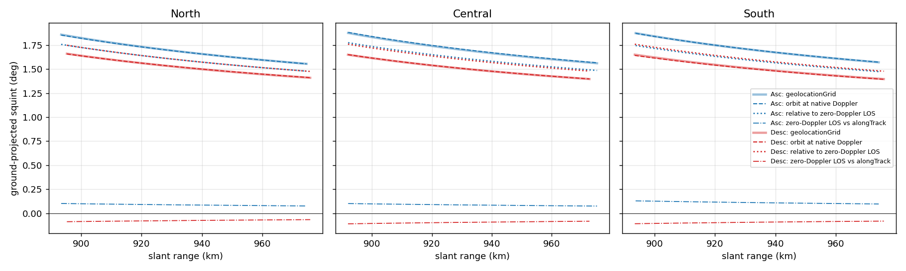
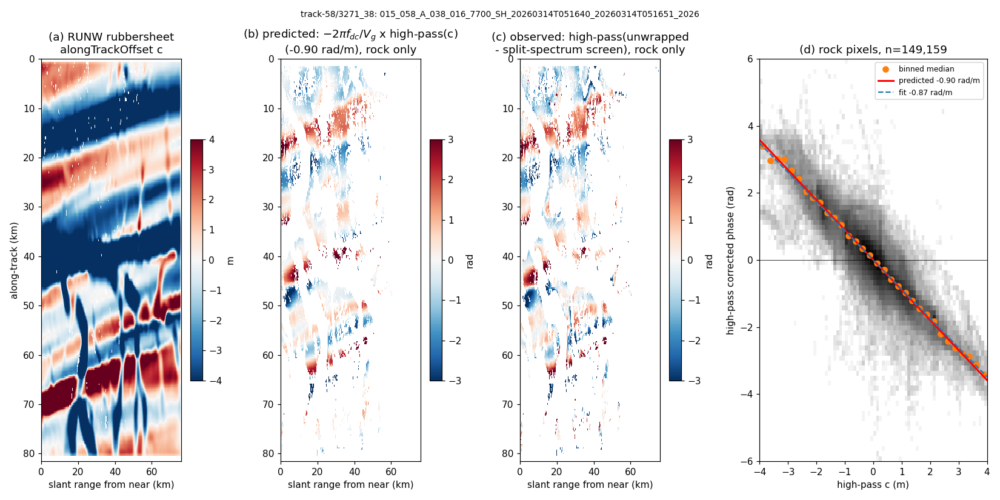
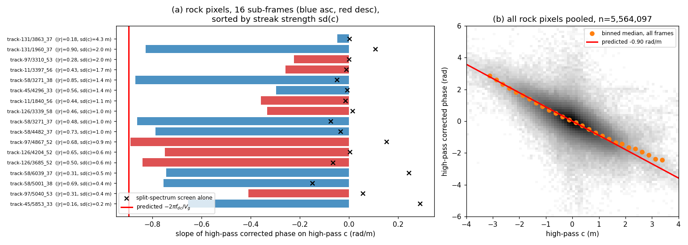
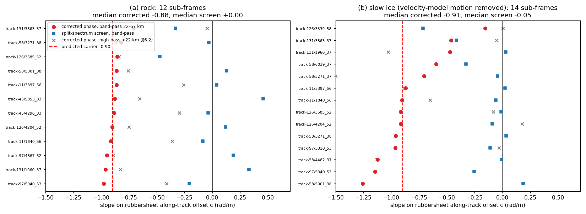
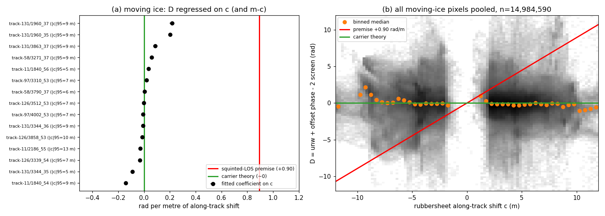
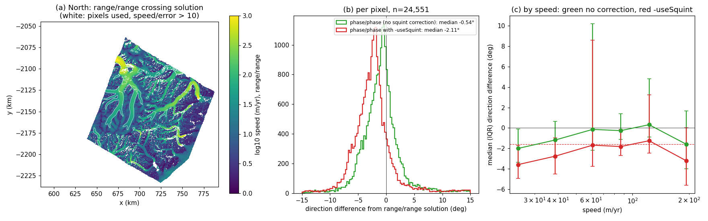

# Squint, Coregistration and the Ionosphere in Zero-Doppler InSAR

*What the interferometric phase of a squinted, zero-Doppler-processed SAR pair actually measures,
how coregistration decides it, and how the ionosphere and split-spectrum correction interact with
it — with tests on NISAR RUNW products over Greenland.*

This note supersedes the reasoning (not the arithmetic) of
[plotSquintError.md](plotSquintError.md). That document assumed the phase is sensitive along the
squinted line of sight; §3 shows this holds only for one coregistration choice, and not the one used
to make NISAR RUNW products.

**Summary of results**

1. A zero-Doppler focused SLC records, at each target's image peak, the phase of the
   **closest-approach (zero-Doppler) range**. In the azimuth-only, small-squint model used here (§2), squint does
   not enter the peak phase; it enters only through the azimuth **Doppler carrier** of the impulse
   response.
2. The carrier converts any azimuth **misregistration** between the coregistered secondary and the
   target's true position into phase. The interferometric phase is therefore
   $$\Delta\phi = \Delta\phi_{\text{zero-Doppler}} - 2\pi f_{dc}\,(c-d)$$
   where $c$ is the coregistration shift applied and $d$ the target's true along-track shift (in time).
   Coregistration that follows the target ($c=d$) gives broadside (zero-Doppler) sensitivity; fixed,
   geometry-only coregistration ($c=0$) gives the squinted line-of-sight sensitivity.
3. The NISAR RUNW products examined here (ISCE3 v0.25.8, rubbersheet coregistration) are rubbersheeted with dense offsets, so smooth along-track ice motion does
   **not** leak into the phase. The `-useSquint` correction in `mosaic3d` assumes it does, and would
   add a ≈1.6° rotation error to phase-derived velocities. Moving-ice data reject that premise (§6.4),
   and crossing-orbit phase directions agree with squint-free range-offset directions only without
   the correction (§6.5).
4. The ionosphere shifts targets in azimuth. A rubbersheet follows that shift too, and because the
   shift is frequency dependent this makes split-spectrum return the screen at **beam-centre** time
   while the main-band phase holds it extrapolated to **zero-Doppler** time. The corrected phase keeps
   a residual $`-2\pi f_{dc}\,s`$, where $s$ is the ionospheric azimuth shift: ≈0.9 rad per metre of shift
   for NISAR. The RUNW data are consistent with both the carrier term and this residual (§6.2, §6.3).
5. The $`-2\pi f_{dc}\,c`$ term is directly visible in NISAR RUNW phase, at the predicted slope of
   $`-2\pi f_{dc}/V_g\approx-0.9`$ rad/m (§6).

---

## 1. Geometry and notation

| Symbol | Meaning | NISAR, Greenland frames |
|---|---|---|
| $\lambda$, $`f_0`$ | carrier wavelength, frequency | 0.2384 m, 1257.5 MHz |
| $f$ | centre frequency of a (sub-)band | $`f_0 \pm 25.7`$ MHz for split-spectrum |
| $t$ | azimuth (zero-Doppler) time | |
| $V$, $`V_g`$ | platform speed, ground-track speed at the target | 7558 m/s, ≈6800 m/s |
| $`f_{dc}`$ | Doppler centroid at $`f_0`$ | 960–976 Hz |
| $\psi$ | 3-D squint relative to the platform velocity, $`\sin\psi=\lambda f_{dc}/2V`$ | 0.87–0.88° ($`\sin\psi\approx0.0153`$); ≈1.4–1.9° when projected on the ground |
| $`k_a`$ | azimuth FM rate, $`\approx -2V V_g/\lambda R`$ | ≈ −464 Hz/s |
| $`\tau_c=t_c-t_0=f_{dc}/k_a`$ | beam-centre time minus zero-Doppler time | ≈ −2.1 s (beam centre *before* zero Doppler) |
| $c$, $d$, $s$ | coregistration shift; true non-dispersive (motion) shift; ionospheric shift — all azimuth time, secondary relative to reference | |
| $`\Phi_{\text{bc}}`$, $`\Phi_{\text{zd}}`$ | differential ionospheric phase screen (radians at $`f_0`$), evaluated at beam-centre time $`t_c`$ / extrapolated to zero-Doppler time $`t_0`$ | differ by $`2\pi f_{dc}s_0`$ (§5.1) |
| $`\Phi_{\text{SS}}`$ | the RUNW `ionospherePhaseScreen` (split-spectrum estimate, filtered) | |
| $`s_0`$, $`s_f`$ | ionospheric azimuth shift (s) at $`f_0`$ / at band frequency $f$ (subscripts on $s$, $f$, $\lambda$ denote frequency; on $\Phi$ and $t$, time) | |
| $`\kappa=\lambda f_{dc}/2V_g=(V/V_g)\sin\psi`$ | equivalent range per metre of uncompensated along-track ground displacement (dimensionless coupling). It is not $\sin\psi$: a ground shift $`\Delta a`$ is a time shift $`\Delta a/V_g`$, during which the platform moves $`(V/V_g)\Delta a`$. It is also not a line-of-sight angle; see §3.3 | 0.0170 |
| $`2\pi f_{dc}/V_g`$ | the same in phase | 0.90 rad/m |

Conventions: SLC phase $e^{-j4\pi R/\lambda}$; interferogram reference × conj(secondary); shifts are
secondary position minus reference position. These are the conventions under which the measured slope
in §6 has the sign derived here.

---

## 2. The focused point target

A target at closest-approach range $`r_0`$ and zero-Doppler time $`t_0`$ produces a raw azimuth phase
history $-4\pi R(t)/\lambda$, with $`R(t)\approx r_0 + V V_g (t-t_0)^2/2r_0`$. It is observed only while
the antenna beam, centred at $`t_c=t_0+\tau_c`$, illuminates it. The instantaneous Doppler
$`k_a(t-t_0)`$ is $`f_{dc}`$ at beam centre: the squint is just the statement that the illuminated part of
the hyperbola is not centred on its apex.

Zero-Doppler focusing matches the hyperbola about its apex and places the target at $`t_0`$. Near the
peak the focused response is

$$
S(t) \simeq A\,\mathrm{sinc}\big(B_a(t-t_0)\big)\; e^{\,j2\pi f_{dc}(t-t_0)}\; e^{-j4\pi r_0/\lambda} \tag{1}
$$

- The **peak phase** is set by $`r_0`$ alone. The gradient of $`r_0`$ with respect to target position is
  the zero-Doppler (broadside) line of sight, because $\partial R/\partial t=0$ at $`t_0`$.
- The **squint** appears only in the carrier $`e^{j2\pi f_{dc}(t-t_0)}`$. It decides which part of the
  azimuth spectrum carries energy, not which geometry the phase reports.

So the phase of a zero-Doppler image is a broadside measurement *at the peak*. Any squint
dependence must come from where the peak is sampled, which is decided by coregistration.

*Scope of this model.* Eq. (1) is the azimuth cut of the impulse response. The full squinted 2-D
response also has range–azimuth coupling and a range phase ramp (Bara et al., 2000,
[doi:10.1109/36.868875](https://doi.org/10.1109/36.868875)). These matter when range alignment changes. The derivation assumes that
reference and secondary are sampled at corresponding range positions, or that those terms are
negligible. That is reasonable at NISAR's ≈0.9° squint, but the azimuth-only argument does not by
itself establish the full 2-D phase behaviour.

**Implication:** squint by itself does not change what zero-Doppler phase measures. Any squint dependence comes from where coregistration samples the secondary relative to its peak.

---

## 3. Motion between passes and the role of coregistration

### 3.1 Along-track motion is a time shift

For a straight track, translating a target along-track by $\Delta a$ produces exactly the same echo
history delayed by $`d=\Delta a/V_g`$. The beam is fixed to the platform, so beam-centre time and range
shift with it. Cross-track motion changes $`r_0`$, and hence the peak phase. Along-track motion changes
only *when* the target is seen: the information about $\Delta a$ is in the azimuth position, not in the
peak phase.

### 3.2 The sampled phase

The secondary is resampled so that the sample written at reference time $t$ is taken from secondary
time $t+c$. If the resampler deramps and reramps the Doppler carrier (as ISCE3's `resample_slc`
does), the output is exactly $S(t+c)$. The secondary peak lies at $`t_0+d`$, so from Eq. (1) the
interferogram picks up a carrier phase:

$$
\Delta\phi = \frac{4\pi}{\lambda}\Delta r_0 \;-\; 2\pi f_{dc}\,(c-d)
= \frac{4\pi}{\lambda}\Big[\Delta r_0 - \kappa\,(\Delta a_c-\Delta a)\Big] \tag{2}
$$

(With reference × conj(secondary) and $`e^{-j4\pi R/\lambda}`$, a range increase of the secondary gives
positive phase. This is the NISAR convention, in which motion cancels in the sum of unwrapped phase and
range-offset phase, as used by `estimateIonosphere`.)

where $`\Delta a_c=V_g c`$ is the applied coregistration shift on the ground.
(A misregistration also costs coherence through the sinc. That limits how large $c-d$ can be before
the phase is lost, but does not change Eq. 2.)

### 3.3 The two limits

| Coregistration | $c$ | Phase sensitivity |
|---|---|---|
| Geometry only (DEM + orbits) | 0 | $`\Delta r_{\text{eff}}\simeq\Delta r_0 + \kappa\,\Delta a`$: the first-order displacement sensitivity of a fixed-pixel interferogram, i.e. squinted-line-of-sight-like sensitivity. $\kappa$ is a processing coupling, not a line-of-sight angle. Measured on tracks 58 and 97, the along-track component of the beam-centre line of sight at the target is 0.0164–0.0175, within ≈±3% of $\kappa=0.0170$ with opposite sign for ascending and descending. So the two should not be identified, and no cosine factor is implied for $`\Delta r_0`$ |
| Follows the target (rubbersheet with dense offsets) | $d$ | $`\Delta r_0`$ only: broadside, zero-Doppler |
| Partial (smoothed rubbersheet) | $d-\varepsilon$ | $`\Delta r_0 + \kappa V_g\varepsilon`$: leakage of the *unfollowed* motion only ($`V_g\varepsilon`$ in ground metres) |

Both limits are physically correct; they answer different questions. A fixed-pixel interferogram
measures range change from a fixed point in space and therefore sees the squinted line of sight. A
peak-following interferogram measures the change in closest-approach range.

**Offsets.** Speckle tracking locates peaks. Range offsets therefore measure $`\Delta r_0`$ and azimuth
offsets measure $d$, both in zero-Doppler geometry, whatever the squint. No squint correction applies
to offsets.

**NISAR numbers.** $\kappa = 0.017$. One metre of along-track motion missed by the coregistration
gives 1.7 cm of apparent range, 0.9 rad of phase, or ≈0.5 m/yr of line-of-sight velocity for a
12-day pair. NISAR's azimuth resolution is ≈7 m, so without a motion-following rubbersheet, ice
faster than ≈200 m/yr would be misregistered by about a resolution cell in 12 days and lose much of
its coherence. This is not a hard threshold. Coherent fast ice in a RUNW indicates the coregistration
largely followed the motion, but does not prove exact peak following.

**Implication:** when the coregistration follows the motion, as in NISAR RUNWs, phase measures closest-approach range change, so use broadside (zero-Doppler) geometry. The squinted-line-of-sight formula applies only to fixed-pixel (geometry-only) coregistration. Offsets never need a squint correction.

---

## 4. Variable and large squint

### 4.1 TOPS (Sentinel-1)

In TOPS the beam is steered, so $`f_{dc}(\eta)`$ sweeps through several kHz within each burst,
equivalent to about ±0.5° of squint. Equation (2) holds pixel by pixel with $`f_{dc}\to f_{dc}(\eta)`$.
ISCE2 coregisters geometrically and applies one scene-wide shift from enhanced spectral diversity
(ESD), so spatially varying ice motion is not followed. The term $`-2\pi f_{dc}(\eta)(c-d)`$ is then a
ramp within each burst, with a discontinuity of $`2\pi\,\Delta f_{dc}\,(c-d)`$ ($`\Delta f_{dc}\approx`$
4–5 kHz) at every burst boundary. Removing $`2\pi f_{dc}(\eta)\,d_{\text{map}}`$ with a velocity map is
exactly the correction Eq. (2) requires.

Two consequences:
- Residual jumps measure $`d-d_{\text{map}}`$: this is burst-overlap interferometry.
- An ESD estimate pooled over moving ice absorbs part of the ice motion into its "timing" constant,
  leaving same-sign jumps everywhere. ESD should be estimated over stationary ground, or after the
  map-predicted overlap phase has been removed.

The mean Doppler of Sentinel-1 is near zero, so the uncorrected error is a zig-zag pattern rather
than a rotation. The same physics in NISAR stripmap, with a constant ≈970 Hz carrier, produces
smooth leakage with no discontinuity to reveal it.

**Implication:** with geometric coregistration plus ESD, Sentinel-1 ice motion appears as burst-boundary jumps. Removing $`2\pi f_{dc}(\eta)\,d_{\text{map}}`$ is the correct fix, and ESD should be estimated off moving ice.

### 4.2 Strongly squinted acquisitions (e.g. ±45°)

The local carrier–misregistration principle still applies, but the small-squint expressions above
cannot simply be extended by substituting a larger Doppler centroid. At ±45° the range–azimuth
coupling, the nonlinear phase history, the different line-of-sight geometry and orbit curvature need
a fuller model. The numbers below are first-order, order-of-magnitude scalings only:

| | NISAR ($\psi\approx0.9°$) | $\psi=45°$, L-band |
|---|---|---|
| $`f_{dc}`$ | 970 Hz | ≈45 kHz (many PRFs) |
| Equivalent range per metre of along-track ground displacement | $\kappa=0.017$ | ≈0.7 (first-order scaling only) |
| Along-track motion per fringe | ≈7 m | 0.17 m |
| Phase per cm of misregistration | 0.009 rad | 0.37 rad |

A fore/aft squint mission measures along-track motion through the carrier, so it must *not* follow the
motion in coregistration. Equivalently, it may follow the motion and add back $`2\pi f_{dc}c`$, since $c$
is known exactly. Fore minus aft then gives $\approx2\sin\psi\,\Delta a$; this is multiple-aperture
InSAR (MAI) with a large aperture split.

The practical difficulties are:
- **Coregistration accuracy:** the phase is equally sensitive to timing and geometric errors.
- **Coherence versus following:** fast motion must be followed to stay coherent, which removes the
  term unless it is added back.
- **Processing geometry:** the zero-Doppler time of a target is $`r_0\tan\psi/V\approx100`$ s
  (≈700 km of orbit) from its acquisition, where orbit curvature and Earth rotation break the
  straight-track picture. Native-squint processing is therefore preferred. Zero-Doppler output is not
  wrong in principle, but it is harder to make accurate.

**Implication:** a fore/aft squint mission gets along-track sensitivity only if its coregistration does not follow the motion, or if the applied shift is added back. The carrier–misregistration principle carries over from NISAR, and the coupling grows from 0.017 to roughly 0.7. A quantitative treatment also needs the range–azimuth coupling, nonlinear phase, line-of-sight geometry and orbit curvature noted above.

---

## 5. The ionosphere

### 5.1 Ionospheric azimuth shifts

A differential ionospheric screen contributes a phase proportional to $1/f$. Its gradient along the
synthetic aperture is a linear phase in slow time, i.e. a Doppler offset $`f_i\propto1/f`$. Azimuth
compression converts a Doppler offset into a shift $`s=-f_i/k_a`$. Since $`k_a\propto f`$,

$$
s_f = s_0\,(f_0/f)^2 . \tag{3}
$$

Focusing with this ramp gives a peak phase (radians) equal to the screen *extrapolated along the
ramp* to zero-Doppler time, $`\Phi_{\text{zd}}`$, rather than its value at beam centre, $`\Phi_{\text{bc}}`$. The two differ by the
ramp over $`\tau_c`$: $`\Phi_{\text{bc}}-\Phi_{\text{zd}} = 2\pi f_{dc}\,s_0`$. At a 300–350 km shell, the beam-centre and
zero-Doppler rays pierce the ionosphere ≈6 km apart along-track.

### 5.2 The band phase equation

Repeat §3.2 for a band at frequency $f$, with $`f_{dc}\to f_{dc}f/f_0`$ (fixed squint angle), the
non-dispersive phase $`\phi_{\text{mot}}\propto f`$, the ionospheric peak phase $`(f_0/f)\Phi_{\text{zd}}`$, and the
same coregistration shift $c$ applied to every band (as when sub-bands are cut from one coregistered
secondary):

$$
\phi_f = \frac{f}{f_0}\Big[\phi_{\text{mot}} - 2\pi f_{dc}\,(c-d)\Big] \;+\; \frac{f_0}{f}\,\Phi_{\text{bc}} . \tag{4}
$$

Equation (4) is the central result. It splits the phase into a **non-dispersive** part, ∝ $f$, and a
**dispersive** part, ∝ $1/f$:

- Under the assumptions of this derivation, the **dispersive part is $`\Phi_{\text{bc}}`$, whatever the common
  shift $c$**. Those assumptions are: a locally linear ionospheric ramp, one shift applied to all
  bands, fixed-squint frequency scaling, and consistent sub-band sampling and phase conventions.
  Split-spectrum, which separates ∝ $f$ from ∝ $1/f$, then returns the screen at beam-centre time.
  This is not universal: for arbitrary screens, different apertures or frequency-dependent warps it
  can differ. The per-band row of §5.3 is one exception.
- The **coregistration leakage is non-dispersive**. Ice leakage, $`-2\pi f_{dc}(c-d)`$, is ∝ $f$ like
  motion, so split-spectrum leaves it in place.
- With $c=0$ the main band holds $`\Phi_{\text{bc}}`$: a fixed-pixel interferogram samples the ionosphere where
  the beam actually crossed it.

### 5.3 Split-spectrum-corrected phase for each coregistration choice

The split-spectrum-corrected main-band phase is $`\phi_{f_0}-\Phi_{\text{bc}} = \phi_{\text{mot}}-2\pi f_{dc}(c-d)`$.
Writing $c$ in terms of what the coregistration follows:

| Coregistration $c$ | Main band holds | Split-spectrum returns | Corrected phase − $`\phi_{\text{mot}}`$ |
|---|---|---|---|
| 0 (geometry only) | $`\Phi_{\text{bc}}`$, plus ice leakage | $`\Phi_{\text{bc}}`$ | $`+2\pi f_{dc}\,d`$ (squinted LOS, §3.3) |
| $`d+s_0`$ (full rubbersheet; ISCE3 / NISAR) | $`\Phi_{\text{zd}}`$ | $`\Phi_{\text{bc}}`$ | $`-2\pi f_{dc}\,s_0`$ ✗ **double counting** |
| $d$ (follow ice, not ionosphere) | $`\Phi_{\text{bc}}`$ | $`\Phi_{\text{bc}}`$ | 0 ✓ |
| $`d+s_f`$ per band (each band on its own peak) | $`\Phi_{\text{zd}}`$ | $`\Phi_{\text{zd}}`$ | 0 ✓ |

"Double counting" here is shorthand for **a residual carrier phase that is excluded from the
dispersive estimate**. The azimuth effect of the ionosphere is compensated by the coregistration but
is then not reflected in the screen; no TEC is literally counted twice. The mechanism is as
follows. The rubbersheet removes the ionospheric
misregistration from the main band, so the main band holds $`\Phi_{\text{zd}}`$. Each sub-band, however, is
displaced by about ±4% of $`s_0`$ from its own peak (Eq. 3). Through the carrier this gives a small
phase difference between the sub-bands, which split-spectrum amplifies by roughly the inverse of that
4% and so reconstructs the full $`\Phi_{\text{bc}}`$. Subtracting $`\Phi_{\text{bc}}`$ from a band that holds $`\Phi_{\text{zd}}`$ leaves
$`-2\pi f_{dc}s_0`$: 0.9 rad per metre of ionospheric shift, shaped like the azimuth streaks, and
indistinguishable from real non-dispersive signal.

**Implication:** with one rubbersheet that follows the ionospheric shift and is shared by all bands, split-spectrum-corrected phase keeps $`-2\pi f_{dc}s_0`$, ≈0.9 rad per metre of ionospheric azimuth shift.

### 5.4 Remedies

- **Follow only the non-dispersive part** in the rubbersheet. Over ice this needs a model, because the
  ionospheric and ice parts of the dense offsets cannot be separated from the offsets alone.
- **Coregister each band with its own modelled shift**, $`c_f=d+s_0(f_0/f)^2`$. The scaling must be
  modelled: the differential shift is ≈4 cm per metre of $`s_0`$, and sub-band offsets measured
  independently are far too noisy. With 0.02-pixel (≈9 cm) offset noise, the carrier phase errors
  amplified by split-spectrum (≈12×) reach ≈1 rad. An iteration works: estimate the screen,
  predict $s$, resample per band, re-estimate.
- **Correct afterwards (simplest):** add $`2\pi f_{dc}(c-d)`$ to the split-spectrum-corrected phase,
  with $c$ the applied residual shift beyond geometric registration and $d$ from a velocity model, both
  in seconds. Equivalently, in ground metres, add $`(2\pi f_{dc}/V_g)(\Delta a_c-\Delta a_{\text{model}})`$. The
  remaining error is $`2\pi f_{dc}(d_{\text{true}}-d_{\text{model}})`$ in phase, i.e.
  $`\kappa(\Delta a_{\text{true}}-\Delta a_{\text{model}})`$ in range. This removes the residual carrier
  and residual ice leakage together. In the slow interior, where $d$ is small and smooth, it reduces
  to adding $`(2\pi f_{dc}/V_g)`$ × the rubbersheet along-track offset.

### 5.5 What ISCE3 actually does

Checked against ISCE3 tag `v0.25.8`, the version that produced the RUNWs used here (`git show
v0.25.8:<path>` in `~/isce3`; HEAD is 0.26-dev and differs in `rubbersheet.py`, `ionosphere.py` and
`crossmul.py`):

- **Resampling keeps the carrier.** `cxx/isce3/image/Resample.cpp:116-169` deramps each chip with the
  *secondary's* native Doppler LUT, sinc-interpolates, and reramps with `doppler_freq × fractional
  index`. The output is $S(t+c)$, which is the assumption behind Eq. (2).
- **Sub-bands share the main-band coregistration.** `split_spectrum` cuts low and high sub-band RSLCs
  from the original, uncoregistered RSLCs. `ionosphere.insar_ionosphere_pair` then resamples each with
  the same geometry-plus-rubbersheet offsets as the main band (`ionosphere.py:577,633-690`). There is no
  per-band scaling of offsets and no compensation for ionospheric azimuth shifts. This is the
  $`c=d+s_0`$ row of the table in §5.3.
- **Rubbersheet:** median-filter culling (9×9, 0.75 px), `fill_smoothed`, then a 5×5 boxcar on the
  dense grid, interpolated bilinearly and added to the geo2rdr offsets. The RUNW
  `pixelOffsets/alongTrackOffset` is this culled, filled, filtered residual field (excluding geometry),
  in ground metres, as secondary minus reference (`rubbersheet.py:352-386` at v0.25.8). The applied SLC-grid warp
  is this field interpolated bilinearly and added to the geo2rdr offsets. So the layer should equal
  the applied $`\Delta a_c`$ on the dense grid. This rests on reading the source with default settings.
  It has not been verified bit-for-bit against a product, and the products' embedded run
  configuration is empty. Verify it before any operational correction (§8).
- **Screen estimate:** `main_diff_low_high_subband` combines the main-band unwrapped phase with the
  unwrapped high × conj(low) difference. It is filtered with an inverse-variance-weighted Gaussian
  (kernel 100, σ = 33 RUNW pixels ≈ 2.4 km in azimuth, 1 iteration). `unwrap_correction` is on by
  default, although these products report `False`.
- **Flattening** uses the geo2rdr range offsets only, so ice motion in range stays in the phase.

**Implication:** ISCE3 v0.25.8 is the $`c=d+s_0`$ row of §5.3, with no later correction. RUNW corrected phase should therefore carry the double-counting residual; this is tested in §6.3.

### 5.6 Phase-minus-group-delay estimators

GrIMP's `estimateIonosphere` estimates the screen as (phase + range-offset phase)/2, using the
opposite signs of phase advance and group delay. Range offsets locate peaks, so they contain no
carrier term. Any non-dispersive, phase-only leakage, such as $`-2\pi f_{dc}(c-d)`$, therefore enters
this estimate at half amplitude, and an unwrapping error of $2\pi$ enters as π. Whether range offsets
see the group delay at beam centre or extrapolated to zero Doppler is not settled here. It decides
whether this estimator also carries a $`\pm\pi f_{dc}s_0`$ term.

**Implication:** GrIMP's own screen avoids the carrier term only partly. It may carry up to half of the residual, depending on which group delay the range offsets see. This is untested.

---

## 6. Experiments with existing NISAR data

All tests use RUNW products (ISCE3 0.25.8, CRID P05012/X05010), GrIMP's rock/ice/water and slow-flow
masks, GrIMP's own ROFF-derived range and azimuth offsets, and `mosaic3d`. No SLC reprocessing was
done. Code: [`nisarerrors/squintCarrierTests.py`](../nisarerrors/squintCarrierTests.py).

| Test | Question | Prediction (this note) | Alternative | Result |
|---|---|---|---|---|
| §6.1 | Is the geolocation-grid squint the Doppler centroid? | yes | artefact | yes, to 0.008° |
| §6.2 | Does RUNW phase contain $`-2\pi f_{dc}c`$ (rock)? | slope −0.90 rad/m | 0 | −0.81 pooled; −0.74 to −0.89 in 9 of 16 frames |
| §6.3 | Does the split-spectrum screen contain the carrier term? (22–67 km band) | no: screen slope 0, corrected −0.90 | screen −0.7, corrected 0 | screen +0.00 / −0.05, corrected −0.88 / −0.91 (rock / slow ice) |
| §6.4 | Does moving ice leak into phase ($`+2\pi f_{dc}d`$)? | ≈0 | +0.90 rad/m (`-useSquint` premise) | −0.05 rad/m pooled, 15 frames |
| §6.5 | Crossing-orbit flow direction, phase vs range offsets | 0° | −1.6° with `-useSquint` | −0.07° ± 0.48° (no correction) vs −1.69° ± 0.49° (`-useSquint`) |

### 6.1 The squint is the Doppler centroid

For six RUNWs (ascending/descending pairs in north, central and south Greenland), the line of sight
was recomputed from the reference orbit (cubic Hermite interpolation of the state vectors) at the
**native-Doppler time**: the time at which the Doppler equals the product's `dopplerCentroid` LUT,
≈2.0–2.2 s before zero Doppler. Its ground heading reproduces the `geolocationGrid` `losUnitVector`
squint to ≈0.003° across the swath; for track 58, for example, 1.854° vs 1.859° at near range and
1.558° vs 1.558° at far range. The zero-Doppler time found from the same orbit matches the grid's
`zeroDopplerTime` to better than 0.1 ms.

At the zero-Doppler time the residual "squint" against `alongTrackUnitVector` is +0.08° ascending
and −0.08° descending. This is an artefact of how the along-track vector is defined, and it accounts
for the 0.18° ascending/descending asymmetry reported in [plotSquintError.md](plotSquintError.md).
Measured against the zero-Doppler line of sight, the squint is the same on both passes, 1.58–1.60° at
mid-swath in all three regions (Fig. 1).

**Figure 1.** Ground-projected squint against slant range for three ascending/descending pairs.
- Thick: the `geolocationGrid` values.
- Dashed: recomputed from the orbit at the native-Doppler time.
- Dotted: measured against the zero-Doppler line of sight.
- Dash-dot: the zero-Doppler residual against `alongTrackUnitVector`, i.e. the definition artefact.

**Implication:** the ≈1.6° squint is real Doppler (≈970 Hz) and is the same on both passes. The ascending/descending difference in [plotSquintError.md](plotSquintError.md) is an artefact of how the along-track vector is defined, so the per-pass squint values used by `-useSquint` are off by ±0.08°.

### 6.2 The carrier term in RUNW phase

On rock $d=0$, so by Eq. (4) the split-spectrum-corrected phase is $`-2\pi f_{dc}c`$ plus real
ionospheric structure the screen does not resolve, troposphere and noise. The rubbersheet offset $c$
over rock is the ionospheric azimuth shift plus a constant. To isolate the carrier term, both fields
are high-passed with the same rock-pixel mask (normalised Gaussian, σ = 50 RUNW pixels ≈ 3.6 km), which
keeps the azimuth streaks. For a statistically stationary screen, a phase screen and its own
along-track gradient have zero covariance in expectation. Pure ionosphere therefore predicts no
*systematic* correlation between the high-passed phase and $c$. Finite, masked, weighted samples
can show chance correlation. Agreement in sign and approximate magnitude across multiple frames, both
pass directions and three regions strengthens the carrier interpretation, although shared processing
effects and sample dependence have not been excluded. The carrier
predicts a slope of $`-2\pi f_{dc}/V_g = -0.89`$ to $-0.92$ rad/m, computed per frame from its own
$`f_{dc}`$ and $`V_g`$.

Pixels used: rock in the GrIMP mask, coherence > 0.5, connected component > 0, demeaned per connected
component, and a plane plus DEM height removed.

**Figure 2.** Track 58, frame 38, 14/26 March 2026.
- (a) The RUNW rubbersheet along-track offset: ionospheric azimuth streaks of ±4 m.
- (b) The predicted carrier phase, $-0.90$ rad/m × high-passed $c$, on rock.
- (c) The observed high-passed split-spectrum-corrected phase on rock.
- (d) Observed against $c$: fitted slope −0.87 rad/m against a predicted −0.90 (|r| = 0.85).

**Figure 3.** (a) Fitted high-pass slope for 16 sub-frames (ascending and descending, three regions),
sorted by streak strength. Crosses show the slope of the split-spectrum screen alone. (b) All
5.6 million rock pixels pooled: the slope of the binned medians is −0.81 rad/m.

Nine of the 16 frames give −0.74 to −0.89 rad/m. Seven give −0.05 to −0.41, and these include most
frames with the strongest streaks: sd(c) of 1.1–4.3 m, often in coastal relief where rock unwrapping
is least reliable. Filtering $c$ as ISCE3 does (median culling, then boxcar) did not restore their
slopes. That argues against offset noise (errors-in-variables bias) but does not exclude it. At longer
wavelengths (§6.3) the same frames show the full slope, so the departure is a short-wavelength effect. No frame has the opposite sign. Over slow interior ice the same test is dominated by km-scale flow features common to
the phase and the offsets, so it is not used.

**Implication:** RUNW phase contains $`-(2\pi f_{dc}/V_g)\times`$ the applied rubbersheet shift. The carrier mechanism of Eq. (2) is real, and the RUNW `pixelOffsets` layer alone is enough to predict it.

### 6.3 Does the split-spectrum screen contain the carrier term? (double counting)

ISCE3's screen filter (σ = 33 pixels) passes wavelengths longer than about 15 km, so at the high-pass
scale of §6.2 the screen is mostly smoothed away. The near-zero screen slopes in Fig. 3a are therefore
not evidence either way. The more direct test uses a band the screen does resolve: the difference of
Gaussian smoothings with σ = 50 and 150 pixels, i.e. wavelengths of about 22–67 km. In that band:
- **Double counting** (screen $`=\Phi_{\text{bc}}`$, Eq. 4): the screen is uncorrelated with $c$, and the
  corrected phase keeps the full −0.9 rad/m.
- **No double counting** (screen $`\approx\Phi_{\text{zd}}`$): the screen carries the carrier term (≈ −0.7 rad/m
  after filtering), and the corrected phase is near 0.

**Figure 6.** Band-pass slopes on $c$ for (a) rock and (b) slow interior ice, with motion from the
velocity model removed.
- Red: split-spectrum-corrected phase.
- Blue: the split-spectrum screen alone.
- Grey: the high-pass corrected phase of §6.2, for comparison.

| Band 22–67 km | Frames | Corrected phase, median slope | Screen, median slope (IQR) |
|---|---|---|---|
| Rock | 12 | **−0.88 rad/m** | **+0.00** (−0.11 … +0.14) |
| Slow ice | 14 | **−0.91 rad/m** | **−0.05** (−0.22 … +0.02) |

The split-spectrum screen does not contain the carrier term, and the corrected phase keeps all of
it, at the predicted −0.90 rad/m. This is consistent with the residual carrier phase ("double counting") of §5.3, in the band where
the screen is resolved, and with the ISCE3 code (§5.5), which applies one coregistration to every
sub-band. It is agreement with a prediction, not an independent causal test. Competing explanations
for a screen-independent correlation of −0.9 rad/m with $c$ have not been formally excluded,
although none is apparent.

The band-pass results also explain the weak frames of §6.2. Frames with high-pass slopes of only
−0.05 to −0.4 (track-131/3863_37, 45/4296_33, 11/3397_56, 11/1840_56) give −0.71 to −0.91 in the
band-pass. The departure is therefore confined to wavelengths shorter than about 20 km in frames with
strong streaks. That is consistent with the limit of the first-order model, in which the ≈10 km synthetic aperture at
the ionosphere averages the screen gradient, so the shift and the phase no longer follow the
linear-ramp relation for narrow streaks. It does not uniquely identify that cause.

**Implication: in the RUNWs examined (ISCE3 v0.25.8), the ionosphere correction is incomplete.** `unwrappedPhase − ionospherePhaseScreen` keeps ≈ −0.9 rad per metre of ionospheric azimuth shift: 1.7 cm of range, or ≈0.5 m/yr of line-of-sight velocity per metre for a 12-day pair. For the ±1–4 m shifts seen here, that is a 0.5–2 m/yr error following the azimuth streaks. It is non-dispersive, so it is indistinguishable from motion. **Fix:** add $`(2\pi f_{dc}/V_g)(\Delta a_c-\Delta a_{\text{model}})`$ with both displacements in ground metres, using the RUNW `pixelOffsets/alongTrackOffset` for $`\Delta a_c`$, once that layer is verified (§5.5). Equivalently, add $`2\pi f_{dc}(c-d_{\text{model}})`$ with both shifts in seconds. Within ISCE3, either coregister each sub-band with its own $`(f_0/f)^2`$-scaled ionospheric shift, or apply the same correction after split-spectrum.

### 6.4 Does moving ice leak into the phase? (the `-useSquint` premise)

Over moving ice, $`D = \phi_{\text{unw}} + \phi_{\text{rangeOffset}} - 2\Phi_{\text{SS}}`$ cancels the
motion (§5.6). By Eq. (2) the remaining coregistration-dependent part is $`-2\pi f_{dc}(c-d)`$. Let $m$
be GrIMP's own measured azimuth offset, so $m\approx d+s$, and regress $D$ on $c$ and $m-c$ (plus a
plane):
- **Carrier theory with a rubbersheet that follows the ice:** coefficient on $c$ ≈ 0, because $c$
  over moving ice is dominated by $d$, which cancels. Coefficient on $m-c$ (the unfollowed motion)
  +0.9.
- **Squinted-line-of-sight premise:** +0.9 on both.

Pixels used: ice, $|m|>2$ m, coherence > 0.6, demeaned per connected component, outliers clipped at
4 MAD.

**Figure 4.** (a) Coefficient on $c$ for 15 sub-frames with along-track shifts up to 5–13 m: −0.14
to +0.22, median ≈0.0. The premise predicts +0.90. (b) All 15 million pixels pooled: $D$ stays flat
as $c$ runs to ±12 m, with a binned-median slope of −0.05 rad/m. The premise line rises to ±10 rad.

The coefficient on $m-c$ is positive in most frames but scattered (−0.3 to +2.4; several near +0.9).
That is consistent with leakage of unfollowed motion, but $m-c$ is small and noisy, so this part is
not a quantitative confirmation.

**Implication:** for rubbersheeted products such as these NISAR RUNWs (ISCE3 v0.25.8 configuration), assuming zero-Doppler (broadside) geometry for the phase is correct. The phase does not see along-track ice motion through the squinted line of sight, so the premise of `-useSquint` is false for these products.

This holds up to the residual $`\kappa(\Delta a-\Delta a_c)`$ in range, with both terms in ground metres.
Because $`\Delta a_c`$ is the whole applied shift, $`\Delta a_c=\Delta a+\Delta a_{\text{iono}}`$ even with
perfect motion following, the residual includes both unfollowed ice motion and ionospheric shifts
followed by the rubbersheet. The ionospheric part, $`-\kappa\Delta a_{\text{iono}}`$, is the §6.3 residual
and occurs throughout the streaks, including in smooth flow. Only the unfollowed-motion contribution
is associated with inadequate tracking of flow, such as at shear margins and sub-km structure. That
contribution is what the $m-c$ regressor targets, since $m$ contains the ionospheric shift too. In this
test it is small and noisy: the coefficient on $m-c$ ranges
from −0.3 to +2.4 rad/m, with several frames near the predicted +0.9. It is therefore consistent with
the data, not quantitatively confirmed.

### 6.5 Crossing-orbit flow direction: phase/phase against range/range

This is the test that matters most for velocities. `mosaic3d` (hopper solver) was run on the same
inputs three ways:
- phase rows only;
- phase rows only with `-useSquint`;
- range-offset rows only (`-3dOff`), which is squint-free (§3.3).

The region is track 58 ascending × track 97 descending, North Greenland, using all 14 + 12 cycles.
Additive errors from baselines and ionosphere turn into direction errors ∝ 1/speed, so the comparison
uses only pixels where both solutions resolve direction well (speed/error > 10). Errors come from a
25 km block bootstrap.

**Figure 5.** (a) Range/range solution and the pixels used. (b) Distribution of the direction of each
phase solution relative to the range/range solution. (c) The same by speed.

| North, n = 24,551 pixels, 22 blocks | Direction relative to range/range |
|---|---|
| phase/phase, no squint correction | **−0.07° ± 0.48°** (block median) |
| phase/phase with `-useSquint` | **−1.69° ± 0.49°** |
| *for reference:* phase/phase with `-useSquint` relative to phase/phase without it | −1.60° (the same at every pixel, IQR 0.1°): the rotation the correction applies |

The ± values are standard deviations of 300 block-bootstrap resamples of the block-median direction
difference (25 km blocks). The two rows share the range solution, so they are not independent. The
uncorrected phase solution is consistent with the squint-free range solution. The `-useSquint`
solution lies 1.69° from it, about 3.4 bootstrap standard errors, assuming a roughly Gaussian
bootstrap distribution. Below ≈40 m/yr both phase solutions drift negative by about 1–2°, as expected from
additive biases at low speed. Between 60 and 150 m/yr the uncorrected solution is within 0.3° of the
range solution. An earlier run with three cycles per track gave the same ordering with larger errors.

Two other crossings were tried and are not used:
- **South (45 × 126):** almost no overlap between the solutions (≤180 pixels).
- **Central (131 × 11):** both phase solutions differ from the range solution by 11–13°, with a speed
  ratio of 0.53. This indicates a problem with the inputs (track 131 has only three complete frames),
  not squint.

**Implication:** `-useSquint` rotates NISAR phase-derived velocities 1.6° away from the squint-free solution. Leave it off.

---

## 7. Implications for GrIMP

- **`mosaic3d -useSquint` should stay off for RUNW phase** from the processing configuration checked here
  (ISCE3 v0.25.8, rubbersheet coregistration). Re-check if the NISAR processing changes. Its premise, phase sensitivity along the
  squinted line of sight, applies only to geometry-only coregistration (§3.3). The data reject it
  directly (§6.4), and turning it on moves crossing-orbit directions 1.6° away from the squint-free
  offset solution (§6.5).
- **Correct the carrier term with the modelled motion, not the full rubbersheet shift.** Add
  $`2\pi f_{dc}(c-d_{\text{model}})`$. Adding $`2\pi f_{dc}c`$ alone also adds $`2\pi f_{dc}d`$, which puts the
  phase back in the squinted, fixed-pixel geometry, i.e. what `-useSquint` assumes. With the model,
  the residual is $`2\pi f_{dc}(d_{\text{true}}-d_{\text{model}})`$ in phase, i.e.
  $`\kappa(\Delta a_{\text{true}}-\Delta a_{\text{model}})`$ in range: 1.7% of the along-track
  velocity-model error, in ground metres.
- **The squint values used by `-useSquint` include the ±0.08° along-track-vector artefact** (§6.1). If
  the correction is ever needed, for example with geometry-only data, derive the effective rotation from
  the coupling $\kappa$ (i.e. from $`f_{dc}`$ and $`V_g`$). Do not use the `geolocationGrid` squint: the
  geometric beam-centre squint differs from $\kappa$ by a few percent (§3.3).
- **RUNW phase carries $`-2\pi f_{dc}(c-d)`$**, which is streak-shaped wherever ionospheric azimuth
  shifts are strong. It can be removed with the rubbersheet offsets stored in every RUNW
  (`pixelOffsets/alongTrackOffset`) and a velocity model (§5.4).

## 8. Open questions

- Whether range offsets see the beam-centre or the zero-Doppler group delay (§5.6).
- Bit-for-bit verification that `pixelOffsets/alongTrackOffset` equals the applied residual warp. This
  covers the write path, filtering stage, interpolation to the SLC grid, units, sign, and mapping to the
  interferogram grid. It is required before using the layer for an operational correction (§5.5).
- A 2-D (range–azimuth) treatment of the squinted impulse response, to bound the terms neglected in §2.
- How the carrier relation degrades for narrow, strong streaks below ≈20 km wavelength (§6.3). A
  second-order model that averages the screen gradient over the aperture should be tested against
  the high-pass slopes.
- Why the central crossing (131 × 11) fails.
- The empirical gain of 0.4 in `azIonoCorrection.py`. The theoretical scale `kTheory` implicitly
  assumes the slow-time and image-row screen gradients are equal, which in a flat thin-shell picture
  means a shell at $h\approx H/2$. A gain of 0.4 suggests a lower effective height, about 200 km,
  for example from auroral E-region structure. This is untested.
