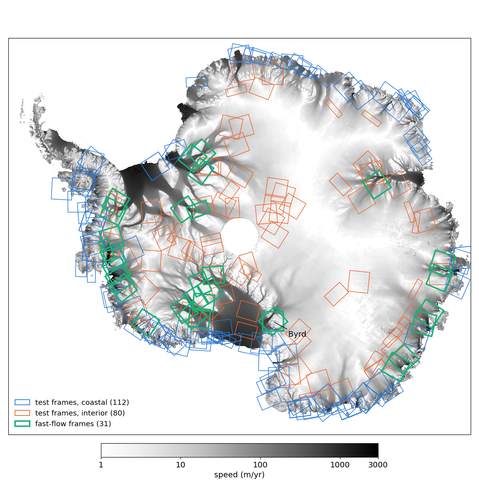
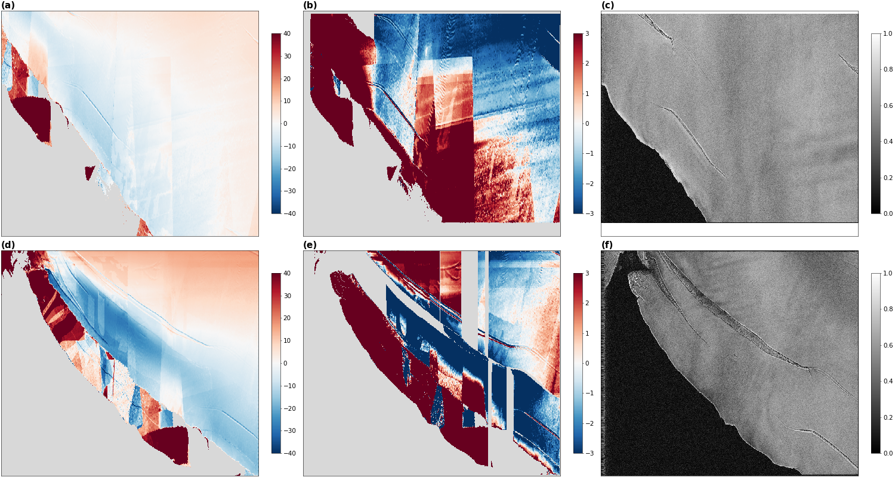
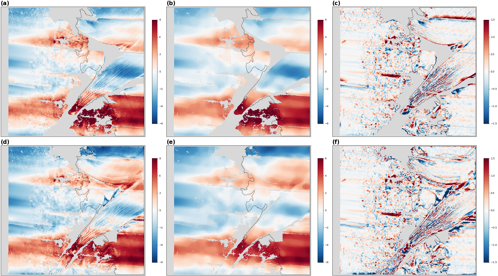
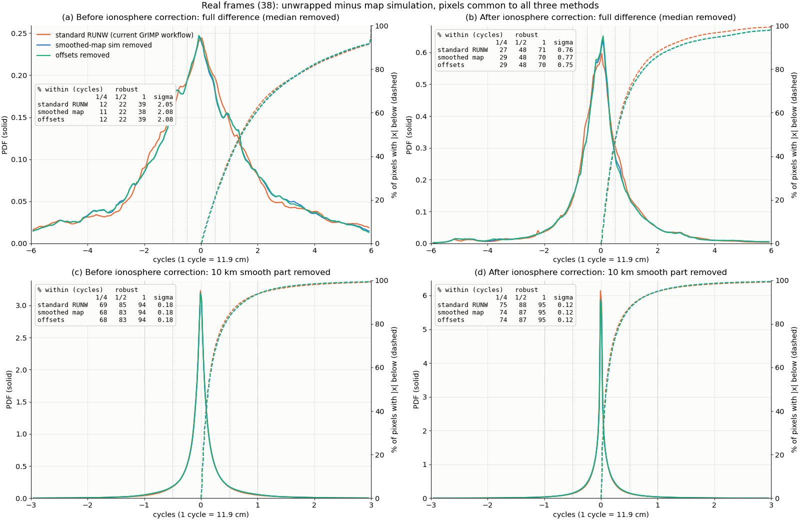

# Unwrapping NISAR interferograms with a reference removed: velocity map or range offsets

**Status: draft, 2026-11-17.** All runs described here are complete (Section 1.5 lists what was run on which
frames). The real-data results are for 223 Antarctica40 frames: 192 of the frames of the synthetic test of
`snaphuTilingMasking.md` (the *test frames*, 112 coastal and 80 interior) and 31 frames chosen for fast flow (the
*fast-flow frames*). Results are given for all 223 together, and broken down by set (fast-flow, coastal test,
interior test) where the sets differ.

## Purpose

The purpose of these experiments is to establish whether removing an estimate of the motion before unwrapping
improves NISAR phase unwrapping, and which estimate to use: a simulation from the NISAR velocity map, or the
interferometric pair's own range offsets. "Improves" has two parts, and both are tested:

- **Coverage and consolidation.** Does more of the frame unwrap, and does it unwrap in fewer, larger connected
  components, so that fewer whole-cycle offsets between components have to be resolved afterwards?
- **Accuracy.** Are the larger components correct, or are we just getting bigger but noisier components, with
  whole-cycle errors hidden inside them?

**Terms.** *Standard RUNW*: the NISAR L1 RUNW product as delivered, with the unwrapped phase and connected components
of the NISAR processing system. *Current GrIMP workflow*: our processing of the standard RUNW today, whose ionosphere
step (the GrIMP offset-phase difference correction) also resolves the whole-cycle offset of each component against the
map simulation. *New unwrappings*: the standard RUNW's wrapped phase unwrapped again here with a reference removed
(Section 1.1), then put through the same GrIMP ionosphere step.

## Summary

Fast ice flow aliases the interferometric phase: across shear margins and in fast, narrow outlets the phase changes by
more than half a cycle between pixels, which creates residues that make the unwrapped solution ambiguous there and
prone to cycle errors. The standard RUNW therefore breaks fast-flowing areas into separate components (a median of 2
of 5% or more of the frame on the 31 fast-flow frames). Removing a good estimate of the motion before unwrapping removes
residues caused by that aliasing, so the residual phase has fewer residues and can be unwrapped in larger pieces; the
estimate is added back afterwards, so the result still agrees with the wrapped phase to whole cycles. Figure 1 shows
an example on Byrd Glacier: the standard RUNW breaks the fast flow and the shelf into separate components (Figure 1a),
while with either reference removed the frame unwraps as one component (Figure 1b, c), and the two new unwrappings
agree on all but 0.3% of their common pixels, where they differ by one cycle (Figure 1d).

Results:

- **Recommendation (provisional).** Unwrap with a reference removed where it reduces the residues: the range offsets
  where they cover more than 95% of the ice, otherwise the 1 km smoothed map, and never the unsmoothed map (Section 4).
- **Residues and consolidation.** On the 223 real frames, removing either reference reduces the residues on 142-145
  frames (median 0.97 of the original count) and raises the median largest component from 68% to 79-80% of the valid
  ice, and the total unwrapped from 82% to 86-87% (Sections 2.3 and 3.1). The gain is concentrated in fast flow: on the
  31 fast-flow frames the residues fall by a median 20-23% and the largest component rises from 55% to 80-81%; on the
  coastal test frames it rises from 51% to 65%, and on the interior test frames, which the standard RUNW already
  unwraps as nearly one component, from 96% to 97%.
- **Which reference.** The offsets leave the fewest residues on 67 of the 131 real frames whose offsets cover more than
  95% of the ice, against 36 for the smoothed map; on the 92 frames with larger gaps in the offsets the smoothed map
  is better (55 against 20). The unsmoothed map adds residues on 9 of 11 frames tested, through seams and short-scale
  errors in the mosaic (Section 2).
- **Accuracy.** In the synthetic test, where the truth is known, the larger components are more accurate, not less:
  with the real offsets as the reference the mean share of wrong pixels in the largest component falls from 1.65% to
  0.89%, and with synthetic offsets that see the same motion as the phase to 0.13% (Section 3.2.1). On the real
  frames the two references, which are independent of each other, give the same unwrapping on a median 99.94% of
  pixels, and against the map simulation the new unwrappings are as close as the standard RUNW (current GrIMP workflow)
  on the pixels all three unwrap (Sections 3.2.2-3.2.3).
- **Where a reference hurts.** A reference with seams (the unsmoothed map, `t152A`), gaps over 30% of the frame filled
  by interpolation (`t032D`, 32%) or 15% more residues than with no reference (`t102D`) makes the unwrapping worse. In
  each case the residue count of the reference-removed phase is higher than without it, which suggests choosing the
  reference per frame by its residues (Section 3.3).

*Figure 1. One interferogram unwrapped three ways: as in the standard RUNW, and with each of the two references
removed before unwrapping. Byrd Glacier entering the Ross Ice Shelf (`t159D_f128`, 2026-07-07 to 2026-07-19). (a)-(c) Unwrapped
phase in cycles relative to the median on grounded ice; grey lines are component boundaries, black the floating-ice
outline. (a) The standard RUNW: it covers 76% of the ice in 4 components of 5% or more, the largest 43%, and splits the
fast flow and the shelf into separate components at arbitrary levels. (b) Unwrapped with the smoothed map simulation
removed: 83% of the ice in one component. (c) Unwrapped with the range offsets removed: 84% in one component.
(d) (b) minus (c) in whole cycles: equal on 99.71% of their common pixels, +1 on 0.20%, −1 on 0.08%.*

## 1. Method

This section describes how a reference is removed before unwrapping, the two references compared, the frames
used, and what is done after unwrapping, so that the residue counts and results in Sections 2 and 3 can be read
against it.

### 1.1 Unwrapping with a reference removed

Let φ be the wrapped phase of the RUNW and φ_ref a reference phase on the same grid, an estimate of the line-of-sight
motion in phase units. We unwrap the residual wrap(φ − φ_ref) and add φ_ref back:

    U = unwrap(wrap(φ − φ_ref)) + φ_ref

Because φ_ref is added back exactly, U − φ is a whole number of cycles at every pixel: the reference changes how the
phase is unwrapped, not what the wrapped phase is. Where φ_ref is close to the motion, the residual is smooth (ionosphere,
reference error, noise) and has few residues; where φ_ref is wrong on short scales, the residual can have more residues
than φ itself.

The unwrapper is the masked tiled `-S` configuration of `snaphuTilingMasking.md`: the modified snaphu 2.0.7 with
4 x 4 tiles, `-S`, and residue-dense regions masked and smoothly filled. The residue mask is computed on the
residual, after φ_ref is removed. Pixels outside the Antarctic ice mask (open water, sea ice, mélange) are excluded
from the solution on all frames. The method does not depend on the unwrapper, but whether the gains carry over to others, such as whirlwind,
has not been tested.

### 1.2 The two references

- **Map simulation.** The line-of-sight phase simulated from the current NISAR Antarctic velocity mosaic (200 m,
  multi-year, June 2025 to November 2026), as the current GrIMP workflow already does for its ambiguity step. Before
  simulating, the mosaic is smoothed with a 1 km (5 x 5 pixel) mean over valid pixels. The unsmoothed mosaic was
  tried first and is not recommended (Section 2.2).
- **Range offsets.** The pair's own range offsets, as produced by the current GrIMP workflow from the RUNW's
  companion ROFF product: its three offset layers merged, culled and lightly smoothed. They are converted to phase
  units (4π/λ times the offset minus the geometric offset) and smoothed further, to about 1 km. Gaps in the offsets are filled with `intfloat` (weighted distance, search
  up to 100 pixels). The offsets measure the actual motion of this pair, including any change since the map was made
  and the tide, at coarser resolution than the phase.

### 1.3 Data

- **Test frames (192).** Frames of the synthetic test of `snaphuTilingMasking.md`, drawn to represent the coast (112)
  and the interior (80) of the Antarctica40 project. Their real data are unwrapped with both references like the
  fast-flow frames.
- **Fast-flow frames (31).** Thirty frames chosen over fast-flowing grounded ice, plus Byrd Glacier. The thirty were
  drawn from all Antarctica40 frame locations: at most one third of the frame over open water, at least 300 km² of
  grounded ice faster than 400 m/yr, and at least two components in the standard RUNW each of 5% or more of the frame;
  the most recent such pair per location, at most two per track, centres at least 100 km apart, ranked by fast-ice
  area. They cover the Siple Coast ice streams, Pine Island and Thwaites, Recovery and Slessor, Totten and Denman,
  Evans and Rutford, Lambert, the Peninsula and Byrd. None of them is a test frame.
- **Synthetic test (200 frames).** The full synthetic test of `snaphuTilingMasking.md`, which includes the test
  frames. The truth is each frame's map simulation, and the noisy interferogram is the
  truth plus noise matched to the frame's coherence and residue density. For this study the same noisy interferograms
  were unwrapped with two references: the frame's **real** range offsets, which differ from the synthetic truth by the
  real map error and ionosphere as well as their own noise (a harder case than real data, where phase and offsets see
  the same motion), and **synthetic** offsets, the truth blurred by two 1 km means plus the real offsets' short-scale
  part and with the real offsets' gaps.

Figure 2 shows where the frames are.

*Figure 2. The 223 real frames, over ice speed from the NISAR multi-year Antarctic mosaic (June 2025 to November
2026), polar stereographic projection. Thin outlines: the 192 test frames, coastal (blue, 112) and interior (orange,
80). Thick green outlines: the 31 fast-flow frames, including Byrd.*

### 1.4 After unwrapping

Where results are given after the ionosphere step, the ionosphere correction is the GrIMP offset-phase difference
correction, run as in the current GrIMP workflow; it also resolves the whole-cycle offset of each component against
the map simulation (i.e., removes 2π ambiguities). The same step is applied to the standard RUNW and to the new
unwrappings. It is not discussed further here.

### 1.5 What was run

Table 1 lists what was run on each set of frames and how many were scored. All runs used the Antarctic ice mask, and
all residue counts are on the same valid ice pixels for every reference within a frame.

*Table 1. Runs and frames.*

| Set | Frames | Run | Scored |
|---|---|---|---|
| Synthetic test | 200 (including the test frames) | the synthetic interferograms unwrapped with masked tiled `-S` and no reference, with the real offsets removed, and with the synthetic offsets removed | 200 |
| Test frames, real data | 192 (112 coastal, 80 interior) | the standard RUNW's wrapped phase unwrapped with masked tiled `-S`, once with the 1 km smoothed map simulation removed and once with the range offsets removed, then the GrIMP ionosphere step on each | 192 |
| Fast-flow frames, real data | 31 | as for the test frames' real data | 31 |
| Unsmoothed map | 11 (Byrd and 10 coastal test frames) | residues only, with the unsmoothed map simulation removed | 11 |

The comparison with the map (Section 3.2.3) uses the 218 real frames (188 test, 30 fast-flow) on which the standard
RUNW also has a corrected product.

## 2. Residues

Residues are what force the unwrapper to cut the phase into components, so the first test of a reference is
whether removing it reduces them. This section shows the effect on one frame, the need to smooth the map, and the
counts for all real frames.

### 2.1 An example

Figure 3 shows Byrd Glacier. Without a reference (Figure 3a), the residues lie along the shear margins of the Byrd flow and along
decorrelated rifts and streaks. Removing the range offsets clears the outer edges of the shear margins, where the
phase aliases; the residues it adds elsewhere are outnumbered, and the total falls to 0.86 times (Figure 3d, g). The unsmoothed map simulation clears
the same margins but adds residues inside the flow band, in stripes parallel to flow, and in patches on the grounded ice: the
mosaic's short-scale detail does not match this pair, and the total rises to 1.05 times (Figure 3b, e). Smoothing the mosaic by 1 km
before simulating brings the total below that with no reference (0.89 times; Figure 3c, f).

*Figure 3. Byrd (`t159D_f128`): residue density in 1 km blocks over valid ice, on the same pixels in every panel.
(a) The wrapped phase with no reference (342,747 residues). (b) With the unsmoothed map simulation removed (360,783,
1.05 times). (c) With the 1 km smoothed map simulation removed (306,337, 0.89 times). (d) With the range offsets
removed (293,846, 0.86 times). (e)-(g) Change of (b)-(d) from (a), residues per pixel; red = more residues.*

### 2.2 Smoothing the map

Table 2 compares the unsmoothed and smoothed map simulations with the offsets on the eleven frames that have both
simulations. Smoothing helps on every frame. On three coastal frames the map simulation multiplies the residues
(12-24 times unsmoothed, still 4-7 times smoothed); the offsets are close to neutral there.

*Table 2. Residues of the wrapped phase with each reference removed, relative to no reference, same pixels.*

| Frame | Residues, no reference | Map | Map smoothed 1 km | Range offsets |
|---|---|---|---|---|
| `t159D_f128` (Byrd) | 342,747 | 1.05 | 0.89 | 0.86 |
| `t014A_f143` | 52,638 | 0.87 | 0.79 | 0.79 |
| `t064D_f123` | 33,454 | 1.08 | 0.83 | 0.76 |
| `t111A_f144` | 512,166 | 1.01 | 0.91 | 0.86 |
| `t009A_f144` | 351,991 | 1.15 | 1.06 | 0.93 |
| `t060A_f139` | 800,398 | 1.18 | 1.05 | 0.96 |
| `t081D_f127` | 204,496 | 1.22 | 1.12 | 0.90 |
| `t032D_f121` | 177,997 | 1.09 | 0.96 | 0.99 |
| `t152A_f139` | 4,126 | 23.68 | 5.93 | 0.97 |
| `t166A_f139` | 20,943 | 12.42 | 4.41 | 1.15 |
| `t022A_f139` | 13,990 | 18.93 | 7.07 | 1.33 |

The worst cases are seams in the mosaic. On `t152A` (Figure 4a), the simulation minus the standard RUNW's unwrapped phase
(Figure 4b) is a patchwork of rectangles with steps of one to three cycles along straight lines, and a block in the lower left about
40 cycles off; the coherence on the ice has a median of 0.60 and is above 0.5 on 90% of it (Figure 4c), so the data are good and
the steps are in the map. Smoothing softens
the seams but a step of whole cycles remains a step.

The range offsets can add error too. `t022A_f139`, an ice-shelf front cut by rifts, is the frame where they do
most (1.33 times the residues; Table 2). The offsets themselves are smooth (Figure 4d). Their difference from the
standard RUNW (Figure 4e) is dominated by the RUNW's separate components, each at its own level, and a smooth
ionospheric gradient; the offsets' own error shows as steps along the rifts parallel to the front, where the motion
changes across the rift over a shorter distance than the offsets' 1 km smoothing. The coherence on the ice has a median of 0.53 (Figure 4f). The frame
starts with 13,990 residues (0.4% of its 3.9 million valid ice pixels), so the 4,600 the offsets add are a 33%
increase.

*Figure 4. Where each reference adds error; (a), (b), (d) and (e) are masked to the Antarctic ice mask, as unwrapped. Top row, the unsmoothed map simulation on `t152A_f139`: (a) the
simulation, cycles; (b) the simulation minus the standard RUNW's unwrapped phase, cycles, where the rectangles are seams
between scenes in the velocity mosaic and the block at lower left is about 40 cycles off; (c) coherence (median 0.60
on the ice). Bottom row, the range offsets on `t022A_f139`, an ice-shelf front with rifts: (d) the offsets in phase
units as removed before unwrapping, cycles; (e) the offsets minus the standard RUNW's unwrapped phase, cycles, median
removed: the blocks are the RUNW's components at their own levels, the smooth gradient includes the ionosphere, which
the offsets and the phase see with opposite signs, and the offsets' error is in the steps along the rifts; (f) coherence.*

### 2.3 All real frames

Figure 5 gives the residue ratio of both references on all 223 scored real frames, and Table 3 summarizes it by set.

*Table 3. Residues with each reference removed relative to no reference, per frame: frames with fewer residues than
with no reference, the median ratio (10-90% of frames), and the frames on which each option leaves the fewest.*

| | All real frames (223) | Fast-flow (31) | Test, coastal (112) | Test, interior (80) |
|---|---|---|---|---|
| Map smoothed 1 km: fewer residues; median ratio | 145; 0.97 (0.67-1.07) | 28; 0.80 (0.45-0.98) | 73; 0.97 (0.86-1.45) | 44; 0.99 (0.53-1.04) |
| Range offsets: fewer residues; median ratio | 142; 0.97 (0.66-1.07) | 27; 0.77 (0.43-1.00) | 79; 0.97 (0.83-1.05) | 36; 1.01 (0.56-1.18) |
| Fewest residues: smoothed map / offsets / none | 91 / 87 / 45 | 9 / 20 / 2 | 47 / 51 / 14 | 35 / 16 / 29 |

Over all 223 frames each reference reduces the residues on about two thirds of the frames, by a median 3%. The
reduction is concentrated in fast flow: on the fast-flow frames both references remove a fifth or more of the residues, by up to two thirds (0.32), and the
two track each other: their ratios differ by a median 0.03 (at most 0.11). On the test frames most ratios lie near 1,
where the reference changes the residues by a few percent; in the interior, where slow flow aliases little, no
reference leaves the fewest residues on 29 of the 80. Nine coastal test frames lie beyond the right edge of the
figure, including the map-seam frames of Table 2.

The choice between the two references follows the gaps in the offsets (Table 4). Gaps are measured as the share of a
frame's valid ice pixels with no offsets before the `intfloat` fill. Where the offsets cover more than 95% of the ice,
they leave the fewest residues on half the frames, twice as often as the smoothed map; with gaps of 5% or more the
smoothed map is better on most frames. The median gap is 2.5% over all 223 frames (2.3% on the test frames, 3.4% on the fast-flow
frames), and 59 frames have gaps over 20%.

*Table 4. Which option leaves the fewest residues, by the share of the ice with no offsets; all 223 real frames.*

| Offsets missing on | Frames | Fewest residues: offsets / smoothed map / none |
|---|---|---|
| < 5% of the ice | 131 | 67 / 36 / 28 |
| 5-20% | 33 | 8 / 23 / 2 |
| 20-30% | 14 | 2 / 10 / 2 |
| > 30% | 45 | 10 / 22 / 13 |

*Figure 5. Residues with each reference removed relative to no reference, per frame: smoothed map simulation (x)
against range offsets (y), for the 192 test frames, coastal (circles) and interior (squares), and the 31 fast-flow
frames (diamonds). Filled: the offsets cover more than 95% of the ice; open: gaps of 5% or more. Below 1 means fewer
residues than with no reference; below the dashed line, the offsets leave fewer than the map. Nine coastal test frames
with ratios above 2 are drawn at 2.*

## 3. Results

This section tests the two parts of the objective in turn: whether the unwrapping covers more of the ice in fewer
components, and whether those larger components are accurate. It ends with the cases where a reference makes the
unwrapping worse.

### 3.1 Coverage and component consolidation

Figure 6 ranks each frame's components by size, and Table 5 gives the medians, for all 223 real frames and by set.
Over all of them the standard RUNW's median largest component is 68% of the valid ice and the new unwrappings' 79-80%;
the total unwrapped rises from 82% to 86-87%. On the 31 fast-flow frames (Figure 6a) the standard RUNW's median largest
component is 55%, and its curve reaches its total of 80% only at about the fourth component; with either reference the
largest component is 80-81% and the total, 88%, is reached by the third. On the 192 test frames (Figure 6b) the curves
are closer, 72% against 79% for the largest component and 82% against 86% in all, because the gain is on the coast:
there the largest component rises from 51% to 65%, while the interior frames are near one component (96-97%) with or
without a reference (Figure 6d).

*Table 5. Connected components on the real frames, medians over frames, as shares of the valid ice.*

| | Standard RUNW | Map smoothed 1 km | Range offsets |
|---|---|---|---|
| All real frames (223): largest component (25-75% of frames) | 68% (38-95%) | 80% (44-97%) | 79% (41-97%) |
| All: all components; components of 5% or more | 82%; 1 | 86%; 1 | 87%; 1 |
| Fast-flow (31): largest component (25-75%) | 55% (26-76%) | 81% (28-97%) | 80% (27-96%) |
| Fast-flow: all components; components of 5% or more | 80%; 2 | 88%; 1 | 88%; 1 |
| Test (192): largest component (25-75%) | 72% (41-96%) | 79% (47-97%) | 79% (44-97%) |
| Test: all components | 82% | 86% | 86% |
| Test, coastal (112) / interior (80): largest component | 51% / 96% | 65% / 97% | 65% / 97% |
| Test, coastal / interior: all components | 72% / 96% | 76% / 98% | 76% / 98% |

In the synthetic test (Figure 6c) every configuration already reaches its total within two or three components: the
synthetic phase has no ionospheric streaks and no real motion that the map gets wrong, which are what fragment the
real interferograms. The ordering is the same, but the gains are smaller: the median largest component is 75% for
stock untiled snaphu with no mask (our stand-in for how the standard RUNW is unwrapped), 81% for masked tiled `-S`, and
84.5% with the real or synthetic offsets removed. With either reference removed, the fast-flow frames look like the
synthetic ones. The largest component varies widely between frames in every case (Figure 6d).

*Figure 6. Connected components ranked largest to smallest; the same colour and marker mean the same method
throughout. (a) The 31 fast-flow frames: cumulative share of valid ice covered by the largest n components, median
over frames, for the standard RUNW and the two new unwrappings. (b) The same for the 192 test frames. (c) Synthetic test
(200 frames): the same for the scored area, for stock untiled snaphu with no mask, masked tiled `-S` with no reference,
and masked tiled `-S` with the real or synthetic offsets removed. (d) The largest component per frame, for the
fast-flow frames, the coastal (112) and interior (80) test frames, and the synthetic test (box 25-75%, line median with
its value at right, whiskers 10-90%).*

### 3.2 Accuracy: are the bigger components noisier?

Larger components only help if they are right. No single test settles this for real data, so the synthetic test,
where the truth is known, comes first (3.2.1). It is followed by a consistency check between the two references
(3.2.2), the real unwrappings against the map simulation (3.2.3), and the offsets as a check on the whole-cycle
choices that differ from the standard RUNW (3.2.4).

#### 3.2.1 Synthetic test

The synthetic test is the only one with a true answer. It is scored as in `snaphuTilingMasking.md`: within each
component, the share of pixels whose whole-cycle count differs from the component's median (so arbitrary offsets
between components are not counted), and separately for the largest component alone.

| Synthetic test, 200 frames | No reference | Real offsets removed | Synthetic offsets removed |
|---|---|---|---|
| Wrong pixels, median / mean | 0.061% / 1.59% | 0.046% / 0.88% | 0.032% / 0.29% |
| Wrong pixels in the largest component, median / mean | 0.029% / 1.65% | 0.021% / 0.89% | 0.015% / 0.13% |
| Mean wrong pixels, coastal / interior | 2.47% / 0.26% | 1.45% / 0.02% | 0.47% / 0.01% |
| Frames with fewer / more wrong pixels (by > 0.05 points) | | 49 / 12 | 73 / 9 |
| Largest component, median | 81.3% | 84.5% | 84.5% |

*Figure 7. Synthetic test, 200 frames, masked tiled `-S` with no reference, with the real offsets removed and with
synthetic offsets removed. (a) Mean share of wrong pixels over frames, all scored pixels, for all frames and by class.
(b) The same for the largest component only. (c) Frames with fewer (solid) and more (hatched) wrong pixels than with no
reference, by more than 0.05 percentage points.*

Removing the offsets makes the unwrapping more accurate, and the largest components cleaner, on both versions of the
test (Figure 7a, b), and improves more frames than it worsens: 49 against 12 with the real offsets and 73 against 9 with synthetic
offsets (Figure 7c). The worst frames gain most: with synthetic offsets, `t166A_f139` falls from 64% wrong pixels to 1.3%, `t022A_f139`
from 59% to 0.8% and `t059D_f122` from 13.7% to 1.2%.

The two versions bracket the real case. The real offsets are a harsh reference here, because the synthetic truth is
the map simulation: the offsets also carry the real map error and ionosphere, which the synthetic phase does not.
The synthetic offsets were checked against the real ones on 20 frames: they remove a similar share of residues from
the synthetic phase (median 0.93 of the original count, 10-90% 0.53-1.01) as the real offsets remove from the real
phase (0.91, 0.65-1.02).

#### 3.2.2 Consistency between the two references

This is a consistency check, not a test of accuracy. The two new unwrappings start from the same wrapped phase and use
the same unwrapper, but different references, so any difference between them comes from the reference: if one
reference pulled the unwrapping into wrong cycles, the two would disagree there. Agreement therefore shows that the
result does not depend on which reference is used. It cannot show that either is right, because an error that comes
from the data, for example the same wrong path across a decorrelated gap, is made by both.

The two unwrappings were compared pixel by pixel, after removing the most common whole-cycle offset within each pair of
overlapping components. Over all 223 real frames they differ on a median 0.06% of their common pixels, and on less
than 6.5% on 90% of the frames. On the fast-flow frames they differ on a median 0.03%, and on less than
1.3% on 90% of the frames (at most 10%, `t142A_f141`). On the test frames they differ on a median 0.07% (0.00% in the
interior, 0.53% on the coast), and on less than 6.7% on 90% of the frames. The three that disagree most, by 41-48%
(`t057D_f127`, `t162D_f121`, `t022A_f139`), are coastal; `t022A_f139` is one of the frames where the map simulation
multiplies the residues (Table 2). Disagreement between the two, one pixel-by-pixel comparison, is therefore a flag for
a reference that fails, and it points to the same frames as the residue counts (Section 3.3).

#### 3.2.3 Real frames against the map simulation

The synthetic test has a known answer, but its noise is simpler than that of real data: it has no ionospheric streaks
and no real motion that differs from the map. Real data have no truth to score against, so here the map simulation is
used as a common yardstick. It is not the truth (map error, ionosphere, tide), but it is the same for every method, so
it gives relative accuracy. The differences from the map are compared before and after the ionosphere correction,
and with a 10 km smooth part removed. The smooth part is a robust local surface (1 km block medians, median filters at
20 then 10 km with outlier rejection). Removing it leaves the short-scale differences, where a wrong-cycle patch smaller
than about 5 km stands out as ±1 cycle against near-zero surroundings; patches larger than about 10-20 km are absorbed
into the surface and are not seen by this test.

Figure 8 shows what removing the smooth part does on Byrd, before the ionosphere correction. The difference from the
map (Figure 8a, d) is dominated by the ionospheric streaks and, for the standard RUNW, by the levels of its separate
components. The surface takes these out (Figure 8b, e). What is left (Figure 8c, f) is short-scale: striations along the
Byrd flow band, where the fast flow has detail finer than the map's 1 km smoothing, thin lines at the edges of the
streaks, mottling of about ±0.5 cycle over the grounded ice, and isolated patches near ±1 cycle, smaller than
10 km by construction, which are the candidates for
whole-cycle errors. On this frame the same patches appear in both unwrappings, which points to the map rather than to
either unwrapping. Figure 9 gives the results over all the real frames, and Tables 6 and 7 for the two sets.

*Figure 8. What removing the 10 km smooth part does, on Byrd (`t159D_f128`), before the ionosphere correction; cycles,
black = floating-ice outline. Top row, the standard RUNW (ambiguity-resolved by the current GrIMP workflow): (a) its
difference from the map simulation, median removed; (b) the 10 km robust local surface of (a); (c) (a) minus (b), with
17.1% of pixels more than half a cycle from zero and 6.0% more than one cycle. Bottom row, (d)-(f) the same for the
unwrapping with the smoothed map simulation removed: 21.4% and 8.1%, higher mainly because it also covers the Byrd flow
band and mouth. After the ionosphere correction the shares fall to 15.0% and 5.3% for the standard RUNW and 18.0% and
7.1% for the new unwrapping.*

Over the 218 real frames with all three products, the full difference before the ionosphere correction is broad and
dominated by ionospheric streaks, with under half the pixels within a cycle of the map (Figure 9a); after it, 78-79%
are (Figure 9b). With the smooth part removed (Figure 9c, d), the robust σ is 0.12 cycles before the correction and
0.06-0.07 after (Table 6). The fast-flow frames depart further from the map than the test frames (Table 7), as expected
where the map resolves the flow least well.

*Table 6. All real frames with all three products (218), pixels common to all three methods, pooled. One cycle is
11.9 cm in line of sight.*

| | Standard RUNW, current GrIMP workflow | Map smoothed 1 km | Range offsets |
|---|---|---|---|
| Robust σ, full difference, before / after ionosphere correction | 1.60 / 0.48 cycles | 1.56 / 0.46 | 1.56 / 0.45 |
| Robust σ, 10 km smooth part removed, before / after | 0.12 / 0.06 | 0.13 / 0.07 | 0.13 / 0.07 |
| Within 1/4 / 1/2 / 1 cycle, smooth part removed, after correction | 82 / 91 / 96% | 80 / 91 / 97% | 80 / 91 / 97% |
| More than 4 cycles from the map, full difference, after correction | 2.3% | 3.0% | 2.9% |

*Table 7. By set: fast-flow frames (30 of the 31 with all three products) and test frames (188 of the 192).*

| | Standard RUNW, current GrIMP workflow | Map smoothed 1 km | Range offsets |
|---|---|---|---|
| Fast-flow: robust σ, full difference, before / after correction | 2.08 / 0.74 cycles | 2.10 / 0.74 | 2.08 / 0.74 |
| Fast-flow: robust σ, smooth part removed, before / after | 0.17 / 0.11 | 0.18 / 0.12 | 0.18 / 0.12 |
| Fast-flow: within 1/4 / 1/2 / 1 cycle, smooth part removed, after | 77 / 88 / 95% | 75 / 88 / 95% | 75 / 88 / 95% |
| Fast-flow: more than 4 cycles from the map, full difference, after | 3.2% | 5.0% | 4.9% |
| Test: robust σ, full difference, before / after correction | 1.51 / 0.44 cycles | 1.48 / 0.43 | 1.48 / 0.43 |
| Test: robust σ, smooth part removed, before / after | 0.12 / 0.06 | 0.12 / 0.06 | 0.12 / 0.06 |
| Test: within 1/4 / 1/2 / 1 cycle, smooth part removed, after | 83 / 92 / 97% | 82 / 91 / 97% | 82 / 91 / 97% |
| Test: more than 4 cycles from the map, full difference, after | 2.1% | 2.5% | 2.5% |

*Figure 9. Real frames: each ambiguity-resolved unwrapping minus the map simulation, on pixels common to all three
methods, pooled over the 218 real frames with all three products (188 test, 30 fast-flow). (a) Before the ionosphere
correction, full difference (median removed). (b) After the ionosphere correction, full difference. (c) Before the
correction, with the 10 km smooth part removed. (d) After the correction, with the smooth part removed. Each panel shows
the PDF (solid, left axis) and the share of pixels within a given distance of zero (dashed, right axis), and a table of
the shares within 1/4, 1/2 and 1 cycle and the robust σ. Values beyond the axis limits are counted at the limit.*

On the pixels all three unwrap, the new unwrappings are as close to the map as the standard RUNW processed with the
current GrIMP workflow. Three caveats:

- **The standard RUNW has more freedom.** Each of its separate components is levelled to the map in the GrIMP ambiguity
  step, so where it is in pieces it is pulled towards the map by construction. A single component covering most of the
  frame has one whole-cycle offset and cannot be pulled that way. After correction, the standard RUNW's narrower core
  (per-frame median robust σ 0.14 against 0.16 cycles over all frames) and smaller far tail (2.3% against 2.9-3.0% of
  pixels more than 4 cycles from the map) are consistent with that, on both sets (Table 7).
- **The tails look like map error.** After correction, 3-5% of pixels are more than a cycle off for all three
  methods. The
  histograms are smooth, with no secondary peaks at ±1 or ±2 cycles, and on Byrd, the frame examined in detail, the
  far departures are in fast flow and shear margins with detail finer than the map's 1 km smoothing.
- **The new unwrappings cover more.** On their own pixels the new unwrappings depart more often than the standard RUNW
  (after correction, more than one cycle on 4.9-5.0% of pixels against 3.7% over all frames; 6.6% against 4.8% on the
  fast-flow frames, 4.6% against 3.5% on the test frames). Since the three are tied on common pixels, the extra departures are in the added area that the
  standard RUNW leaves unwrapped.

#### 3.2.4 Whole-cycle choices against the offsets

Where a new unwrapping and the standard RUNW differ by a whole number of cycles, both after the GrIMP ambiguity step, the offsets can be
used to judge which is right: in each region of difference, the step in (phase − offsets) from a 2 km band outside the
region, where the two agree, to a 2 km band inside it, skipping 0.5 km next to the edge where the offsets blur.
Since the ionosphere is smooth, the right solution should show the smaller step. A solution is counted only if its
step is under one cycle and at least half a cycle smaller than the other's.

Over all 223 real frames (smoothed-map run against the standard RUNW), 35.5 million pixels support the new
unwrapping and 15.2 million the standard RUNW, 15.2 million and 8.2 million of them on floating ice, with 102.6 million
undecided; 64 frames favour the new unwrapping, 36 the standard RUNW, and 123 are tied.

On the fast-flow frames, 12.5 million pixels support the new unwrapping
and 3.3 million the standard RUNW, 3.2 million and 0.5 million of them on floating ice; 36.2 million are undecided
because neither step is under one cycle. On Byrd, for example, the ionospheric streaks give both solutions steps of up
to 6 cycles across the two bands. Thirteen frames favour the new unwrapping, four the standard RUNW, and fourteen are
tied. On Byrd, the standard RUNW's shelf components, levelled by the GrIMP ambiguity step, sit at the map's level while
the new unwrapping, which reaches the shelf continuously through the data, puts them 1-3 cycles higher; the range
offsets, which measure this pair's motion independently of both, agree with the new unwrapping.

On the 192 test frames, 23.0 million pixels support the new unwrapping and 11.9 million the standard RUNW (12.0 million
and 7.7 million on floating ice), with 66.4 million undecided. Fifty-one frames favour the new unwrapping, 32 the
standard RUNW, and 109 are tied; on the coast 36 against 20, in the interior 15 against 12. The new unwrapping is still
favoured, by a narrower margin than on the fast-flow frames.

### 3.3 Where a reference hurts

The reference can make the unwrapping worse in three ways seen so far:

- **Seams.** The unsmoothed map on `t152A` multiplies the residues 24 times and breaks the frame into straight-edged
  blocks; smoothed, still 5.9 times. The offsets are neutral (0.97).
- **Gaps filled by interpolation.** On `t032D_f122` in the synthetic test, the real offsets have no data on 32% of the valid pixels.
  The intfloat fill across those gaps joined a 7% component into the main one with errors: wrong pixels rose from 0.5%
  to 3.3%.
- **More residues with the reference.** On `t102D_f122` in the synthetic test, the real offsets increase the residues (91,000 against
  79,000) and the wrong pixels double (1.0% to 2.1%).

In each case the residue count is higher with the reference removed than without it. A rule to consider is therefore
to count the residues for each candidate reference (none, smoothed map, offsets) and unwrap with the one that leaves
the fewest, which takes seconds per frame and is decided before unwrapping. Over all 223 real frames it would choose the smoothed
map on 91, the offsets on 87 and no reference on 45: the offsets on 20 of the 31 fast-flow frames, the smoothed map on 9 and no reference on 2; on the 192 test frames, the smoothed map on 82, the
offsets on 67 and no reference on 43 (Table 3). The gaps in the offsets largely decide between the two references
(Table 4).

## 4. Recommendation

This section states what the results support. It is provisional: the residue rule in item 4 has not yet been tested as
a rule, only its choices counted.

1. **Unwrap with a reference removed.** Remove an estimate of the motion before unwrapping with masked tiled `-S`, and
   add it back afterwards. Over the 223 real frames this consolidates the unwrapping (median largest component 68% to
   79-80% of the valid ice; Section 3.1), most where flow is fast (55% to 80-81% on the fast-flow frames), and in the synthetic test it reduces the wrong pixels rather
   than hiding them in larger components (mean 1.59% to 0.88% with the real offsets, 0.29% with synthetic offsets;
   Section 3.2.1). On the test frames the gain is smaller (largest component 72% to 79%) and is on the coast (51% to
   65%); interior frames gain 1 point because they already unwrap as one component.
2. **Choose the reference by the gaps in the offsets.** Where the offsets cover more than 95% of the ice, use them:
   they leave the fewest residues on 67 of those 131 frames against 36 for the smoothed map (Table 4), have no seams,
   and follow this pair's actual motion, including changes since the map was made and the tide. Where 5% or more of the
   ice has no offsets, use the smoothed map, which leaves the fewest residues on 55 of those 92 frames against 20 for
   the offsets. The 5% threshold comes from these 223 frames and could be refined. Where both references work, they
   give the same unwrapping on a median 99.94% of pixels (Section 3.2.2), so the choice
   matters most where one of them fails.
3. **If the map is used, smooth it first.** Simulate from the mosaic smoothed by 1 km. The unsmoothed mosaic adds
   residues on 9 of the 11 frames tested, and up to 24 times the residues at seams (`t152A`; Section 2.2).
4. **Guard against a reference that adds residues.** Before unwrapping, count the residues with the chosen reference
   and with none, and unwrap the phase as is if the reference does not reduce them. No reference leaves the fewest
   residues on 45 of the 223 frames, 29 of them interior test frames (Table 3). This takes seconds per frame and would
   have avoided the failures in Section 3.3.

## 5. Open questions and next steps

This section lists what remains to be settled before a reference could be used routinely.

- **Testing the selection rule.** Items 2 and 4 of Section 4 are based on residue counts; unwrapping each frame with the
  option they choose and scoring it as in Section 3 would test them as a rule, including whether a choice per block
  instead of per frame does better.
- **Errors inside large components on real data.** The synthetic test shows that components covering most of the frame
  are cleaner, but its noise lacks the ionospheric streaks and map mismatch of real data. An edge test inside those
  components, rather than only between methods, would check this directly.

## Appendix: files

The scripts and output directories behind each table and figure, for rerunning or extending them.

Work directory `/Volumes/insar4/ian/Data/NISAR/Antarctica/unwrapTest40/`:

| Path | Contents |
|---|---|
| `bin/selectFast.py`, `framesFast.csv` | selection of the 30 fast-flow frames |
| `nisarSimTest/smoothVelMap.py`, `nisarSimTest/nisarVelSmooth1km/` | the 1 km smoothed velocity mosaic and its region file |
| `nisarSimTest/nisarSimFrame.py` | unwrapping with a reference removed (`NISARSIM_UNWRAPREF` = map or offsets, `NISARSIM_REGION`) |
| `nisarSimTest/runFast.py`, `runFast200.sh` | the real-data pipeline per frame and reference; results in `framesFastSmooth/`, `framesFastOffsets/` |
| `nisarSimTest/scoreFast.py`, `summarizeFast.py` | per-frame scores (residues, components, agreement, edge test); `scoresFast/` |
| `nisarSimTest/residueRefs.py` | Table 2, Figure 3 |
| `nisarSimTest/gapIce.py` | the share of each frame's valid ice with no offsets (Table 4) |
| `nisarSimTest/figResidueRatios.py` | Figure 5 |
| `nisarSimTest/scoreVsSimJumps.py`, `figVsSimPdfCdf4.py` | Tables 6 and 7, Figure 9 |
| `nisarSimTest/aggregateRef.py` | the numbers for all real frames and by set (Tables 3, 5, 6, 7) |
| `nisarSimTest/figSmoothRemoval.py` | Figure 8 |
| `nisarSimTest/ccRankFast.py`, `diagOceanMask/figCCRankBoth223.py` | Figure 6 (by set) |
| `diagOceanMask/synthOffsets.py`, `synthOffsetsSummary.py`, `figSynthAccuracy.py` | the synthetic test with the offsets; results in `synth3_offsets/` and `synth3_offsets_synthetic/`; Figure 7 |
| `diagOceanMask/offsetsRealism.py` | the check of the synthetic offsets against the real ones |
| `nisarSimTest/figDirectUnw.py` | Figure 1 |
| `nisarSimTest/figMapSeams.py` | Figure 4 |
| `diagOceanMask/figFrameMapRef.py` | Figure 2 |
