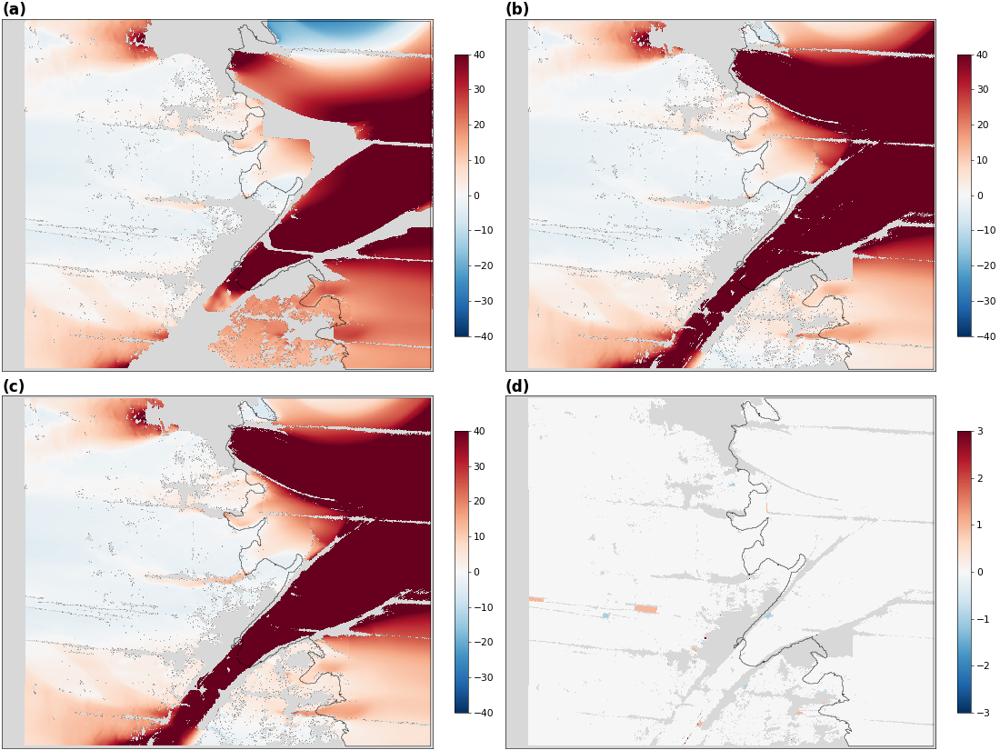
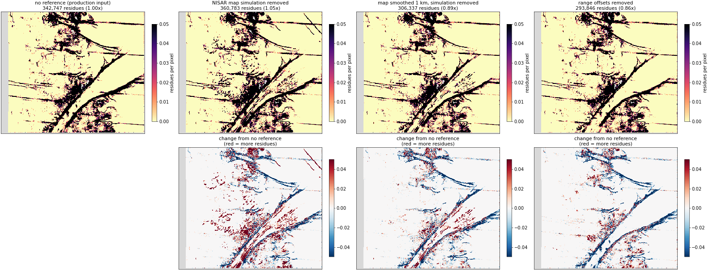
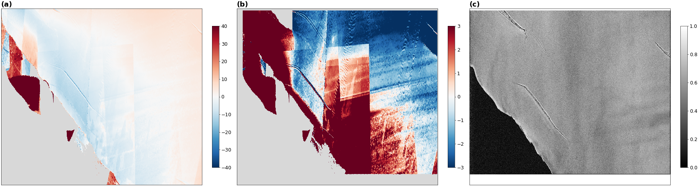
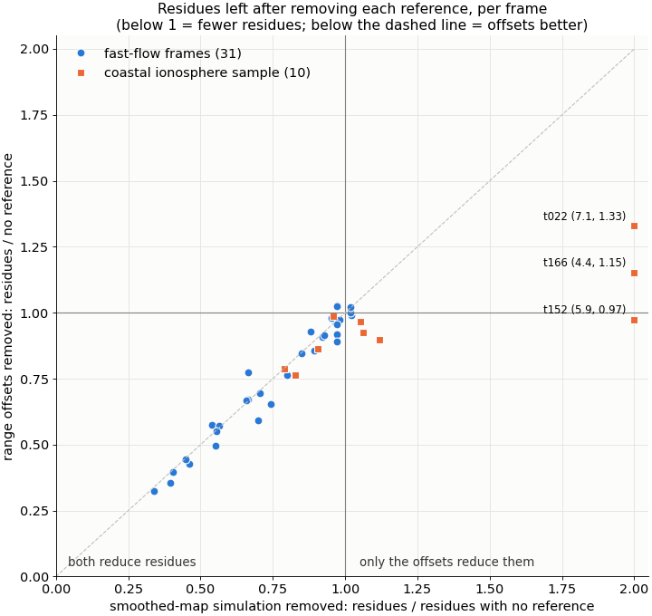
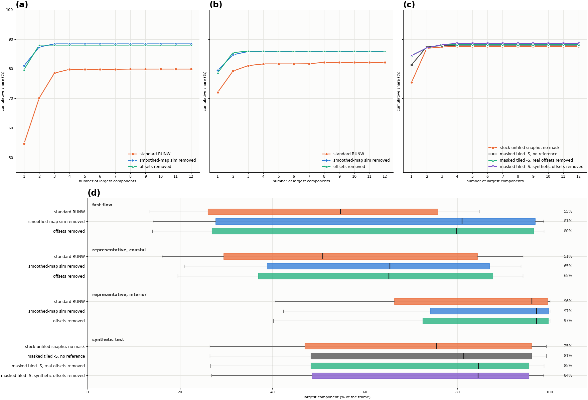
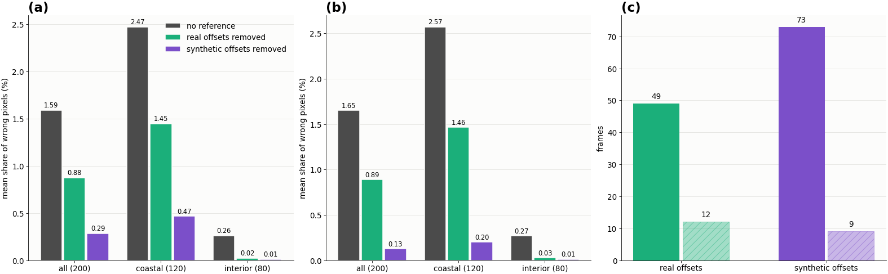

# Unwrapping NISAR interferograms with a reference removed: velocity map or range offsets

**Status: draft, 2026-11-17.** Real-data results are from 41 Antarctica40 frames; the synthetic results are from the
200-frame test of `snaphuTilingMasking.md`. The real-data run on the same 200 frames is in progress, and this document
will be refreshed when it finishes.

## Purpose

The purpose of these experiments is to establish whether removing an estimate of the motion before unwrapping
improves NISAR phase unwrapping, and which estimate to use: a simulation from the NISAR velocity map, or the
interferometric pair's own range offsets. "Improves" has two parts, and both are tested:

- **Coverage and consolidation.** Does more of the frame unwrap, and does it unwrap in fewer, larger connected
  components, so that fewer whole-cycle offsets between components have to be resolved afterwards?
- **Accuracy.** Are the larger components correct, or are we just getting bigger but noisier components, with
  whole-cycle errors hidden inside them?

**Terms.** *Standard RUNW*: the NISAR L1 RUNW product as delivered, with the unwrapped phase and connected components
of the NISAR processing system. *Current GrIMP workflow*: our processing of the standard RUNW today, whose ionosphere
step (the GrIMP offset-phase difference correction) also resolves the whole-cycle offset of each component against the
map simulation. *New unwrappings*: the standard RUNW's wrapped phase unwrapped again here with a reference removed
(Section 1.1), then put through the same GrIMP ionosphere step.

## Summary

Fast ice flow aliases the interferometric phase: across shear margins and in fast, narrow outlets the phase changes by
more than half a cycle between pixels, which creates residues that the unwrapper has to cut around. The standard
RUNW therefore breaks fast-flowing areas into many components. Removing a good estimate of the motion before
unwrapping removes much of that aliasing, so the residual phase has fewer residues and can be unwrapped in larger
pieces; the estimate is added back afterwards, so the result still agrees with the wrapped phase to whole cycles.
Figure 1 shows an example on Byrd Glacier: the standard RUNW breaks the fast flow and the shelf into separate
components (Figure 1a), while with either reference removed the frame unwraps as one component (Figure 1b, c), and
the two new unwrappings agree on all but 0.3% of their common pixels, where they differ by one cycle (Figure 1d).

Results so far:

- **Residues.** On 41 real frames, removing the range offsets reduces the residues on 35 frames (median 0.86 of the
  original count) and removing the 1 km smoothed map simulation on 32 (median 0.89). The unsmoothed map often adds
  residues instead, through seams and short-scale errors in the mosaic; smoothing it by 1 km before simulating removes
  most of that, but not seams with steps of whole cycles (Section 2).
- **Coverage and consolidation.** On the real frames the median largest component grows from 53% of the valid ice
  in the standard RUNW to 80-81% with either reference, and the total unwrapped area from 83% to 87% (Section 3.1). The
  median frame goes from two components of 5% or more to one.
- **Accuracy.** In the synthetic test, where the truth is known, the larger components are more accurate, not less:
  with the real offsets as the reference the mean share of wrong pixels in the largest component falls from 1.65% to
  0.89%, and with synthetic offsets that see the same motion as the phase to 0.13% (Section 3.2.1). On the real
  frames the two references, which are independent of each other, give the same unwrapping on a median 99.96% of
  pixels, and against the map simulation the new unwrappings are as close as the standard RUNW (current GrIMP
  workflow) on the pixels all three unwrap (Sections 3.2.2-3.2.3).
- **Where a reference hurts.** A reference with seams (the unsmoothed map, `t152A`), large interpolated gaps
  (`t032D`, offsets with 32% gaps) or a poor fit (`t102D`) makes the unwrapping worse. In each case the residue count
  of the reference-removed phase is higher than without it, which suggests choosing the reference per frame by its
  residues (Section 3.3).

*Figure 1. One interferogram unwrapped three ways: as in the standard RUNW, and with each of the two references
removed before unwrapping. Byrd Glacier entering the Ross Ice Shelf (`t159D_f128`, 2026-07-07 to 2026-07-19). (a)-(c) Unwrapped
phase in cycles relative to the median on grounded ice; grey lines are component boundaries, black the floating-ice
outline. (a) The standard RUNW: it covers 76% of the ice in 4 components of 5% or more, the largest 43%, and splits the
fast flow and the shelf into separate components at arbitrary levels. (b) Unwrapped with the smoothed map simulation
removed: 83% of the ice in one component. (c) Unwrapped with the range offsets removed: 84% in one component.
(d) (b) minus (c) in whole cycles: equal on 99.71% of their common pixels, +1 on 0.20%, −1 on 0.08%.*

## 1. Method

This section describes how a reference is removed before unwrapping, the two references compared, the frames
used, and what is done after unwrapping, so that the residue counts and results in Sections 2 and 3 can be read
against it.

### 1.1 Unwrapping with a reference removed

Let φ be the wrapped phase of the RUNW and φ_ref a reference phase on the same grid, an estimate of the line-of-sight
motion in phase units. We unwrap the residual wrap(φ − φ_ref) and add φ_ref back:

    U = unwrap(wrap(φ − φ_ref)) + φ_ref

Because φ_ref is added back exactly, U − φ is a whole number of cycles at every pixel: the reference changes how the
phase is unwrapped, not what the wrapped phase is. Where φ_ref is close to the motion, the residual is smooth (ionosphere,
reference error, noise) and has few residues; where φ_ref is wrong on short scales, the residual can have more residues
than φ itself.

The unwrapper is the masked tiled `-S` configuration of `snaphuTilingMasking.md`: the modified snaphu 2.0.7 with
4 x 4 tiles, `-S`, and residue-dense regions masked and smoothly filled. The residue mask is computed on the
residual, after φ_ref is removed. Pixels outside the Antarctic ice mask (open water, sea ice, mélange) are excluded
from the solution on all frames.

### 1.2 The two references

- **Map simulation.** The line-of-sight phase simulated from the current NISAR Antarctic velocity mosaic (200 m,
  multi-year, June 2025 to November 2026), as the current GrIMP workflow already does for its ambiguity step. Before
  simulating, the mosaic is smoothed with a 1 km (5 x 5 pixel) mean over valid pixels. The unsmoothed mosaic was
  tried first and is not recommended (Section 2.2).
- **Range offsets.** The pair's own range offsets, as produced by the current GrIMP workflow from the RUNW's
  companion ROFF product: its three offset layers merged, culled and lightly smoothed. They are converted to phase
  units (4π/λ times the offset minus the geometric offset) and smoothed further, to about 1 km. Gaps in the offsets are filled with `intfloat` (weighted distance, search
  up to 100 pixels). The offsets measure the actual motion of this pair, including any change since the map was made
  and the tide, at coarser resolution than the phase.

### 1.3 Data

- **Real frames (41).** Thirty frames chosen over fast-flowing grounded ice, plus Byrd Glacier, and a ten-frame
  coastal sample used in earlier ionosphere work. The thirty were drawn from all Antarctica40 frame locations: at most
  one third of the frame over open water, at least 300 km² of grounded ice faster than 400 m/yr, and at least two
  components in the standard RUNW each of 5% or more of the frame; the most recent such pair per location, at most two per
  track, centres at least 100 km apart, ranked by fast-ice area. They cover the Siple Coast ice streams, Pine Island and
  Thwaites, Recovery and Slessor, Totten and Denman, Evans and Rutford, Lambert, the Peninsula and Byrd.
- **Synthetic test (200 frames).** The test of `snaphuTilingMasking.md`: the truth is each frame's map simulation, and
  the noisy interferogram is the truth plus noise matched to the frame's coherence and residue density. For this
  study the same noisy interferograms were unwrapped with two references: the frame's **real** range offsets, which
  differ from the synthetic truth by the real map error and ionosphere as well as their own noise (a harder case than
  real data, where phase and offsets see the same motion), and **synthetic** offsets, the truth blurred by two 1 km
  means plus the real offsets' short-scale part and with the real offsets' gaps.

### 1.4 After unwrapping

Where results are given after the ionosphere step, the ionosphere correction is the GrIMP offset-phase difference
correction, run as in the current GrIMP workflow; it also resolves the whole-cycle offset of each component against
the map simulation. The same step is applied to the standard RUNW and to the new unwrappings. It is not discussed
further here.

## 2. Residues

Residues are what force the unwrapper to cut the phase into components, so the first test of a reference is
whether removing it reduces them. This section shows the effect on one frame, the need to smooth the map, and the
counts for all real frames.

### 2.1 An example

Figure 2 shows Byrd Glacier. Without a reference (Figure 2a), the residues lie along the shear margins of the Byrd flow and along
decorrelated rifts and streaks. Removing the range offsets clears the outer edges of the shear margins, where the
phase aliases, and adds little elsewhere (0.86 times the residues; Figure 2d, g). The unsmoothed map simulation clears
the same margins but adds residues inside the flow band, in stripes parallel to flow, and in patches on the grounded ice: the
mosaic's short-scale detail does not match this pair, and the total rises to 1.05 times (Figure 2b, e). Smoothing the mosaic by 1 km
before simulating removes most of the added residues (0.89 times; Figure 2c, f).

*Figure 2. Byrd (`t159D_f128`): residue density in 1 km blocks over valid ice, on the same pixels in every panel.
(a) The wrapped phase with no reference (342,747 residues). (b) With the unsmoothed map simulation removed (360,783,
1.05 times). (c) With the 1 km smoothed map simulation removed (306,337, 0.89 times). (d) With the range offsets
removed (293,846, 0.86 times). (e)-(g) Change of (b)-(d) from (a), residues per pixel; red = more residues.*

### 2.2 Smoothing the map

Table 1 compares the unsmoothed and smoothed map simulations with the offsets on the eleven frames that have both
simulations. Smoothing helps on every frame. On three coastal frames the map simulation multiplies the residues
(12-24 times unsmoothed, still 4-7 times smoothed); the offsets are close to neutral there.

*Table 1. Residues of the wrapped phase with each reference removed, relative to no reference, same pixels.*

| Frame | Residues, no reference | Map | Map smoothed 1 km | Range offsets |
|---|---|---|---|---|
| `t159D_f128` (Byrd) | 342,747 | 1.05 | 0.89 | 0.86 |
| `t014A_f143` | 52,638 | 0.87 | 0.79 | 0.79 |
| `t064D_f123` | 33,454 | 1.08 | 0.83 | 0.76 |
| `t111A_f144` | 512,166 | 1.01 | 0.91 | 0.86 |
| `t009A_f144` | 351,991 | 1.15 | 1.06 | 0.93 |
| `t060A_f139` | 800,398 | 1.18 | 1.05 | 0.96 |
| `t081D_f127` | 204,496 | 1.22 | 1.12 | 0.90 |
| `t032D_f121` | 177,997 | 1.09 | 0.96 | 0.99 |
| `t152A_f139` | 4,126 | 23.68 | 5.93 | 0.97 |
| `t166A_f139` | 20,943 | 12.42 | 4.41 | 1.15 |
| `t022A_f139` | 13,990 | 18.93 | 7.07 | 1.33 |

The worst cases are seams in the mosaic. On `t152A` (Figure 3a), the simulation minus the standard RUNW's unwrapped phase
(Figure 3b) is a patchwork of rectangles with steps of one to three cycles along straight lines, and a block in the lower left about
40 cycles off; the coherence is high throughout (Figure 3c), so the data are good and the steps are in the map. Smoothing softens
the seams but a step of whole cycles remains a step.

*Figure 3. `t152A_f139`. (a) The unsmoothed map simulation, cycles. (b) The simulation minus the standard RUNW's
unwrapped phase, cycles; the rectangles are seams between scenes in the velocity mosaic, and the block at lower left is
about 40 cycles off. (c) Coherence, high throughout.*

### 2.3 All real frames

Figure 4 gives the residue ratio of both references on all 41 frames.

| | Fewer residues than no reference | Median ratio (10-90%) | Fewest residues of the three |
|---|---|---|---|
| Map smoothed 1 km | 32 of 41 | 0.89 (0.46-1.06) | 10 frames |
| Range offsets | 35 of 41 | 0.86 (0.45-1.02) | 27 frames |
| No reference | | 1 | 4 frames |

On the fast-flow frames the two references track each other closely, with reductions of up to two thirds (0.32);
where they differ, the offsets are usually the better of the two. The three frames off the right of the figure are
the map-seam frames of Table 1.

*Figure 4. Residues with each reference removed relative to no reference, per frame: smoothed map simulation (x)
against range offsets (y), for the 31 fast-flow frames (circles) and the 10-frame coastal sample (squares). Below 1
means fewer residues than with no reference; below the dashed line, the offsets leave fewer than the map. Ratios above
2 are drawn at 2 and labelled with their values.*

## 3. Results

This section tests the two parts of the purpose in turn: whether the unwrapping covers more of the ice in fewer
components, and whether those larger components are accurate. It ends with the cases where a reference makes the
unwrapping worse.

### 3.1 Coverage and component consolidation

Figure 5 ranks each frame's components by size. On the real frames (Figure 5a), the standard RUNW's median largest
component is 53% of the valid ice and it needs about eight components to reach its total of 83%; with either reference the
largest component is 80-81% and the total, 87%, is reached by the third component.

| Real frames (41), median | Standard RUNW | Map smoothed 1 km | Range offsets |
|---|---|---|---|
| Largest component (share of valid ice) | 53% | 81% | 80% |
| Largest component, 25-75% of frames | 27-77% | 29-95% | 28-95% |
| All components | 83% | 87% | 87% |
| Components of 5% or more | 2 | 1 | 1 |

In the synthetic test (Figure 5b) every configuration already reaches its total within two or three components: the
synthetic phase has no ionospheric streaks and no real motion that the map gets wrong, which are what fragment the
real interferograms. The ordering is the same, but the gains are smaller: the median largest component is 75% for
stock untiled snaphu with no mask (our stand-in for how the standard RUNW is unwrapped), 81% for masked tiled
`-S`, and 84.5% with the real or synthetic offsets removed. The spread between frames is large in every case
(Figure 5c), mostly because frames differ in how much coherent ice they have.
With either reference removed, the real frames look like the synthetic ones.

*Figure 5. Connected components ranked largest to smallest; the same colour and marker mean the same method
throughout. (a) Real frames (41): cumulative share of valid ice covered by the largest n components, median over
frames, for the standard RUNW and the two new unwrappings. (b) Synthetic test (200 frames): the same for the scored
area, for stock untiled snaphu with no mask, masked tiled `-S` with no reference, and masked tiled `-S` with the real
or synthetic offsets removed. (c) The largest component per frame for all seven (box 25-75%, line median with its
value at right, whiskers 10-90%).*

### 3.2 Accuracy: are the bigger components noisier?

#### 3.2.1 Synthetic test

The synthetic test is the only one with a true answer. It is scored as in `snaphuTilingMasking.md`: within each
component, the share of pixels whose whole-cycle count differs from the component's median (so arbitrary offsets
between components are not counted), and separately for the largest component alone.

| Synthetic test, 200 frames | No reference | Real offsets removed | Synthetic offsets removed |
|---|---|---|---|
| Wrong pixels, median / mean | 0.061% / 1.59% | 0.046% / 0.88% | 0.032% / 0.29% |
| Wrong pixels in the largest component, median / mean | 0.029% / 1.65% | 0.021% / 0.89% | 0.015% / 0.13% |
| Mean wrong pixels, coastal / interior | 2.47% / 0.26% | 1.45% / 0.02% | 0.47% / 0.01% |
| Frames with fewer / more wrong pixels (by > 0.05 points) | | 49 / 12 | 73 / 9 |
| Largest component, median | 81.3% | 84.5% | 84.5% |

*Figure 6. Synthetic test, 200 frames, masked tiled `-S` with no reference, with the real offsets removed and with
synthetic offsets removed. (a) Mean share of wrong pixels over frames, all scored pixels, for all frames and by class.
(b) The same for the largest component only. (c) Frames with fewer (solid) and more (hatched) wrong pixels than with no
reference, by more than 0.05 percentage points.*

Removing the offsets makes the unwrapping more accurate, and the largest components cleaner, on both versions of the
test (Figure 6a, b), and improves many more frames than it worsens (Figure 6c). The worst frames gain most: with synthetic offsets, `t166A_f139` falls from 64% wrong pixels to 1.3%, `t022A_f139`
from 59% to 0.8% and `t059D_f122` from 13.7% to 1.2%.

The two versions bracket the real case. The real offsets are a harsh reference here, because the synthetic truth is
the map simulation: the offsets also carry the real map error and ionosphere, which the synthetic phase does not.
The synthetic offsets were checked against the real ones on 20 frames: they remove a similar share of residues from
the synthetic phase (median 0.93 of the original count, 10-90% 0.53-1.01) as the real offsets remove from the real
phase (0.91, 0.65-1.02).

#### 3.2.2 Agreement between the two references

The map and the offsets are independent estimates of the motion, so where the two unwrappings agree they are unlikely
to share an error. Comparing them pixel by pixel, after removing the most common whole-cycle offset within each joint
component, they differ on a median 0.04% of their common pixels (90% of frames below 8.4%). The largest
disagreements, 33-48%, are on three coastal sample frames (`t022A_f139`, `t166A_f139`, `t081D_f127`); on the first two
the map simulation multiplies the residues (Table 1). This rules out errors that depend on the reference, but not errors both make, for
example by taking the same path across a decorrelated gap.

#### 3.2.3 Real frames against the map simulation

The map simulation is not the truth for real data (map error, ionosphere, tide), but it is the same yardstick for every
method, so it gives relative accuracy. Figure 7 shows the difference between each ambiguity-resolved unwrapping and
the map simulation, before and after the ionosphere correction, and with a 10 km smooth part removed. The smooth part
is a robust local surface (1 km block medians, median filters at 20 then 10 km with outlier rejection); removing it
leaves the short-scale differences, where a wrong-cycle patch smaller than about 5 km stands out as ±1 cycle against
near-zero surroundings. Patches larger than about 10-20 km are absorbed into the surface and are not seen by this test.

Before the ionosphere correction, the full difference is broad and dominated by ionospheric streaks (Figure 7a);
after it, about 70% of pixels are within a cycle of the map (Figure 7b). With the smooth part removed (Figure 7c, d),
the distributions are narrow and the three methods nearly coincide.

*Table 2. Real frames (38 with all three products), pixels common to all three methods, pooled. One cycle is 11.9 cm
in line of sight.*

| | Standard RUNW, current GrIMP workflow | Map smoothed 1 km | Range offsets |
|---|---|---|---|
| Robust σ, full difference, before / after ionosphere correction | 2.05 / 0.76 cycles | 2.08 / 0.77 | 2.08 / 0.75 |
| Robust σ, 10 km smooth part removed, before / after | 0.18 / 0.12 | 0.18 / 0.12 | 0.18 / 0.12 |
| Standard deviation, smooth part removed, after correction | 0.50 | 0.48 | 0.48 |
| Within 1/4 / 1/2 / 1 cycle, smooth part removed, after correction | 75 / 88 / 95% | 74 / 87 / 95% | 74 / 87 / 95% |

*Figure 7. Real frames: each ambiguity-resolved unwrapping minus the map simulation, on pixels common to all three
methods, pooled over 38 frames. (a) Before the ionosphere correction, full difference (median removed). (b) After the
ionosphere correction, full difference. (c) Before the correction, with the 10 km smooth part removed. (d) After the
correction, with the smooth part removed. Each panel shows the PDF (solid, left axis) and the share of pixels within a
given distance of zero (dashed, right axis), and a table of the shares within 1/4, 1/2 and 1 cycle and the robust σ.
Values beyond the axis limits are counted at the limit.*

On the pixels all three unwrap, the new unwrappings are as close to the map as the standard RUNW processed with the
current GrIMP workflow. Three caveats:

- **The standard RUNW has more freedom.** Each of its separate components is levelled to the map in the GrIMP ambiguity step, so
  where it is in pieces it is pulled towards the map by construction. A single large component has one whole-cycle
  offset and cannot be pulled that way. The standard RUNW's slightly narrower core after correction (per-frame median robust
  σ 0.15 against 0.18 cycles) and its slightly smaller far tail are consistent with that.
- **The tails are mostly map error.** About 5% of pixels are more than a cycle off for all three methods. The
  histograms are smooth, with no secondary peaks at ±1 or ±2 cycles, and on Byrd, the frame examined in detail, the
  far departures are in narrow fast flow and shear margins that the 1 km smoothed map does not resolve.
- **The new unwrappings cover more.** On their own pixels, about 25 points more of the ice than the standard RUNW, the new
  unwrappings depart more often (after correction, more than one cycle on 7.2-7.3% of pixels against 5.4%), because
  the added area is the harder ground that the standard RUNW leaves unwrapped.

#### 3.2.4 Whole-cycle choices against the offsets

Where a new unwrapping and the standard RUNW differ by a whole number of cycles, both after the GrIMP ambiguity step, the offsets can be
used to judge which is right: in each region of difference, the step in (phase − offsets) from a 2 km band outside the
region, where the two agree, to a 2 km band inside it, skipping 0.5 km next to the edge where the offsets blur.
Since the ionosphere is smooth, the right solution should show the smaller step. A solution is counted only if its
step is under one cycle and at least half a cycle smaller than the other's.

On the 41 frames (smoothed-map run against the standard RUNW), 14.4 million pixels support the new unwrapping and
3.3 million the standard RUNW, 4.9 million and 0.6 million of them on floating ice; 40.5 million are undecided, mostly because strong
ionospheric streaks change the phase by several cycles across the bands. Sixteen frames favour the new unwrapping, five
the standard RUNW, and twenty are tied. On Byrd, the standard RUNW's shelf components, levelled by the GrIMP
ambiguity step, sit at the map's level while the new
unwrapping, which reaches the shelf continuously through the data, puts them 1-3 cycles higher; the range offsets,
which measure this pair's motion independently of both, agree with the new unwrapping.

### 3.3 Where a reference hurts

The reference can make the unwrapping worse in three ways seen so far:

- **Seams.** The unsmoothed map on `t152A` multiplies the residues 24 times and breaks the frame into straight-edged
  blocks; smoothed, still 5.9 times. The offsets are neutral (0.97).
- **Large gaps.** On `t032D_f122` in the synthetic test, the real offsets have no data on 32% of the valid pixels.
  The intfloat fill across those gaps joined a 7% component into the main one with errors: wrong pixels rose from 0.5%
  to 3.3%.
- **A poor fit.** On `t102D_f122` in the synthetic test, the real offsets increase the residues (91,000 against
  79,000) and the wrong pixels double (1.0% to 2.1%).

In each case the residue count is higher with the reference removed than without it. A rule to consider is therefore
to count the residues for each candidate reference (none, smoothed map, offsets) and unwrap with the one that leaves
the fewest, which takes seconds per frame and is decided before unwrapping. On the 41 real frames it would choose the
offsets on 27, the smoothed map on 10 and no reference on 4. Not filling large gaps in the offsets is a second
candidate change.

## 4. Open questions and next steps

This section lists what remains to be settled before a reference could be used routinely, and what the running
200-frame real-data test will add.

- **The 200-frame real-data run.** The same pipeline on the real data of the 200 synthetic-test frames is running;
  Sections 2.3, 3.1 and 3.2.2-3.2.4 will be refreshed with it.
- **Choosing the reference.** Per frame, as above, or per block, using the reference only where it reduces residues;
  and how to treat large gaps in the offsets.
- **Errors inside large components on real data.** The synthetic test shows the larger components are cleaner, but its
  noise lacks the ionospheric streaks and map mismatch of real data. An edge test inside the large components, rather
  than only between methods, would check this directly.

## Appendix: files

The scripts and output directories behind each table and figure, for rerunning or extending them.

Work directory `/Volumes/insar4/ian/Data/NISAR/Antarctica/unwrapTest40/`:

| Path | Contents |
|---|---|
| `bin/selectFast.py`, `framesFast.csv` | selection of the 30 fast-flow frames |
| `nisarSimTest/smoothVelMap.py`, `nisarSimTest/nisarVelSmooth1km/` | the 1 km smoothed velocity mosaic and its region file |
| `nisarSimTest/nisarSimFrame.py` | unwrapping with a reference removed (`NISARSIM_UNWRAPREF` = map or offsets, `NISARSIM_REGION`) |
| `nisarSimTest/runFast.py`, `runFast200.sh` | the real-data pipeline per frame and reference; results in `framesFastSmooth/`, `framesFastOffsets/` |
| `nisarSimTest/scoreFast.py`, `summarizeFast.py` | per-frame scores (residues, components, agreement, edge test); `scoresFast/` |
| `nisarSimTest/residueRefs.py`, `figResidueRatios.py` | Table 1, Figures 2 and 4 |
| `nisarSimTest/scoreVsSimJumps.py`, `figVsSimPdfCdf4.py` | Table 2, Figure 7 |
| `nisarSimTest/ccRankFast.py`, `diagOceanMask/figCCRankBoth.py` | Figure 5 |
| `diagOceanMask/synthOffsets.py`, `synthOffsetsSummary.py`, `figSynthAccuracy.py` | the synthetic test with the offsets; results in `synth3_offsets/` and `synth3_offsets_synthetic/`; Figure 6 |
| `diagOceanMask/offsetsRealism.py` | the check of the synthetic offsets against the real ones |
| `nisarSimTest/figDirectUnw.py` | Figure 1 |
