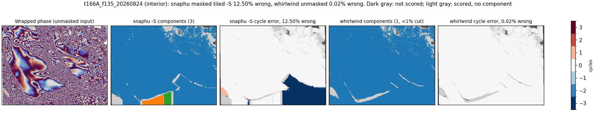
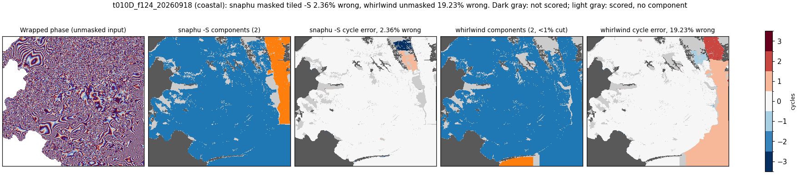
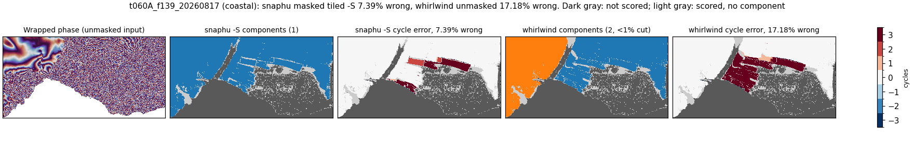
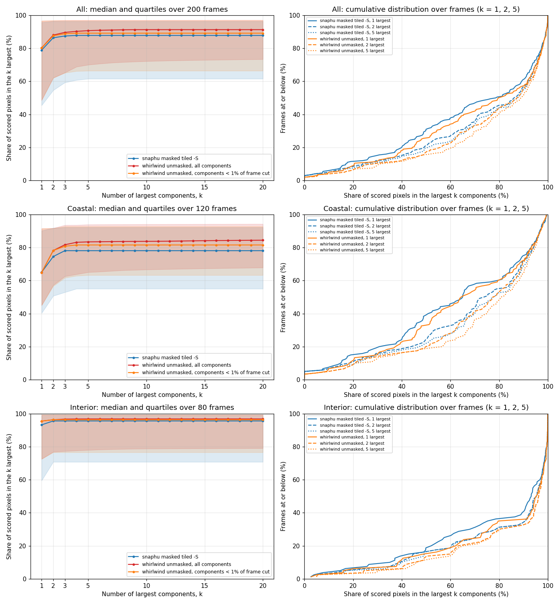

# Whirlwind as an alternative to snaphu: speed and accuracy on the 200-frame synthetic test

**Status: draft, 2026-11-16.** Uses the same 200 synthetic Antarctica40 frames, inputs and scoring as
[snaphuTilingMasking.md](snaphuTilingMasking.md) (Sections 2.4 and 3.5 there).

## Summary

[whirlwind](https://github.com/scottstanie/whirlwind-insar) (version 0.10.0) is a multithreaded minimum-cost-flow
unwrapper written in Rust. We ran it with default settings on all 200 synthetic interferograms, both unmasked and with
the same residue mask that snaphu `-S` uses. Unless stated otherwise, "whirlwind" below means the unmasked run.
We compared it with snaphu in two configurations: masked tiled `-S`, which is the recommended configuration from the
snaphu study, and unmasked untiled, which is used in production now.

- **Speed.** Whirlwind takes 8.7 h of wall time in total, compared with 10.4 h for snaphu `-S` and 74.3 h for
  untiled snaphu. It uses far less CPU: 9.8 h, compared with 31.3 h for `-S`. The median frame is a little slower
  than `-S` (98 s against 77 s). Whirlwind is about twice as fast on interior frames but about half as fast on
  coastal ones.
- **Accuracy.** Whirlwind is slightly less accurate than snaphu `-S` on the typical frame. The median share of
  pixels with the wrong cycle count is 0.085%, against 0.057%. Its mean is lower (1.41% against 1.55%), but only
  because of one frame where snaphu `-S` fails badly (Section 3.3).
- **Connected components.** Whirlwind's own output has a median of 30 connected components per frame (maximum
  254), and most of them are tiny. Each component is scored with its own offset, so this extra freedom flatters
  the score. For a fair comparison, all whirlwind scores here first cut its components with snaphu's own rule,
  which keeps only components larger than 1% of the frame. After the cut, both unwrappers have a median of one
  component, and the area held by the largest components is nearly the same (Section 3.4).
- **Masked whirlwind.** Masking makes whirlwind about 15% slower in total (10.0 h against 8.7 h), unlike snaphu,
  which masking makes much faster. It makes whirlwind slightly more accurate: the median is 0.072% against
  0.085%, and masking helps 15 frames and hurts 6. It is still less accurate than snaphu `-S` on the median
  (Section 3.6).
- **Settings.** No whirlwind option we tried (Goldstein filtering, interpolation, downsampling) fixes its worst
  frames (Section 3.5).
- **Running both as a check.** The pixels where snaphu `-S` and whirlwind disagree are 1% of the data but hold
  73% of snaphu's wrong pixels (99% on interior frames). The 22 frames with more than 1% disagreement hold 92% of
  snaphu's wrong pixels. The comparison flags errors but cannot say which unwrapper is right (Section 3.7).

Whirlwind therefore does not replace snaphu `-S` for coastal frames. It is a fast option for interior frames,
where it is twice as fast and the accuracy difference is a few thousandths of a percent of the pixels.

## 1. Method

| | snaphu untiled | snaphu `-S` | whirlwind |
|---|---|---|---|
| Input | unmasked (`synth3/none`) | residue mask 0.25 (`synth3/mask0.25`) | unmasked (`synth3/none`) and masked (`synth3/mask0.25`), two separate runs |
| Configuration | `BASE_CONF`: SMOOTH, MCF, NCORRLOOKS 139 | 4 x 4 tiles, 200 px overlap, NPROC 16, `-S` | defaults, `--nlooks 139`, 16 rayon threads |
| Host | petermann / ryder | petermann / ryder | helheim, 10 frames at a time |

**Whirlwind options.** Every result except Section 3.5 uses whirlwind's defaults: no Goldstein filtering
(`--goldstein-alpha` 0), no `--interpolate` and no `--downsample` (factor 1). The command for each run is saved in
`<mode>/<key>/ww.cmd`, and none of the 400 commands contains any of these options.

**Scoring.** Scoring is the same as for snaphu (`synthTest.wrongCycles`). A pixel is wrong if its difference
from the truth, after removing the median offset of its connected component, rounds to a nonzero number of
cycles. Scoring covers the mask0.25 scored set (the residue mask, and only pixels where the truth is present).
The same scored set is used for every run.

**Component cut.** Before scoring, whirlwind's components smaller than 1% of the whole frame (lines x samples,
masked pixels included) are set to 0. This is snaphu's `MINCONNCOMPFRAC 0.01` rule.

**Worse and better.** A frame counts as substantially worse or better (`synthSummary.worse` / `better`) when the
error at least doubles or changes by more than 0.5 percentage points. Changes smaller than 0.01 points are
ignored.

**Timing caveat.** The snaphu runs were timed on petermann and ryder in the snaphu study. Whirlwind was timed on
helheim (96 cores) with 10 frames running at once. Whirlwind's median 1-minute load average during a run was 12,
and its peak memory use was 1.1 GB median and 1.8 GB maximum.

## 2. Speed

| | snaphu untiled | snaphu `-S` (masked) | whirlwind unmasked | whirlwind masked |
|---|---|---|---|---|
| Median wall, all | 636 s | 77 s | 98 s | 96 s |
| Median wall, coastal (120) | 936 s | 98 s | 182 s | 193 s |
| Median wall, interior (80) | 478 s | 53 s | 27 s | 31 s |
| Total wall, all | 74.3 h | 10.4 h | 8.7 h | 10.0 h |
| Total CPU, all | 74.3 h | 31.3 h | 9.8 h | 11.1 h |

| Whirlwind speedup | vs untiled, median | vs untiled, total | vs `-S`, median | vs `-S`, total |
|---|---|---|---|---|
| unmasked, all | 8.7x | 8.5x | 0.9x | 1.2x |
| unmasked, coastal | 5.5x | 6.0x | 0.6x | 0.7x |
| unmasked, interior | 16.3x | 24.2x | 2.0x | 4.5x |
| masked, all | 8.0x | 7.4x | 0.8x | 1.0x |
| masked, coastal | 5.4x | 5.2x | 0.5x | 0.6x |
| masked, interior | 15.8x | 22.3x | 2.0x | 4.1x |

Whirlwind's threads help little: CPU time is only 1.1 times wall time. Unlike snaphu, whirlwind does not get
faster when the residue-dense areas are masked.

## 3. Accuracy

### 3.1 Summary

Statistics cover the 193 frames where all four runs have at least one component.

| | snaphu untiled | snaphu `-S` (masked) | whirlwind unmasked | whirlwind masked |
|---|---|---|---|---|
| Wrong, median, all | 0.059% | 0.057% | 0.085% | 0.072% |
| Wrong, median, coastal | 0.232% | 0.228% | 0.229% | 0.221% |
| Wrong, median, interior | 0.001% | 0.000% | 0.006% | 0.008% |
| Wrong, mean, all | 1.64% | 1.55% | 1.41% | 1.26% |
| Coverage, median, all | 87.2% | 87.8% | 89.2% | 89.5% |
| Coverage, median, coastal | 78.0% | 78.1% | 81.5% | 82.5% |
| Components after the 1% cut, median (max) | | 1 (6) | 1 (7) | 1 (7) |
| Whirlwind unmasked substantially worse / better | 49 / 22 | 50 / 20 | | |
| Whirlwind masked substantially worse / better | 51 / 22 | 51 / 22 | | |

### 3.2 Why whirlwind is worse more often but has the lower mean

Compared with snaphu `-S`, whirlwind is substantially worse on 50 frames and substantially better on 20 (194
frames where both runs are scored). Its mean error is nevertheless 0.13 percentage points lower. The two
statistics measure different things:

- **The worse/better rule is relative.** Many of the frames counted as worse are worse by tiny amounts. Of the 50
  worse frames, 20 are worse by less than 0.05 points and 35 by less than 0.5 points; the median is +0.075 points
  and the total is +64.9 points.
- **The better frames are better by more.** The 20 better frames gain a median of 0.49 points each, −88.9 points in
  total.
- **One frame dominates the mean.** On `t022A_f139` snaphu `-S` has 59.1% of pixels wrong and whirlwind 7.8%
  (Figure 1). That single frame lowers whirlwind's mean by 0.26 points. Without it, whirlwind's mean is 0.13 points
  *worse* than snaphu `-S`.

The median is therefore the fairer summary, and on the median whirlwind is slightly worse.

These are the frames with the largest differences:

| Frame | Class | snaphu `-S` | whirlwind | Difference (points) | Components, `-S` / whirlwind |
|---|---|---|---|---|---|
| `t022A_f139_20261001` | coastal | 59.12% | 7.77% | −51.34 | 1 / 1 |
| `t166A_f135_20260824` | interior | 12.50% | 0.02% | −12.48 | 3 / 1 |
| `t059D_f122_20261004` | coastal | 13.67% | 4.28% | −9.39 | 3 / 4 |
| `t057D_f127_20260724` | coastal | 3.18% | 0.48% | −2.69 | 1 / 1 |
| `t138A_f141_20260810` | coastal | 2.34% | 8.44% | +6.10 | 4 / 5 |
| `t060A_f139_20260817` | coastal | 7.39% | 17.18% | +9.79 | 1 / 2 |
| `t104A_f142_20260925` | coastal | 22.49% | 32.82% | +10.33 | 3 / 6 |
| `t010D_f124_20260918` | coastal | 2.36% | 19.23% | +16.87 | 2 / 2 |

### 3.3 Examples

Each figure has five panels:

1. The wrapped input.
2. The snaphu `-S` connected components, numbered by size (blue is the largest).
3. The snaphu `-S` error in cycles, after removing each component's median offset.
4. The whirlwind components after the 1% cut.
5. The whirlwind error in cycles.

Dark gray is not scored. Light gray is scored but in no component.

**Whirlwind better: `t022A_f139_20261001`** (Figure 1). Snaphu `-S` puts most of its single component +1 or −3
cycles away from the rest. The boundaries of the offset regions are straight vertical lines, which suggests they
come from the assembly of the tiles. Whirlwind has the same single component and gets almost all of it right; its
errors are a thin strip of +2 to +3 cycles along the upper edge of the data.

*Figure 1. `t022A_f139_20261001`, the frame that dominates the mean.*

**Whirlwind better: `t166A_f135_20260824`** (Figure 2). Snaphu `-S` connects the lower right of the frame to the
main component across a narrow unscored band, and it puts that part −3 cycles away. Whirlwind unwraps the frame
as one component and is wrong on 0.02% of pixels.

*Figure 2. `t166A_f135_20260824`, an interior frame.*

**Whirlwind worse: `t010D_f124_20260918`** (Figure 3). Snaphu `-S` separates the strip along the eastern edge as
its own component, so that strip's offset relative to the main area is not counted. Whirlwind joins the strip to
its main component +1 cycle away (+2 at the north end), so the strip counts as wrong.

*Figure 3. `t010D_f124_20260918`, the largest loss for whirlwind.*

**Whirlwind worse: `t060A_f139_20260817`** (Figure 4). Both unwrappers put a block of the ice shelf off by +2 to
+3 cycles. Whirlwind's block is about twice as large.

*Figure 4. `t060A_f139_20260817`.*

In all four frames the error is a whole region offset by a few cycles, not scattered pixels. A small number of
wrong decisions about how to connect regions decides the outcome, and neither unwrapper makes them consistently
better than the other.

### 3.4 Area held by the largest components

Figure 5 shows how much of each frame's scored set is held by the k largest components, with one row each for all,
coastal and interior frames. On the left are the median and quartiles over frames. On the right is the cumulative
distribution over frames of the share held by the largest one, two and five components.

| Set | Run | Largest, median | 2 largest | 3 largest | 5 largest | 10 largest | Frames where the largest holds < 50% |
|---|---|---|---|---|---|---|---|
| all | snaphu masked tiled `-S` | 78.9% | 86.4% | 87.5% | 87.8% | 87.8% | 62 of 200 |
| all | whirlwind, all components | 80.2% | 88.0% | 89.6% | 90.7% | 91.3% | 51 of 200 |
| all | whirlwind, < 1% cut | 80.2% | 87.6% | 88.8% | 89.2% | 89.2% | 51 of 200 |
| coastal | snaphu masked tiled `-S` | 65.0% | 74.5% | 78.1% | 78.1% | 78.1% | 47 of 120 |
| coastal | whirlwind, all components | 64.9% | 78.2% | 81.7% | 83.4% | 83.7% | 39 of 120 |
| coastal | whirlwind, < 1% cut | 64.9% | 78.2% | 80.7% | 81.5% | 81.5% | 39 of 120 |
| interior | snaphu masked tiled `-S` | 93.2% | 95.6% | 95.6% | 95.6% | 95.6% | 15 of 80 |
| interior | whirlwind, all components | 95.5% | 96.3% | 96.7% | 96.8% | 96.8% | 12 of 80 |
| interior | whirlwind, < 1% cut | 95.5% | 96.3% | 96.3% | 96.3% | 96.3% | 12 of 80 |

- **Coastal frames.** The median frame has about two thirds of its data in the largest component for both
  unwrappers. Whirlwind's second and third components hold more than snaphu's, so after the cut it covers
  81.5% of the scored set against 78.1%. This is the coverage gain in Section 3.1.
- **Interior frames.** The median frame has one dominant component holding 93% to 96% of the data. On 32 of the
  80 interior frames for snaphu and 28 for whirlwind, the largest component holds less than 90%.
- **The cut.** The small components that the cut removes hold only about 2% of the scored pixels on coastal frames
  and 0.5% on interior frames. After the cut, the two unwrappers have almost the same number of degrees of freedom:
  whirlwind's accuracy is not bought with more components.

*Figure 5. Share of scored pixels in the k largest connected components: all (top), coastal (middle) and interior (bottom) frames.*

### 3.5 Whirlwind options

This is a separate test on four frames; no other result in this document uses these options.

We reran four of the worst whirlwind frames with the options that change the solution:

- `--goldstein-alpha 0.7`
- `--interpolate`
- both of these together
- `--downsample 2`

Each run was scored on snaphu `-S`'s components, so that every run has the same pixels and degrees of freedom.

| Frame | Default | Goldstein 0.7 | Interpolate | Goldstein + interpolate | Downsample 2 |
|---|---|---|---|---|---|
| `t010D_f124` | 17.7% | 5.0% | 17.1% | 7.3% | 75.9% |
| `t013A_f144` | 18.7% | 18.9% | 18.8% | 19.3% | 67.6% |
| `t014A_f143` | 0.7% | 0.6% | 33.9% | 34.2% | 83.7% |
| `t030D_f122` | 15.5% | 16.5% | 15.5% | 28.8% | 87.0% |

- Goldstein filtering helps on one frame only.
- Interpolation makes `t014A_f143` much worse.
- Downsampling is 7 to 23 times faster but breaks each frame into 570 to 900 components that do not fit together.

None of the options is a general improvement over the defaults.

### 3.6 Masked whirlwind

Whirlwind run on the masked input (the residue mask that snaphu `-S` uses) is scored the same way, after the 1%
component cut. Before the cut it has a median of 32 components (54 on coastal frames, maximum 392); after the cut,
a median of one.

- **Speed.** Masking makes whirlwind slower: 10.0 h against 8.7 h in total, and 193 s against 182 s for the median
  coastal frame. Masking makes snaphu tiled unwrapping much faster, but it does not help whirlwind.
- **Accuracy.** Masking makes whirlwind slightly more accurate. The median is 0.072% against 0.085% unmasked and
  the mean is 1.26% against 1.41%. Compared frame by frame with unmasked whirlwind, masking makes 15 frames
  substantially better and 6 worse (194 frames). The largest gains are on `t104A_f142` (32.8% to 23.5%), `t060A_f139` (17.2% to 8.7%) and `t151A_f138`
  (3.48% to 0.02%). The largest loss is on `t144A_f143` (0.23% to 2.04%).
- **Against snaphu `-S`.** Masked whirlwind is still slightly worse on the median (0.072% against 0.057%), and it
  is substantially worse on 51 frames and better on 22. Its worst frames are the same as unmasked whirlwind's:
  `t010D_f124` has 19.01% wrong (19.23% unmasked).

### 3.7 Running both unwrappers as a check

If both unwrappers are run, the places where they disagree may show where they are wrong. We compared snaphu `-S`
with whirlwind (components cut by the 1% rule) on the pixels that are scored and lie in a component of both. These
pixels are grouped into joint components: the overlap of one snaphu component and one whirlwind component. A pixel
*disagrees* when the difference between the two solutions, after removing the median difference over its joint
component, rounds to a nonzero number of cycles. Errors are scored for each unwrapper on its own components, as
elsewhere. Percentages are over the pixels in a component of both, so they differ slightly from Section 3.1.

| Set | Frames | Disagree, median / mean | Wrong, snaphu `-S`, median / mean | Wrong, whirlwind, median / mean | Snaphu wrong pixels that disagree | Whirlwind wrong pixels that disagree | Snaphu wrong on agreeing pixels, median / mean | Frames with > 1% disagreement |
|---|---|---|---|---|---|---|---|---|
| all | 194 | 0.018% / 1.35% | 0.029% / 1.40% | 0.035% / 1.31% | 73% | 72% | 0.012% / 0.52% | 22 |
| coastal | 114 | 0.047% / 2.09% | 0.130% / 2.21% | 0.158% / 2.19% | 67% | 71% | 0.083% / 0.88% | 20 |
| interior | 80 | 0.000% / 0.28% | 0.000% / 0.24% | 0.000% / 0.06% | 99% | 96% | 0.000% / 0.01% | 2 |

- **As a pixel mask.** Over all pixels, 1.0% disagree. Dropping them removes 73% of snaphu's wrong pixels, and the
  share of wrong pixels falls from 0.91% to 0.16% of the remaining pixels. On interior frames almost nothing
  disagrees, but 99% of snaphu's few errors are in the pixels that do.
- **As a frame flag.** The 22 frames with more than 1% disagreement hold 92% of snaphu's wrong pixels. Of the 20
  frames where snaphu is more than 1% wrong, 18 are flagged.
- **Which one is right.** Where the solutions disagree, the comparison cannot say which unwrapper is right; it
  can only flag or drop the pixels.
- **Shared errors.** Errors both unwrappers make the same way are not flagged. On `t166A_f139_20260719` both are
  63% wrong and only 44% of snaphu's wrong pixels disagree. On `t059D_f122_20261004` snaphu is 13% wrong but only
  10% of its wrong pixels disagree. Overall, 27% of snaphu's wrong pixels are not flagged.
- **Masked whirlwind** flags snaphu's errors equally well (73%) but is slower. Unmasked whirlwind is the better
  partner.
- **Cost.** Whirlwind adds about 10 h of CPU per 200 frames to snaphu `-S`'s 31 h, about a third more. Both could
  run on the same frame at the same time.

## 4. Conclusions

- Whirlwind run on unmasked input is about as fast overall as snaphu masked tiled `-S`, and it uses a third of the
  CPU. It is twice as fast on interior frames and half as fast on coastal frames.
- On the typical frame whirlwind is slightly less accurate than snaphu `-S` (median 0.085% against 0.057% wrong),
  and it is substantially worse on 50 frames against 20 better. Its lower mean comes from one frame where snaphu
  `-S` fails.
- Masking the input makes whirlwind about 15% slower and slightly more accurate (median 0.072% against 0.085%),
  but still not as accurate as snaphu `-S`.
- Whirlwind's default connected components are far too many to use as they are (median 30). Applying snaphu's 1%
  rule gives component counts and areas that match snaphu's.
- Snaphu `-S` remains the better choice for production, particularly on coastal frames. If whirlwind is used, it
  should be used on interior frames, with its components cut by the 1% rule.
- Running whirlwind alongside snaphu `-S` is a useful, cheap check. The pixels where they disagree are 1% of the
  data and hold 73% of snaphu's wrong pixels, and frames with more than 1% disagreement hold 92% of them. The
  disagreement can be used to flag frames or mask pixels, but not to choose between the two solutions.

## Appendix: files

All files are in `/Volumes/insar4/ian/Data/NISAR/Antarctica/unwrapTest40/diagOceanMask/synth3_whirlwind/`.

| File | Contents |
|---|---|
| `runAlt.py`, `queueAlt.py` | runs whirlwind on one frame, and on the whole queue using claim files; outputs in `none/<key>/` and `mask0.25/<key>/` |
| `dropSmall.py frac0.01` | rescoring after the 1% component cut; `dropSmallfrac0.01/<key>.json`, per-frame table in `dropSmallfrac0.01.md` |
| `timeAccuracy.py` | the speed and accuracy tables in Sections 2 and 3.1 (`timeAccuracy.md`) |
| `compArea.py` | component-area distribution (`compArea.png`, `compArea.md`, `compArea/<key>.json`) |
| `exampleFrames.py <key> <png>` | the example figures (`examples/`) |
| `flagTest.py` | whirlwind option tests (`flagTest/`, `flagTest.out`) |
| `compareBoth.py [wU\|wM]` | the agreement check in Section 3.7 (`compareBoth<run>/<key>.json`, `compareBoth<run>.md`) |
| `summaryAlt.py`, `globalScore.py`, `sameCC.py` | the earlier comparisons: whirlwind masked, scores that ignore components, and scores on snaphu's components |
