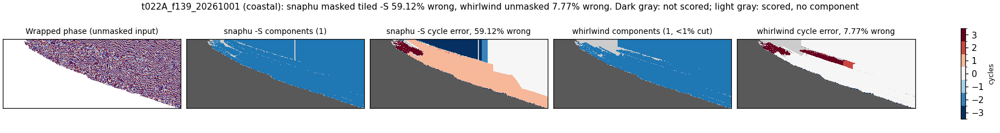

# Whirlwind as an alternative to snaphu: speed and accuracy on the 200-frame synthetic test

**Status: draft, 2026-11-16.** Uses the same 200 synthetic Antarctica40 frames, inputs and scoring as
[snaphuTilingMasking.md](snaphuTilingMasking.md) (Sections 2.4 and 3.5 there), with one change: 7 coastal frames
that had no connected components in at least one snaphu run, so could not be scored, were replaced by 7 new
coastal frames (`frames4.csv`). Every frame is now scored in every run.

## Summary

This test is designed to see whether a different unwrapper, whirlwind, could replace snaphu for unwrapping NISAR
RUNW products: whether it is faster than the snaphu configurations we use or recommend, and whether it is at least
as accurate. Because the synthetic frames have a known answer, we can count, frame by frame, the pixels each
unwrapper puts on the wrong cycle.

[whirlwind](https://github.com/scottstanie/whirlwind-insar) (version 0.10.0) is a multithreaded minimum-cost-flow
unwrapper written in Rust. We ran it with default settings on all 200 synthetic interferograms, both unmasked and with
the same residue mask that snaphu `-S` uses. Unless stated otherwise, "whirlwind" below means the unmasked run.
We compared it with snaphu in two configurations: masked tiled `-S`, which is the recommended configuration from the
snaphu study, and unmasked untiled, which is used in production now.

- **Speed.** Whirlwind takes 9.1 h of wall time in total, compared with 10.9 h for snaphu `-S` and 74.8 h for
  untiled snaphu. It uses far less CPU: 10.2 h, compared with 32.3 h for `-S`. The median frame is a little slower
  than `-S` (101 s against 80 s). Whirlwind is about twice as fast on interior frames but about half as fast on
  coastal ones.
- **Accuracy.** Whirlwind is slightly less accurate than snaphu `-S` on the typical frame. The median share of
  pixels with the wrong cycle count is 0.086%, against 0.061%. Its mean is lower (1.39% against 1.59%), but only
  because of one frame where snaphu `-S` fails badly (Sections 3.2 and 3.3).
- **Connected components.** An unwrapper splits its output into connected components: regions it trusts to be
  unwrapped consistently, each with an unknown offset relative to the others. Whirlwind's own output has a median
  of 30 components per frame (maximum 239), and most of them are tiny. Each component is scored with its own
  offset, so this extra freedom flatters the score. For a fair comparison, all whirlwind scores here first cut its components with snaphu's own rule,
  which keeps only components larger than 1% of the frame. After the cut, both unwrappers have a median of one
  component, and the area held by the largest components is nearly the same (Section 3.4).
- **Masked whirlwind.** Masking makes whirlwind about 15% slower in total (10.5 h against 9.1 h), unlike snaphu,
  which masking makes much faster. It makes whirlwind slightly more accurate: the median is 0.081% against
  0.086%, and masking helps 15 frames and hurts 6. It is still less accurate than snaphu `-S` on the median
  (Section 3.6).
- **Settings.** No whirlwind option we tried (Goldstein filtering, interpolation, downsampling) fixes its worst
  frames (Section 3.5).
- **Running both as a check.** The pixels where snaphu `-S` and whirlwind disagree are 1% of the data but hold
  67% of snaphu's wrong pixels (99% on interior frames). The 24 frames with more than 1% disagreement hold 93% of
  snaphu's wrong pixels. The comparison flags errors but cannot say which unwrapper is right (Section 3.7).

Whirlwind therefore does not replace snaphu `-S` for coastal frames. It is a fast option for interior frames,
where it is twice as fast and the accuracy difference is a few thousandths of a percent of the pixels.

## 1. Method

### 1.1 The test and its terms

The test uses 200 Antarctic NISAR frames (from the Antarctica40 project) and, for each, a synthetic interferogram
with a known answer. The truth is the phase predicted from an existing velocity map; noise is added that follows
the frame's real coherence, at a level calibrated so that the synthetic interferogram is as hard to unwrap as the
real one. The construction is described in Section 2.4 of [snaphuTilingMasking.md](snaphuTilingMasking.md).

- **Frames.** A frame is named `t<track><A|D>_f<frame>_<second date>`, for example `t022A_f139_20261001` (track 22,
  ascending, frame 139). **Coastal** frames (120) contain some floating ice or ocean; **interior** frames (80) are
  entirely grounded ice. Coastal frames are much harder, because ocean and sea ice decorrelate.
- **Cycle errors.** Unwrapping recovers the full phase from its value modulo 2π. A pixel is **wrong** if the
  unwrapper has put it on the wrong 2π cycle. An error usually affects a whole region at once, so it costs many
  pixels.
- **Residues** are points where the wrapped phase around a 2 x 2 loop of pixels does not add up to zero. Noise
  creates them, and the unwrapper must pair each with one of opposite sign (or with the frame edge), which is what
  makes noisy frames slow and hard.
- **Residue mask.** The mask from the snaphu study: 15 x 15 pixel blocks whose residue density exceeds 0.25 per
  loop, removed before unwrapping and filled with a smooth phase. It removes mostly open ocean and sea ice.
  `synth3/none` holds the unmasked inputs and `synth3/mask0.25` the masked ones.
- **Tiling and `-S`.** snaphu can split a frame into tiles (here 4 x 4) unwrapped in parallel. With `-S` it then
  re-optimizes the assembled result as a single tile, so that there are no errors along the tile seams. Untiled
  snaphu runs on a single core.
- **Connected components** are the regions an unwrapper trusts to be internally consistent. The offset between two
  components is unknown, so scoring removes each component's own median offset. Pixels in no component are not
  scored.
- **Scored set** and **coverage.** The scored set is every pixel that the residue mask keeps and where the
  truth is present; it is the same for every run, masked or not. Coverage is the share of the scored set that lies in a component.

### 1.2 Runs

| | snaphu untiled | snaphu `-S` | whirlwind |
|---|---|---|---|
| Input | unmasked (`synth3/none`) | residue mask 0.25 (`synth3/mask0.25`) | unmasked (`synth3/none`) and masked (`synth3/mask0.25`), two separate runs |
| Configuration | `BASE_CONF`: SMOOTH, MCF, NCORRLOOKS 139 | 4 x 4 tiles, 200 px overlap, NPROC 16, `-S` | defaults, `--nlooks 139`, 16 rayon threads |
| Host | petermann / ryder | petermann / ryder | helheim, 8 to 10 frames at a time |

### 1.3 Scoring and settings

**Whirlwind options.** Every result except Section 3.5 uses whirlwind's defaults: no Goldstein filtering
(`--goldstein-alpha` 0), no `--interpolate` and no `--downsample` (factor 1). The command for each run is saved in
`<mode>/<key>/ww.cmd`, and none of the 400 commands contains any of these options.

**Scoring.** Scoring is the same as for snaphu (`synthTest.wrongCycles`). A pixel is wrong if its difference
from the truth, after removing the median offset of its connected component, rounds to a nonzero number of
cycles. "Wrong" percentages are the share of a frame's scored pixels in a component that are wrong; medians and
means are then taken over frames.

**Component cut.** Before scoring, whirlwind's components smaller than 1% of the whole frame (lines x samples,
masked pixels included) are removed, so their pixels are not scored. snaphu applies this rule to its own output
(`MINCONNCOMPFRAC 0.01`); without the cut, whirlwind's many tiny components would each get their own offset and
flatter its score.

**Worse and better.** Whirlwind counts as substantially worse on a frame (`synthSummary.worse`) when its error is
more than double snaphu's or more than 0.5 percentage points higher, and also at least 0.01 points higher, so
0.000% against 0.001% is not counted. Substantially better is the same rule the other way round.

**Timing caveat.** The snaphu runs were timed on petermann and ryder in the snaphu study. Whirlwind was timed on
helheim (96 cores) with 8 to 10 frames running at once. Whirlwind's median 1-minute load average during a run was 12,
and its peak memory use was 1.1 GB median and 1.8 GB maximum.

## 2. Speed

Wall time is the elapsed time per frame; CPU time adds up the time of all threads.

| | snaphu untiled | snaphu `-S` (masked) | whirlwind unmasked | whirlwind masked |
|---|---|---|---|---|
| Median wall, all | 647 s | 80 s | 101 s | 102 s |
| Median wall, coastal (120) | 955 s | 104 s | 203 s | 230 s |
| Median wall, interior (80) | 478 s | 53 s | 27 s | 31 s |
| Total wall, all | 74.8 h | 10.9 h | 9.1 h | 10.5 h |
| Total CPU, all | 74.7 h | 32.3 h | 10.2 h | 11.5 h |

| Whirlwind speedup | vs untiled, median | vs untiled, total | vs `-S`, median | vs `-S`, total |
|---|---|---|---|---|
| unmasked, all | 8.5x | 8.2x | 0.9x | 1.2x |
| unmasked, coastal | 5.3x | 5.8x | 0.5x | 0.7x |
| unmasked, interior | 16.3x | 24.2x | 2.0x | 4.5x |
| masked, all | 7.5x | 7.1x | 0.8x | 1.0x |
| masked, coastal | 5.1x | 5.0x | 0.5x | 0.6x |
| masked, interior | 15.8x | 22.3x | 2.0x | 4.1x |

Whirlwind's threads help little: CPU time is only 1.1 times wall time. Unlike snaphu, whirlwind does not get
faster when the residue-dense areas are masked.

## 3. Accuracy

### 3.1 Summary

Statistics cover all 200 frames; every run has at least one component on every frame.

| | snaphu untiled | snaphu `-S` (masked) | whirlwind unmasked | whirlwind masked |
|---|---|---|---|---|
| Wrong, median, all | 0.062% | 0.061% | 0.086% | 0.081% |
| Wrong, median, coastal | 0.248% | 0.233% | 0.237% | 0.223% |
| Wrong, median, interior | 0.001% | 0.000% | 0.006% | 0.008% |
| Wrong, mean, all | 1.68% | 1.59% | 1.39% | 1.24% |
| Coverage, median, all | 87.6% | 88.0% | 89.4% | 90.0% |
| Coverage, median, coastal | 80.7% | 80.7% | 83.0% | 83.8% |
| Whirlwind unmasked substantially worse / better | 50 / 25 | 51 / 23 | | |
| Whirlwind masked substantially worse / better | 52 / 25 | 52 / 25 | | |
| Components after the 1% cut, median (max) | | 1 (6) | 1 (7) | 1 (7) |

The worse / better rows count frames where whirlwind is substantially worse or better than the run at the top of
the column. On the median frame, whirlwind is slightly less accurate than either snaphu run. On coastal frames the
medians are nearly equal, and whirlwind covers more of the scored set.

### 3.2 Why whirlwind is worse more often but has the lower mean

Compared with snaphu `-S`, whirlwind is substantially worse on 51 frames and substantially better on 23 (of 200).
Its mean error is nevertheless 0.20 percentage points lower. The two
statistics measure different things:

- **The worse/better rule is relative.** Many of the frames counted as worse are worse by tiny amounts. Of the 51
  worse frames, 21 are worse by less than 0.05 points and 36 by less than 0.5 points; the median is +0.073 points
  and the total is +64.9 points.
- **The better frames are better by more.** The 23 better frames gain a median of 1.41 points each, −103.5 points in
  total.
- **One frame dominates the mean.** On `t022A_f139` snaphu `-S` has 59.1% of pixels wrong and whirlwind 7.8%
  (Figure 1). That single frame lowers whirlwind's mean by 0.26 points. Without it, whirlwind's mean is 0.05 points
  *worse* than snaphu `-S`.

The median is therefore the fairer summary, and on the median whirlwind is slightly worse.

These are the 20 frames with the largest error for either unwrapper, ranked by the larger of the two. The worse
of the two is in bold. Snaphu `-S` is worse on 10 of them and whirlwind on 10. Several of the worst frames defeat
both unwrappers: on `t166A_f139` (both dates), `t104A_f142` and `t058D_f126` both are more than 15% wrong.

| Frame | Class | Wrong, snaphu `-S` | Wrong, whirlwind | Components, `-S` / whirlwind | Coverage, `-S` / whirlwind |
|---|---|---|---|---|---|
| `t166A_f139_20260719` | coastal | **63.76%** | 63.51% | 3 / 3 | 96.3% / 95.6% |
| `t022A_f139_20261001` | coastal | **59.12%** | 7.77% | 1 / 1 | 96.7% / 92.2% |
| `t104A_f142_20260925` | coastal | 22.49% | **32.82%** | 3 / 6 | 74.9% / 78.0% |
| `t166A_f139_20260917` | coastal | 30.09% | **30.83%** | 2 / 3 | 94.1% / 94.8% |
| `t058D_f126_20260922` | coastal | 16.65% | **19.47%** | 3 / 3 | 84.1% / 83.1% |
| `t010D_f124_20260918` | coastal | 2.36% | **19.23%** | 2 / 2 | 89.4% / 89.0% |
| `t060A_f139_20260817` | coastal | 7.39% | **17.18%** | 1 / 2 | 86.1% / 85.9% |
| `t059D_f122_20261004` | coastal | **13.67%** | 4.28% | 3 / 4 | 79.2% / 80.0% |
| `t125D_f124_20260902` | coastal | **12.77%** | 2.62% | 2 / 3 | 82.3% / 84.4% |
| `t166A_f135_20260824` | interior | **12.50%** | 0.02% | 3 / 1 | 93.2% / 94.6% |
| `t138A_f141_20260810` | coastal | 2.34% | **8.44%** | 4 / 5 | 35.5% / 38.5% |
| `t151A_f138_20260904` | interior | **5.89%** | 3.48% | 2 / 2 | 97.4% / 96.3% |
| `t065A_f139_20260817` | coastal | **5.51%** | 4.10% | 3 / 3 | 91.6% / 90.2% |
| `t030D_f122_20260722` | coastal | 1.64% | **5.42%** | 2 / 4 | 20.0% / 29.7% |
| `t087D_f125_20260924` | coastal | 1.61% | **4.50%** | 1 / 1 | 83.3% / 85.5% |
| `t123A_f138_20260914` | coastal | **4.25%** | 4.01% | 1 / 1 | 95.3% / 95.7% |
| `t111A_f144_20260913` | coastal | **4.13%** | 2.47% | 5 / 4 | 58.4% / 62.1% |
| `t059D_f122_20261016` | coastal | 1.01% | **3.65%** | 4 / 4 | 76.7% / 78.8% |
| `t057D_f127_20260922` | coastal | **3.48%** | 0.90% | 1 / 1 | 93.4% / 95.3% |
| `t102D_f122_20260727` | coastal | 1.05% | **3.45%** | 2 / 2 | 61.7% / 66.1% |

### 3.3 Examples

Each figure has five panels:

1. The wrapped input.
2. The snaphu `-S` connected components, numbered by size (blue is the largest).
3. The snaphu `-S` error in cycles, after removing each component's median offset.
4. The whirlwind components after the 1% cut.
5. The whirlwind error in cycles.

Dark gray is not scored. Light gray is scored but in no component.

**Whirlwind better: `t022A_f139_20261001`** (Figure 1). Snaphu `-S` puts most of its single component +1 or −3
cycles away from the rest. The boundaries of the offset regions are straight vertical lines, which suggests they
come from the assembly of the tiles. Whirlwind has the same single component and gets almost all of it right; its
errors are a thin strip of +2 to +3 cycles along the upper edge of the data.

*Figure 1. `t022A_f139_20261001`, the frame that dominates the mean.*

**Whirlwind better: `t166A_f135_20260824`** (Figure 2). Snaphu `-S` connects the lower right of the frame to the
main component across a narrow unscored band, and it puts that part −3 cycles away. Whirlwind unwraps the frame
as one component and is wrong on 0.02% of pixels.

*Figure 2. `t166A_f135_20260824`, an interior frame.*

**Whirlwind worse: `t010D_f124_20260918`** (Figure 3). Snaphu `-S` separates the strip along the eastern edge as
its own component, so that strip's offset relative to the main area is not counted. Whirlwind joins the strip to
its main component +1 cycle away (+2 at the north end), so the strip counts as wrong.

*Figure 3. `t010D_f124_20260918`, the largest loss for whirlwind.*

**Whirlwind worse: `t060A_f139_20260817`** (Figure 4). Both unwrappers put a block of the ice shelf off by +2 to
+3 cycles. Whirlwind's block is about twice as large.

*Figure 4. `t060A_f139_20260817`.*

In all four frames the error is a whole region offset by a few cycles, not scattered pixels. A small number of
wrong decisions about how to connect regions decides the outcome, and neither unwrapper makes them consistently
better than the other.

### 3.4 Area held by the largest components

Figure 5 shows how much of each frame's scored set is held by the k largest components, with one row each for all,
coastal and interior frames. On the left are the median and quartiles over frames. On the right is the cumulative
distribution over frames of the share held by the largest one, two and five components.

| Set | Run | Largest, median | 2 largest | 3 largest | 5 largest | 10 largest | Frames where the largest holds < 50% |
|---|---|---|---|---|---|---|---|
| all | snaphu masked tiled `-S` | 81.3% | 87.5% | 87.8% | 88.0% | 88.0% | 58 of 200 |
| all | whirlwind, all components | 82.2% | 88.5% | 89.9% | 90.8% | 91.6% | 46 of 200 |
| all | whirlwind, after the 1% cut | 82.2% | 88.3% | 89.3% | 89.4% | 89.4% | 46 of 200 |
| coastal | snaphu masked tiled `-S` | 65.6% | 77.1% | 80.7% | 80.7% | 80.7% | 43 of 120 |
| coastal | whirlwind, all components | 69.4% | 80.5% | 83.1% | 85.0% | 86.2% | 34 of 120 |
| coastal | whirlwind, after the 1% cut | 69.4% | 79.8% | 82.7% | 83.0% | 83.0% | 34 of 120 |
| interior | snaphu masked tiled `-S` | 93.2% | 95.6% | 95.6% | 95.6% | 95.6% | 15 of 80 |
| interior | whirlwind, all components | 95.5% | 96.3% | 96.7% | 96.8% | 96.8% | 12 of 80 |
| interior | whirlwind, after the 1% cut | 95.5% | 96.3% | 96.3% | 96.3% | 96.3% | 12 of 80 |

- **Coastal frames.** The median frame has about two thirds of its data in the largest component (66% for snaphu,
  69% for whirlwind). Whirlwind's second and third components also hold more than snaphu's, so after the cut it
  covers 83.0% of the scored set against 80.7%. This is the coverage gain in Section 3.1.
- **Interior frames.** The median frame has one dominant component holding 93% to 96% of the data. On 32 of the
  80 interior frames for snaphu and 28 for whirlwind, the largest component holds less than 90%.
- **The cut.** The small components that the cut removes hold only about 3% of the scored pixels on coastal frames
  and 0.5% on interior frames. After the cut, the two unwrappers have almost the same number of degrees of freedom:
  whirlwind's accuracy is not bought with more components.

*Figure 5. Share of scored pixels in the k largest connected components: all (top), coastal (middle) and interior (bottom) frames.*

### 3.5 Whirlwind options

This is a separate test on four frames; no other result in this document uses these options.

We reran four of the worst whirlwind frames with the options that change the solution:

- `--goldstein-alpha 0.7`
- `--interpolate`
- both of these together
- `--downsample 2`

Each run was scored on snaphu `-S`'s components rather than its own, so that every run has the same pixels and
degrees of freedom. The Default column therefore differs from whirlwind's numbers elsewhere in this document.

| Frame | Default | Goldstein 0.7 | Interpolate | Goldstein + interpolate | Downsample 2 |
|---|---|---|---|---|---|
| `t010D_f124` | 17.7% | 5.0% | 17.1% | 7.3% | 75.9% |
| `t013A_f144` | 18.7% | 18.9% | 18.8% | 19.3% | 67.6% |
| `t014A_f143` | 0.7% | 0.6% | 33.9% | 34.2% | 83.7% |
| `t030D_f122` | 15.5% | 16.5% | 15.5% | 28.8% | 87.0% |

- Goldstein filtering helps on one frame only.
- Interpolation makes `t014A_f143` much worse.
- Downsampling is 7 to 23 times faster but breaks each frame into 570 to 900 components that do not fit together.

None of the options is a general improvement over the defaults.

### 3.6 Masked whirlwind

Whirlwind run on the masked input (the residue mask that snaphu `-S` uses) is scored the same way, after the 1%
component cut. Before the cut it has a median of 31 components (52 on coastal frames, maximum 392); after the cut,
a median of one.

- **Speed.** Masking makes whirlwind slower: 10.5 h against 9.1 h in total, and 230 s against 203 s for the median
  coastal frame. Masking makes snaphu tiled unwrapping much faster, but it does not help whirlwind.
- **Accuracy.** Masking makes whirlwind slightly more accurate. The median is 0.081% against 0.086% unmasked and
  the mean is 1.24% against 1.39%. Compared frame by frame with unmasked whirlwind, masking makes 15 frames
  substantially better and 6 worse (of 200). The largest gains are on `t104A_f142` (32.8% to 23.5%),
  `t060A_f139` (17.2% to 8.7%) and `t151A_f138` (3.48% to 0.02%). The largest loss is on `t144A_f143` (0.23% to 2.04%).
- **Against snaphu `-S`.** Masked whirlwind is still slightly worse on the median (0.081% against 0.061%), and it
  is substantially worse on 52 frames and better on 25. Its worst frames are the same as unmasked whirlwind's:
  `t010D_f124` has 19.01% wrong (19.23% unmasked).

### 3.7 Running both unwrappers as a check

If both unwrappers are run, the places where they disagree may show where they are wrong. We compared snaphu `-S`
with whirlwind (components cut by the 1% rule) on the pixels that are scored and lie in a component of both. These
pixels are grouped into joint components: the overlap of one snaphu component and one whirlwind component. A pixel
*disagrees* when the difference between the two solutions, after removing the median difference over its joint
component, rounds to a nonzero number of cycles. Errors are scored for each unwrapper on its own components, as
elsewhere. Percentages are over the pixels in a component of both, so they differ slightly from Section 3.1.

| Set | Frames | Disagree, median / mean | Wrong, snaphu `-S`, median / mean | Wrong, whirlwind, median / mean | Snaphu wrong pixels that disagree | Whirlwind wrong pixels that disagree | Snaphu wrong on agreeing pixels, median / mean | Frames with > 1% disagreement |
|---|---|---|---|---|---|---|---|---|
| all | 200 | 0.018% / 1.33% | 0.030% / 1.43% | 0.037% / 1.29% | 67% | 73% | 0.013% / 0.56% | 24 |
| coastal | 120 | 0.048% / 2.02% | 0.139% / 2.22% | 0.158% / 2.11% | 61% | 72% | 0.084% / 0.94% | 22 |
| interior | 80 | 0.000% / 0.28% | 0.000% / 0.24% | 0.000% / 0.06% | 99% | 96% | 0.000% / 0.01% | 2 |

- **As a pixel mask.** Over all pixels, 1.0% disagree. Dropping them removes 67% of snaphu's wrong pixels, and
  snaphu's share of wrong pixels falls from 0.98% to 0.32% of the remaining pixels. On interior frames almost nothing
  disagrees, but 99% of snaphu's few errors are in the pixels that do.
- **As a frame flag.** The 24 frames with more than 1% disagreement hold 93% of snaphu's wrong pixels. Of the 22
  frames where snaphu is more than 1% wrong, 20 are flagged.
- **Which one is right.** Where the solutions disagree, the comparison cannot say which unwrapper is right; it
  can only flag or drop the pixels.
- **Shared errors.** Errors both unwrappers make the same way are not flagged. On `t166A_f139_20260719` both are
  63% wrong and only 44% of snaphu's wrong pixels disagree. On `t059D_f122_20261004` snaphu is 13% wrong but only
  10% of its wrong pixels disagree, and on `t125D_f124_20260902` snaphu is 12% wrong but only 11% disagree. Overall,
  33% of snaphu's wrong pixels are not flagged.
- **Masked whirlwind** flags snaphu's errors equally well (67%) but is slower. Unmasked whirlwind is the better
  partner.
- **Cost.** Whirlwind adds about 10 h of CPU per 200 frames to snaphu `-S`'s 32 h, about a third more. Run in
  parallel on the same machine, a frame finishes when the slower of the two does. Compared with snaphu `-S` alone,
  that adds little on interior frames (median 53 s to 57 s) but roughly doubles the time on coastal frames (104 s to
  213 s), because whirlwind is the slower of the two there (203 s alone). For all 200 frames the total wall time
  rises from 10.9 h to 15.2 h, still a fifth of untiled snaphu's 74.8 h.

## 4. Conclusions

- Whirlwind run on unmasked input is about as fast overall as snaphu masked tiled `-S`, and it uses a third of the
  CPU. It is twice as fast on interior frames and half as fast on coastal frames.
- On the typical frame whirlwind is slightly less accurate than snaphu `-S` (median 0.086% against 0.061% wrong),
  and it is substantially worse on 51 frames against 23 better. Its lower mean comes from one frame where snaphu
  `-S` fails.
- Masking the input makes whirlwind about 15% slower and slightly more accurate (median 0.081% against 0.086%),
  but still not as accurate as snaphu `-S`.
- Whirlwind's default connected components are far too many to use as they are (median 30). Applying snaphu's 1%
  rule gives component counts and areas that match snaphu's.
- Snaphu `-S` remains the better choice for production, particularly on coastal frames. If whirlwind is used, it
  should be used on interior frames, with its components cut by the 1% rule.
- Running whirlwind alongside snaphu `-S` is a useful, cheap check. The pixels where they disagree are 1% of the
  data and hold 67% of snaphu's wrong pixels, and frames with more than 1% disagreement hold 93% of them. The
  disagreement can be used to flag frames or mask pixels, but not to choose between the two solutions. Run in
  parallel, the pair takes about 40% more wall time than snaphu `-S` alone, almost all of it on coastal frames.

## Appendix: files

All files are in `/Volumes/insar4/ian/Data/NISAR/Antarctica/unwrapTest40/diagOceanMask/synth3_whirlwind/`.

| File | Contents |
|---|---|
| `runAlt.py`, `queueAlt.py` | runs whirlwind on one frame, and on the whole queue using claim files; outputs in `none/<key>/` and `mask0.25/<key>/` |
| `dropSmall.py frac0.01` | rescoring after the 1% component cut; `dropSmallfrac0.01/<key>.json`, per-frame table in `dropSmallfrac0.01.md` |
| `timeAccuracy.py` | the speed and accuracy tables in Sections 2 and 3.1 (`timeAccuracy.md`) |
| `compArea.py` | component-area distribution (`compArea.png`, `compArea.md`, `compArea/<key>.json`) |
| `worstFrames.py [N]` | the 20 worst frames in Section 3.2 (`worstFrames.md`) |
| `exampleFrames.py <key> <png>` | the example figures (`examples/`) |
| `flagTest.py` | whirlwind option tests (`flagTest/`, `flagTest.out`) |
| `compareBoth.py [wU\|wM]` | the agreement check in Section 3.7 (`compareBoth<run>/<key>.json`, `compareBoth<run>.md`) |
| `summaryAlt.py`, `globalScore.py`, `sameCC.py` | the earlier comparisons: whirlwind masked, scores that ignore components, and scores on snaphu's components |
